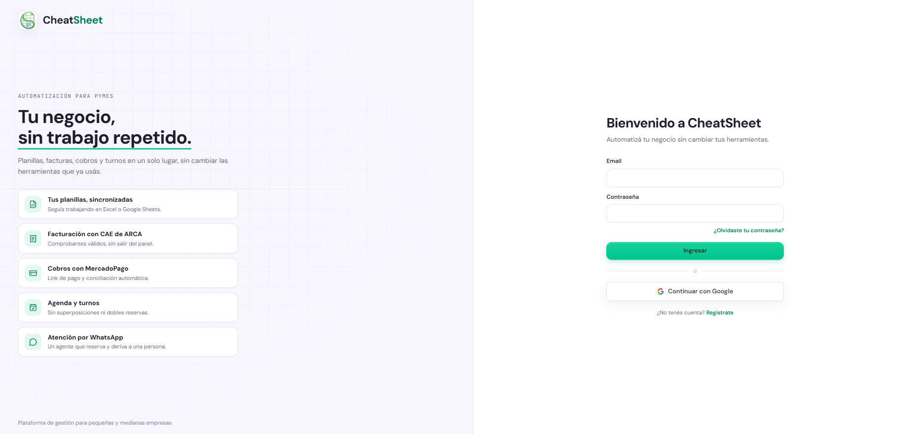
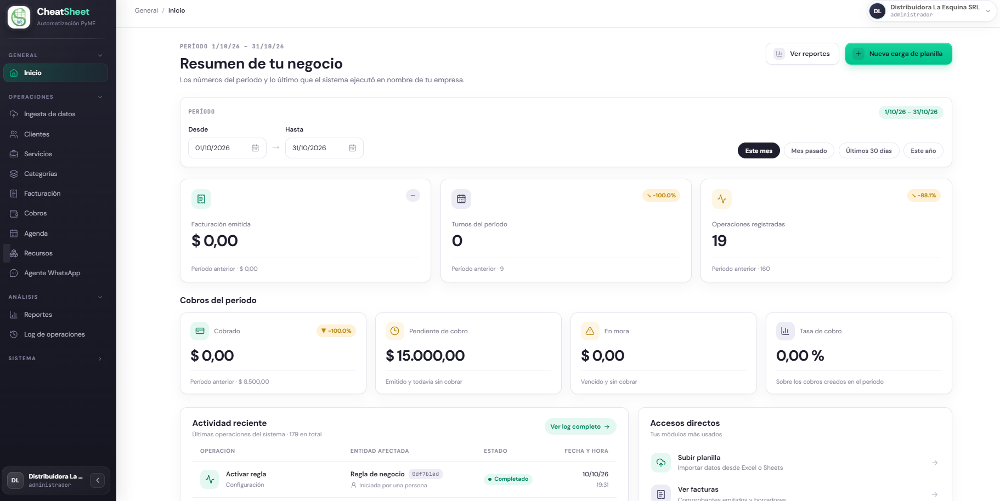

## Ingreso al sistema y navegación

### Para qué sirve

Esta sección explica cómo iniciar sesión en CheatSheet y cómo moverse por el panel. Una vez dentro, el menú lateral reúne todas las funciones de la plataforma, agrupadas por tipo de tarea.

### Quién puede usarla

Cualquier usuario con una cuenta activa en una empresa: Administrador, Operador o Solo Lectura. Lo que cada uno ve dentro del panel depende de su rol.

### Iniciar sesión

El ingreso se realiza desde la pantalla de inicio de sesión (HU-E1-01 — Registrar empresa e iniciar sesión), que da la bienvenida con el texto «Bienvenido a CheatSheet». El usuario puede ingresar con su email y contraseña, o con su cuenta de Google.

#### Paso a paso

1. Abrir la dirección del panel en un navegador.
2. Completar el campo «Email» con el correo de la cuenta.
3. Completar el campo «Contraseña».
4. Pulsar «Ingresar».

Para ingresar con Google, pulsar «Continuar con Google» y autorizar el acceso. CheatSheet solicita únicamente el email y el nombre del perfil de Google.

Tras iniciar sesión, el sistema lleva al panel principal o al paso pendiente del onboarding si la empresa aún no terminó de configurarse.

#### Mensajes y errores frecuentes

| Mensaje | Qué significa | Qué hacer |
|---|---|---|
| Ingrese un email válido. | El email tiene un formato incorrecto. | Revisar el correo ingresado. |
| La contraseña debe tener al menos 8 caracteres. | La contraseña es demasiado corta. | Ingresar una contraseña de ocho caracteres o más. |
| Ese email ya tiene una cuenta asociada. ¿Desea iniciar sesión? | El email ingresado ya está registrado. | Iniciar sesión con ese email en lugar de crear una cuenta. |

### Navegar por el panel

Una vez dentro, el menú lateral izquierdo organiza las funciones de la plataforma en cuatro secciones. Cada entrada del menú abre una pantalla distinta.

- **General:** «Inicio», el panel de resumen de la empresa.
- **Operaciones:** el trabajo del día a día: «Ingesta de datos», «Clientes», «Servicios», «Categorías», «Facturación», «Cobros», «Agenda», «Recursos» y «Agente WhatsApp».
- **Análisis:** «Reportes» y «Log de operaciones».
- **Sistema:** la configuración de la empresa: «Empresa», «Usuarios», «Integraciones», «Puntos de venta», «Reglas de negocio», «Respuestas frecuentes», «Plantillas», «Paquete contable», «Notificaciones», «Mis preferencias» y «Soporte».

En el extremo superior figura el nombre de la empresa y el rol del usuario con el que se ingresó. Las opciones de la sección Sistema son accesibles principalmente para el Administrador; el Operador trabaja sobre la sección Operaciones y el rol Solo Lectura consulta la información sin modificarla.

### Cerrar sesión

Para salir del panel, pulsar «Cerrar sesión». La sesión también se cierra sola tras un período de inactividad, por seguridad; en ese caso, el panel solicita ingresar nuevamente.
