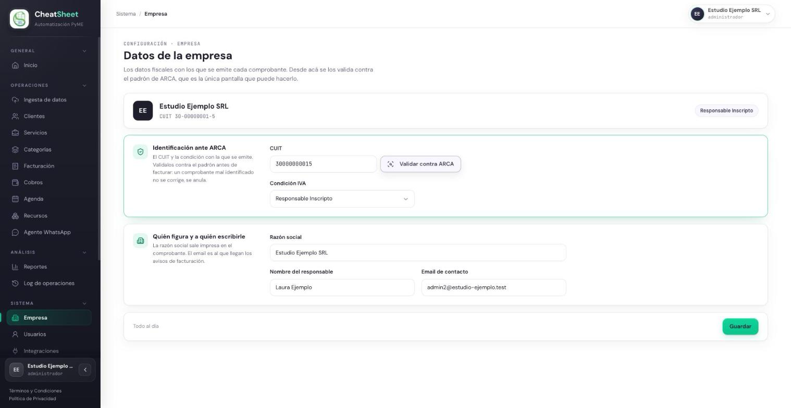
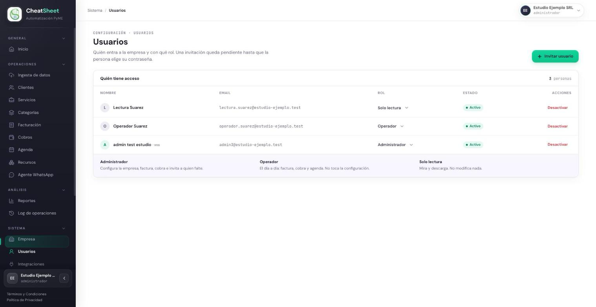
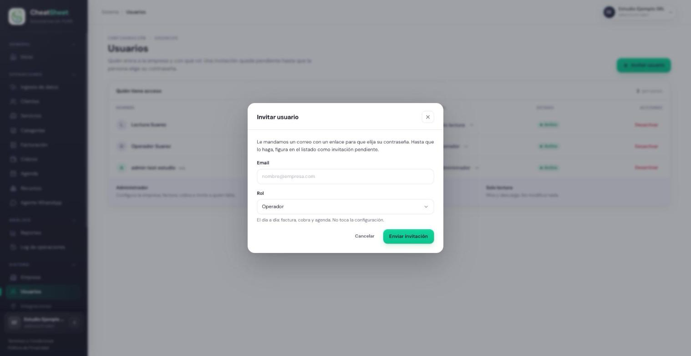
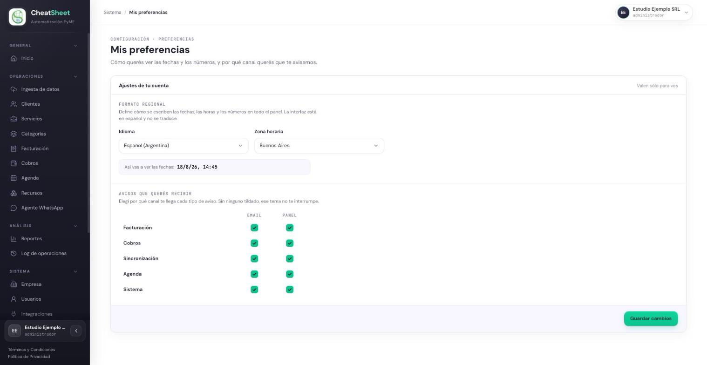

## Acceso y usuarios

### Para qué sirve

Este capítulo reúne lo que el Administrador configura sobre la propia empresa y sobre las personas
que la usan: los datos fiscales con los que se emite cada comprobante, quién entra al panel y con
qué rol, y las preferencias personales de cada usuario. También explica qué pasa cuando se
actualizan los Términos y Condiciones.

### Quién puede usarla

| Funcionalidad | Administrador | Operador | Solo Lectura |
|---|---|---|---|
| Datos de la empresa | Consulta, valida contra ARCA y modifica | Solo consulta | Solo consulta |
| Usuarios | Invita, cambia roles, desactiva y reactiva | Solo consulta la lista | Solo consulta la lista |
| Mis preferencias | Sí, las propias | Sí, las propias | Sí, las propias |

Los roles son tres y no se configuran: Administrador («Configura la empresa, factura, cobra e invita
a quien falte.»), Operador («El día a día: factura, cobra y agenda. No toca la configuración.») y
Solo Lectura («Mira y descarga. No modifica nada.»).

### Cómo llegar

- «Menú › Sistema › Empresa» para los datos de la empresa.
- «Menú › Sistema › Usuarios» para la gestión de usuarios.
- «Menú › Sistema › Mis preferencias», o el menú de la cuenta arriba a la derecha, para las
  preferencias personales.

### Configurar los datos de la empresa

HU-E1-02 — Configurar datos de la empresa. Son los datos fiscales que se imprimen en cada
comprobante. El CUIT se valida contra el padrón de ARCA, que completa la razón social y la
condición frente al IVA.

#### Paso a paso

1. Ingresar a «Menú › Sistema › Empresa».
2. En «Identificación ante ARCA», completar «CUIT».
3. Hacer clic en «Validar contra ARCA».
4. Revisar el recuadro «Lo que devolvió el padrón»: denominación, condición y situación.
5. Verificar que «Condición IVA» sea la correcta.
6. En «Quién figura y a quién escribirle», completar «Razón social», «Nombre del responsable» y
   «Email de contacto».
7. Hacer clic en «Guardar» y esperar el mensaje «Guardamos los datos de la empresa.».

Cambiar el CUIT de una empresa con ARCA conectada desconecta ARCA: hay que volver a verificar la
delegación con el CUIT nuevo (MAN-20).

#### Mensajes y errores frecuentes

| Mensaje | Qué significa | Qué hacer |
|---|---|---|
| «Ingresá los 11 dígitos del CUIT» | El CUIT está incompleto o tiene caracteres de más | Escribir los 11 dígitos, con o sin guiones |
| «ARCA no encuentra este CUIT en su padrón. Revisalo antes de continuar.» | El CUIT no existe en ARCA | Revisar el número contra la constancia de inscripción |
| «ARCA conoce este CUIT, pero figura como inactivo en su padrón.» | El CUIT existe pero está dado de baja | Revisar la situación fiscal de la empresa en ARCA |
| «No pudimos consultar el padrón de ARCA.» | ARCA no respondió | Guardar igual y validar más tarde |
| «Ese CUIT ya está registrado en otra empresa.» | Otra empresa del sistema usa ese CUIT | Revisar el número; un CUIT pertenece a una sola empresa |
| «Hay cambios sin guardar» | Se modificó un campo y todavía no se guardó | Hacer clic en «Guardar» |

### Aceptar los términos y condiciones

HU-E1-03 — Aceptar los términos y condiciones del servicio. Al registrar la empresa se aceptan los
Términos y Condiciones y la Política de Privacidad vigentes; el sistema guarda la versión aceptada
y la fecha. Ambos textos se pueden leer sin iniciar sesión, desde los enlaces «Términos y
Condiciones» y «Política de Privacidad» al pie del panel.

#### Paso a paso

1. Al ingresar después de que se publicó una versión nueva, leer la pantalla «Actualizamos nuestros
   textos legales».
2. Abrir cada documento listado para leer la versión vigente.
3. Hacer clic en «Aceptar» para continuar usando el panel, o en «Cerrar sesión» para salir sin
   aceptar.

Mientras la versión nueva no esté aceptada, el panel solo permite leer los textos y cerrar sesión.

#### Mensajes y errores frecuentes

| Mensaje | Qué significa | Qué hacer |
|---|---|---|
| «Debe aceptar los términos y condiciones para continuar.» | Se intentó registrar la empresa sin tildar la aceptación | Tildar la casilla y volver a enviar |
| «Tenés que aceptar los textos legales vigentes para seguir.» | Hay una versión nueva sin aceptar | Aceptarla desde la pantalla de textos legales |
| «Actualizamos los textos legales. Recargá la página, leelos y volvé a aceptarlos.» | La versión cambió mientras la pantalla estaba abierta | Recargar la página y aceptar la versión nueva |

### Invitar a un usuario

HU-E1-04 — Registrar un nuevo usuario en la empresa. El usuario invitado recibe un correo con un
enlace para elegir su contraseña; hasta entonces figura como «Invitación pendiente».

#### Paso a paso

1. Ingresar a «Menú › Sistema › Usuarios».
2. Hacer clic en «Invitar usuario».
3. Completar «Email».
4. Elegir el «Rol».
5. Hacer clic en «Enviar invitación».
6. Verificar que la persona aparezca en la lista con estado «Invitación pendiente».
7. Si el correo no llegó, hacer clic en «Reenviar»; para anular la invitación, hacer clic en
   «Revocar».

Cuando la persona elige su contraseña desde el enlace, su estado pasa a «Activo» y entra con el rol
asignado.

#### Mensajes y errores frecuentes

| Mensaje | Qué significa | Qué hacer |
|---|---|---|
| «Ingresá un email válido.» | El email no tiene un formato válido | Corregir el email |
| «Ese email ya tiene una cuenta. ¿Iniciar sesión?» | El email ya pertenece a un usuario | Usar otro email o gestionar al usuario existente |
| «No pudimos enviar la invitación. Probá de nuevo en unos minutos.» | Falló el envío | Volver a intentar más tarde |
| «Esta invitación no es válida o ya fue utilizada.» | El enlace venció, fue revocado o ya se usó | Reenviar la invitación |

### Cambiar el rol de un usuario

HU-E1-05 — Asignar o cambiar el rol de un usuario. El cambio rige desde la siguiente acción del
usuario y queda registrado en el Log de operaciones.

#### Paso a paso

1. Ingresar a «Menú › Sistema › Usuarios».
2. En la fila del usuario, abrir el selector de la columna «Rol».
3. Elegir el rol nuevo.
4. Verificar que la fila muestre el rol actualizado.

#### Mensajes y errores frecuentes

| Mensaje | Qué significa | Qué hacer |
|---|---|---|
| «La empresa debe conservar al menos un Administrador activo.» | Se intentó quitarle el rol al único Administrador | Asignar primero el rol de Administrador a otro usuario |
| «Tu rol no permite esta acción.» | Quien intenta el cambio no es Administrador | Pedir el cambio a un Administrador |

### Desactivar y reactivar un usuario

HU-E1-06 — Desactivar el acceso de un usuario. El usuario desactivado pierde el acceso en su
siguiente acción, sus sesiones abiertas se cierran y sus datos se conservan. Al reactivarlo
recupera el rol que tenía.

#### Paso a paso

1. Ingresar a «Menú › Sistema › Usuarios».
2. En la fila del usuario, hacer clic en «Desactivar».
3. Confirmar el aviso «¿Desactivar a …? Pierde el acceso de inmediato.». Si el usuario es la propia
   cuenta, el aviso es «Vas a desactivar tu propia cuenta y vas a perder el acceso. ¿Seguro?».
4. Verificar que el estado pase a «Inactivo».
5. Para devolverle el acceso, hacer clic en «Reactivar» en la misma fila.

#### Mensajes y errores frecuentes

| Mensaje | Qué significa | Qué hacer |
|---|---|---|
| «La empresa debe conservar al menos un Administrador activo.» | Se intentó desactivar al único Administrador | Asignar primero el rol de Administrador a otro usuario |
| «No pudimos completar la operación. Probá de nuevo en unos minutos.» | La operación falló | Volver a intentar más tarde |

### Actualizar las preferencias personales

HU-E1-07 — Actualizar preferencias personales. Las preferencias son de cada usuario: no cambian lo
que ven los demás.

#### Paso a paso

1. Ingresar a «Menú › Sistema › Mis preferencias».
2. En «Formato regional», elegir «Idioma» y «Zona horaria», y revisar el ejemplo de cómo se van a
   ver las fechas.
3. En «Avisos que querés recibir», tildar o destildar «Email» y «Panel» para cada tema:
   Facturación, Cobros, Sincronización, Agenda y Sistema.
4. Hacer clic en «Guardar cambios».
5. Verificar el mensaje «Listo, tus preferencias quedaron guardadas.».

Un tema sin ningún canal tildado deja de generar avisos para ese usuario desde ese momento.

#### Mensajes y errores frecuentes

| Mensaje | Qué significa | Qué hacer |
|---|---|---|
| «No pudimos guardar los cambios. Probá de nuevo en unos minutos.» | Falló el guardado | Volver a intentar más tarde |
