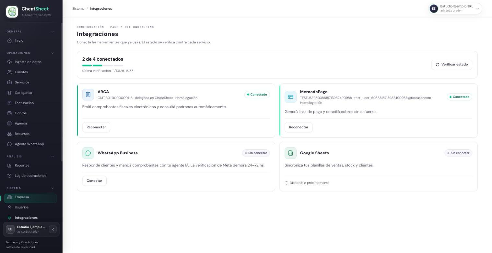
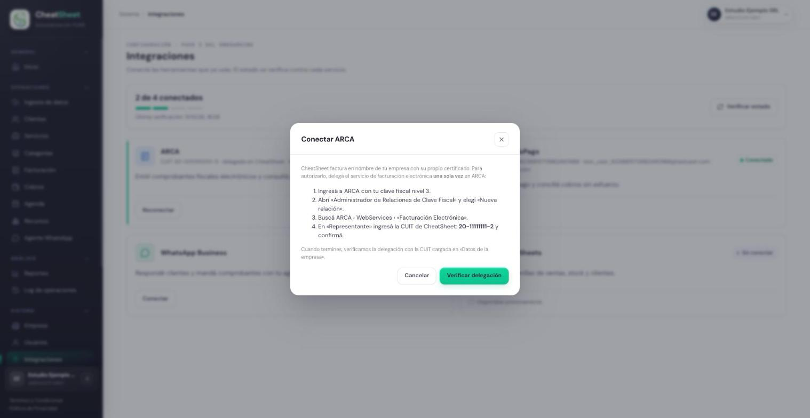
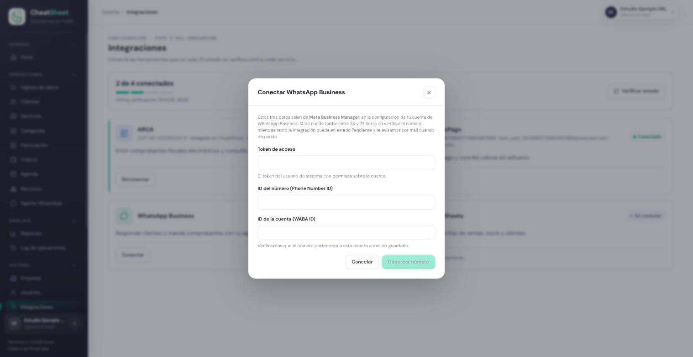

## Integraciones

### Para qué sirve

La pantalla Integraciones conecta la empresa con los servicios externos que el sistema necesita
para operar: ARCA para emitir comprobantes con CAE, MercadoPago para generar links de cobro y
WhatsApp Business para el agente que atiende a los clientes. También muestra el estado de cada
conexión y permite verificarlo contra el servicio en el momento.

Esta pantalla es el paso 3 del onboarding: al terminar los datos de la empresa, el sistema lleva
al Administrador directamente a Integraciones.

### Quién puede usarla

| Rol | Qué puede hacer |
|---|---|
| Administrador | Conectar, reconectar y verificar todas las integraciones |
| Operador | Ver el estado de las integraciones y verificarlo |
| Solo Lectura | No tiene acceso: el sistema rechaza la consulta de las integraciones |

### Cómo llegar

«Menú › Sistema › Integraciones». La sección «Sistema» del menú lateral aparece cerrada al
ingresar: se abre con un clic sobre su título.

Cada servicio tiene una tarjeta con su estado:

| Estado | Qué significa |
|---|---|
| «Conectado» | La conexión funciona y fue verificada contra el servicio |
| «Pendiente» | El servicio todavía está revisando la conexión (WhatsApp Business, entre 24 y 72 horas) |
| «Atención» | La conexión existe pero requiere una acción; el detalle se muestra en la tarjeta |
| «Sin conectar» | La empresa todavía no conectó el servicio, o la conexión se perdió |

La tarjeta de Google Sheets indica «Disponible próximamente»: la vinculación de planillas se hace
desde Ingesta de datos (MAN-40).

### Conectar ARCA

HU-E2-01 — Conectar cuenta de ARCA con credenciales validadas. La empresa no carga certificados:
delega una sola vez en ARCA el servicio de facturación electrónica en la CUIT de CheatSheet, y el
sistema verifica esa delegación. Los comprobantes se emiten a nombre de la CUIT cargada en «Datos
de la empresa».

#### Paso a paso

1. Ingresar a ARCA con la clave fiscal nivel 3 de la empresa.
2. Abrir «Administrador de Relaciones de Clave Fiscal» y elegir «Nueva relación».
3. Buscar ARCA › WebServices › «Facturación Electrónica».
4. En «Representante», ingresar la CUIT de CheatSheet que muestra el panel y confirmar.
5. Volver al panel e ingresar a Integraciones.
6. En la tarjeta ARCA, hacer clic en «Conectar» (o «Reconectar» si ya estuvo conectada).
7. Leer los pasos de delegación que muestra la ventana «Conectar ARCA».
8. Hacer clic en «Verificar delegación».
9. Esperar el mensaje «Verificando en ARCA…» y verificar que la tarjeta pase a «Conectado», con la
   CUIT de la empresa y la leyenda «delegada en CheatSheet».

Si más adelante la empresa cambia su CUIT en «Datos de la empresa», el sistema desconecta ARCA:
hay que delegar el servicio con la CUIT nueva y volver a verificar.

#### Mensajes y errores frecuentes

| Mensaje | Qué significa | Qué hacer |
|---|---|---|
| «ARCA no registra que la CUIT … haya delegado Facturacion Electronica en CheatSheet. Delegala desde el Administrador de Relaciones de Clave Fiscal y volve a verificar.» | La delegación no existe en ARCA, o se hizo con otra CUIT | Revisar en ARCA la relación con la CUIT de CheatSheet y volver a verificar |
| «No se pudo conectar» | ARCA no respondió o rechazó la consulta | Esperar unos minutos y volver a hacer clic en «Verificar delegación» |
| «Revisá los datos fiscales» | La CUIT o la condición frente al IVA cargadas no coinciden con el padrón de ARCA | Corregir «Datos de la empresa» antes de emitir comprobantes |

### Conectar MercadoPago

HU-E2-02 — Conectar cuenta de MercadoPago. La conexión se autoriza en el sitio de MercadoPago: el
panel nunca pide ni guarda la contraseña de la cuenta.

#### Paso a paso

1. Ingresar a Integraciones.
2. En la tarjeta MercadoPago, hacer clic en «Conectar».
3. Iniciar sesión en MercadoPago con la cuenta que recibirá los cobros.
4. Autorizar el acceso de CheatSheet.
5. Verificar que el navegador vuelva a Integraciones y que la tarjeta muestre «Conectado» con el
   identificador de la cuenta.

#### Mensajes y errores frecuentes

| Mensaje | Qué significa | Qué hacer |
|---|---|---|
| «No autorizaste el acceso, así que la cuenta no quedó conectada.» | Se canceló la autorización en MercadoPago | Repetir el paso a paso y autorizar el acceso |
| «El proveedor no completó la autorización. Probá de nuevo.» | MercadoPago devolvió una autorización incompleta | Volver a hacer clic en «Conectar» |
| «La cuenta de MercadoPago es real y este entorno es de homologacion. Conecta una cuenta de prueba.» | En el entorno de pruebas solo se aceptan cuentas de prueba de MercadoPago | Conectar una cuenta de prueba |
| «La cuenta de MercadoPago es de prueba: los cobros no van a ser reales.» | En el entorno productivo se conectó una cuenta de prueba | Conectar la cuenta real de la empresa |

### Conectar WhatsApp Business

HU-E2-03 — Conectar cuenta de WhatsApp. Los tres datos de la conexión se obtienen en Meta Business
Manager, en la configuración de la cuenta de WhatsApp Business de la empresa.

#### Paso a paso

1. Ingresar a Integraciones.
2. En la tarjeta WhatsApp Business, hacer clic en «Conectar».
3. Completar «Token de acceso» con el token del usuario de sistema que tiene permisos sobre la
   cuenta.
4. Completar «ID del número (Phone Number ID)».
5. Completar «ID de la cuenta (WABA ID)».
6. Hacer clic en «Conectar número».
7. Verificar que la tarjeta pase a «Pendiente»: Meta revisa el número entre 24 y 72 horas.
8. Esperar el aviso por email; al terminar la revisión, la tarjeta pasa a «Conectado» con el nombre
   visible del número.

#### Mensajes y errores frecuentes

| Mensaje | Qué significa | Qué hacer |
|---|---|---|
| «Completá los tres datos para conectar el número.» | Falta alguno de los tres datos | Completar los tres campos |
| «Falta el token de acceso de WhatsApp Business» | El token llegó vacío | Copiar de nuevo el token desde Meta Business Manager |
| «El numero no pertenece a la cuenta de WhatsApp declarada» | El ID del número no corresponde a ese WABA ID | Revisar en Meta Business Manager que ambos datos sean de la misma cuenta |
| La tarjeta queda en «Sin conectar» con el motivo de Meta | Meta rechazó la verificación del número | Corregir lo que indica el motivo y volver a conectar |

### Verificar el estado de las integraciones

HU-E2-05 — Validar el estado de una conexión externa. El estado de cada tarjeta se verifica contra
el servicio, no se toma de lo guardado.

#### Paso a paso

1. Ingresar a Integraciones.
2. Hacer clic en «Verificar estado».
3. Esperar el mensaje «Verificando…».
4. Revisar el estado de cada tarjeta y la hora de «Última verificación», arriba de las tarjetas.
5. Si una tarjeta quedó en «Sin conectar», usar su botón «Conectar» o «Reconectar».

#### Mensajes y errores frecuentes

| Mensaje | Qué significa | Qué hacer |
|---|---|---|
| «No se pudo verificar» | El panel no pudo consultar el estado | Volver a hacer clic en «Verificar estado» |
| Una tarjeta en «Atención» | La conexión funciona con advertencias; el detalle aparece en la tarjeta | Seguir la indicación del detalle |
| Una tarjeta en «Sin conectar» después de haber estado conectada | La delegación en ARCA se revocó, o el acceso a MercadoPago o WhatsApp se perdió | Reconectar la integración siguiendo su paso a paso |
