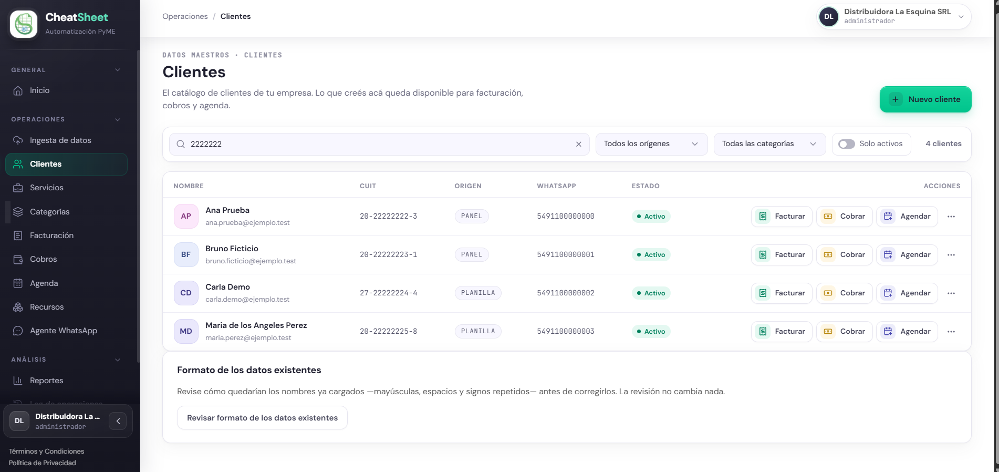
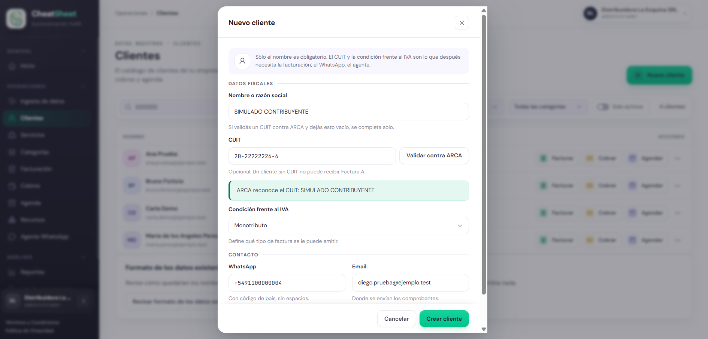
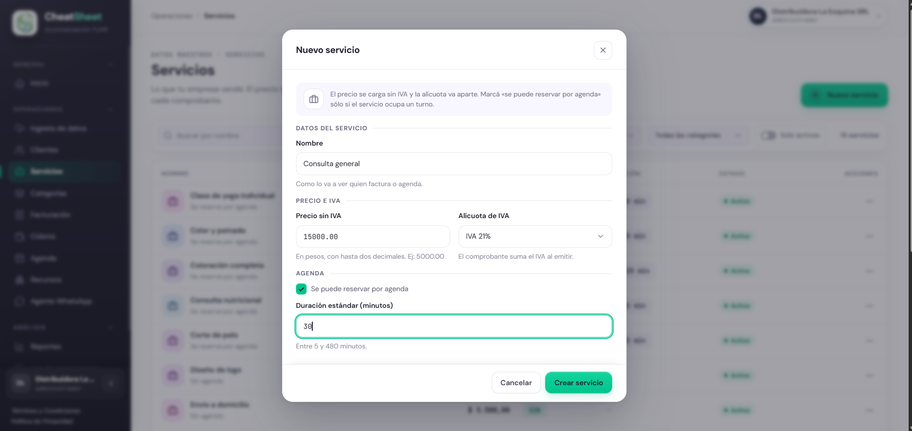
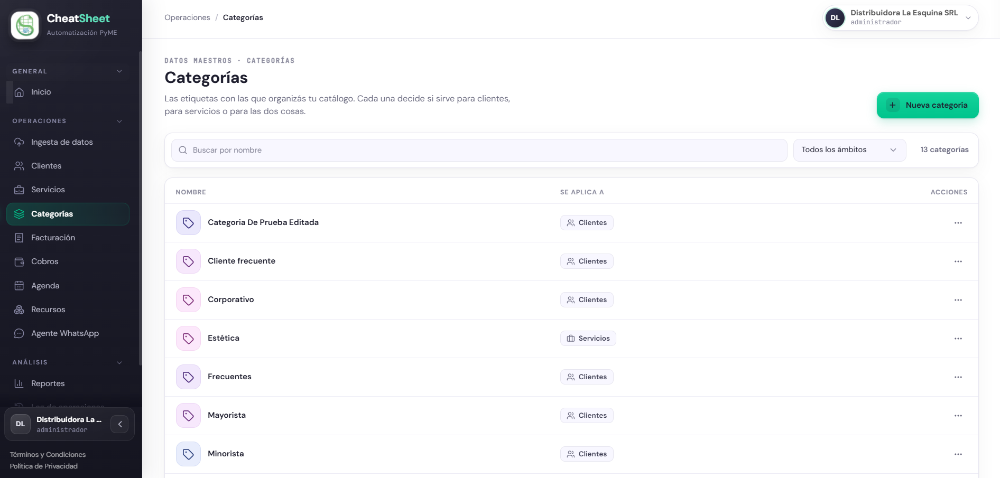
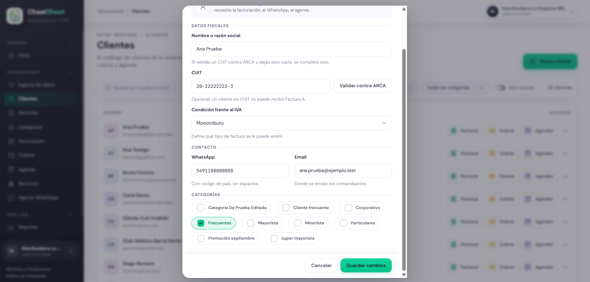

## Datos maestros

### Para qué sirve

Este capítulo explica cómo se mantiene el catálogo de la empresa: los clientes a los que se les
factura, cobra y agenda; los servicios que se venden y se reservan; y las categorías que sirven
para clasificar a unos y otros. Todo lo que se carga acá queda disponible de inmediato en
Facturación, Cobros y Agenda, y los servicios agendables quedan disponibles para el agente de
WhatsApp.

### Quién puede usarla

| Funcionalidad | Administrador | Operador | Solo Lectura |
|---|---|---|---|
| Clientes | Consulta, crea, edita, desactiva y reactiva | Consulta, crea, edita, desactiva y reactiva | Solo consulta |
| Servicios | Consulta, crea, edita, desactiva y reactiva | Consulta, crea, edita, desactiva y reactiva | Solo consulta |
| Categorías | Consulta, crea, edita y elimina | Consulta, crea, edita y elimina | Solo consulta |
| Asignar categorías | Sí | Sí | No |

Para el rol Solo Lectura el panel oculta los botones de alta y las acciones de cada fila, y la API
rechaza cualquier modificación aunque se la pida directamente.

### Cómo llegar

- «Menú › Operaciones › Clientes» para el catálogo de clientes (PAN-DM-01).
- «Menú › Operaciones › Servicios» para el catálogo de servicios (PAN-DM-02).
- «Menú › Operaciones › Categorías» para las categorías (PAN-DM-03).

### Gestionar el catálogo de clientes

HU-E4-01 — Consultar y gestionar el catálogo de clientes. El listado muestra cada cliente con
«Nombre», «CUIT», «Origen», «WhatsApp» y «Estado». El origen indica de dónde vino el cliente
(«Panel», «Planilla» o «Agente») y no se puede editar. Desde cada fila se accede directamente a
«Facturar», «Cobrar» y «Agendar» con ese cliente ya elegido.

#### Paso a paso

1. Ingresar a «Menú › Operaciones › Clientes».
2. Para buscar, escribir en «Buscar por nombre o CUIT» y presionar Enter. Para acotar el listado,
   usar los filtros «Origen» y «Categoría», o activar «Solo activos».
3. Para dar de alta un cliente, hacer clic en «Nuevo cliente».
4. En «Datos fiscales», completar «CUIT» y hacer clic en «Validar contra ARCA».
5. Revisar el resultado: si ARCA reconoce el CUIT, el panel muestra la razón social y, si
   «Nombre o razón social» está vacío, lo completa solo.
6. Verificar «Nombre o razón social» y elegir la «Condición frente al IVA».
7. Completar «WhatsApp», con código de país y sin espacios, y «Email».
8. Hacer clic en «Crear cliente».
9. Para modificar un cliente, abrir el menú «Más acciones» de su fila, elegir «Editar», cambiar los
   datos y hacer clic en «Guardar cambios».
10. Para sacarlo del catálogo, elegir «Desactivar» en el mismo menú y confirmar el aviso «¿Desactivar
    a …? Deja de estar en el catálogo.». Un cliente inactivo ofrece «Reactivar» en su fila.

El CUIT es opcional, pero un cliente sin CUIT no puede recibir Factura A. El nombre, el email, el
WhatsApp y el CUIT se guardan normalizados: por ejemplo, «MARIA DE LOS ANGELES perez» se guarda
como «Maria de los Angeles Perez». Desactivar un cliente no borra sus comprobantes, cobros ni
turnos.

#### Mensajes y errores frecuentes

| Mensaje | Qué significa | Qué hacer |
|---|---|---|
| «Un CUIT tiene 11 digitos, no …» | El CUIT tiene dígitos de más o de menos | Escribir los 11 dígitos, con o sin guiones |
| «El digito verificador del CUIT no es correcto» | El último dígito no corresponde a los diez anteriores | Revisar el número contra la constancia de inscripción |
| «ARCA no reconoce ese CUIT. Revisalo antes de guardar.» | El CUIT no existe en el padrón de ARCA | Corregir el CUIT; el cliente no se guarda con un CUIT que ARCA no conoce |
| «No se pudo validar contra ARCA: … El cliente se guarda igual.» | ARCA no respondió | Guardar igual y volver a validar más tarde |
| «Ya existe un cliente con ese CUIT.» | Otro cliente de la empresa tiene el mismo CUIT, aunque esté escrito con otro formato | Hacer clic en «Ver el cliente existente» y editar ese cliente |
| «El nombre del cliente es obligatorio» | Se intentó guardar sin nombre y sin un CUIT validado | Completar «Nombre o razón social» |

### Gestionar el catálogo de servicios

HU-E4-02 — Consultar y gestionar el catálogo de servicios. El listado muestra cada servicio con
«Nombre», «Precio», «IVA», «Duración» y «Estado». Un servicio que «Se reserva por agenda» lleva una
duración estándar, que es la que se asigna a cada turno.

#### Paso a paso

1. Ingresar a «Menú › Operaciones › Servicios».
2. Para buscar, escribir en «Buscar por nombre»; para acotar el listado, usar los filtros
   «Agendables» y «Categoría», o activar «Solo activos».
3. Para dar de alta un servicio, hacer clic en «Nuevo servicio».
4. Completar «Nombre», tal como lo va a ver quien factura o agenda.
5. Completar «Precio sin IVA», en pesos y con hasta dos decimales.
6. Elegir la «Alícuota de IVA»: 0 %, 10,5 % o 21 %.
7. Si el servicio se reserva por turno, tildar «Se puede reservar por agenda» y completar
   «Duración estándar (minutos)», entre 5 y 480.
8. Hacer clic en «Crear servicio».
9. Para modificarlo, elegir «Editar» en el menú «Más acciones» de su fila y hacer clic en «Guardar
   cambios». Para sacarlo del catálogo, elegir «Desactivar» y confirmar; un servicio inactivo
   ofrece «Reactivar».

Un precio modificado aplica a las operaciones futuras: los comprobantes ya emitidos conservan su
precio. Para emisores Monotributo o Exento, que emiten Factura C, el precio del catálogo es el
precio final y la alícuota se ignora. Desactivar un servicio no borra los comprobantes ni los
turnos que lo usan.

#### Mensajes y errores frecuentes

| Mensaje | Qué significa | Qué hacer |
|---|---|---|
| «El precio debe ser mayor a cero.» | El precio está en cero o es negativo | Corregir el precio |
| «La duracion es obligatoria para servicios agendables.» | El servicio se reserva por agenda y no tiene duración | Completar «Duración estándar (minutos)» o destildar «Se puede reservar por agenda» |
| «La duracion debe estar entre 5 y 480 minutos.» | La duración está fuera del rango permitido | Cargar un valor entre 5 y 480 |
| «La duracion debe ser un numero entero de minutos.» | La duración tiene decimales o letras | Cargar un número entero |
| «El nombre del servicio es obligatorio» | Se intentó guardar sin nombre | Completar «Nombre» |

### Gestionar categorías

HU-E4-03 — Gestionar categorías personalizadas. Cada categoría tiene un nombre y un ámbito, «Se
aplica a»: «Clientes», «Servicios» o «Clientes y servicios». El ámbito decide qué se puede
clasificar con ella.

#### Paso a paso

1. Ingresar a «Menú › Operaciones › Categorías».
2. Hacer clic en «Nueva categoría».
3. Completar «Nombre».
4. Elegir en «Se aplica a» el ámbito de la categoría.
5. Hacer clic en «Crear categoría».
6. Para cambiarle el nombre, elegir «Editar» en el menú «Más acciones» de su fila y hacer clic en
   «Guardar cambios». El nombre nuevo se ve en todos los clientes y servicios que la tienen.
7. Para eliminarla, elegir «Eliminar» y confirmar el aviso «¿Eliminar "…"? Los clientes y servicios
   que la tengan asignada la pierden, y el resto de sus datos no se toca.».

#### Mensajes y errores frecuentes

| Mensaje | Qué significa | Qué hacer |
|---|---|---|
| «Ya existe una categoria con ese nombre en este ambito.» | Hay otra categoría con el mismo nombre y el mismo ámbito | Usar otro nombre o editar la categoría existente |
| «El nombre de la categoria es obligatorio» | Se intentó guardar sin nombre | Completar «Nombre» |
| «No se pudo guardar la categoría.» | Falló el guardado | Volver a intentar más tarde |

### Clasificar clientes y servicios con categorías

HU-E4-04 — Clasificar clientes o servicios mediante categorías. Un cliente o un servicio puede
tener varias categorías. Solo se ofrecen las categorías cuyo ámbito corresponde: a un cliente, las
de «Clientes» o «Clientes y servicios»; a un servicio, las de «Servicios» o «Clientes y servicios».
La asignación aplica en el momento y no cambia las operaciones ya registradas.

#### Paso a paso

1. Ingresar a «Menú › Operaciones › Clientes» o a «Menú › Operaciones › Servicios».
2. En la fila del elemento, abrir el menú «Más acciones» y elegir «Editar». Las categorías se
   asignan a un cliente o servicio ya creado.
3. En la sección «Categorías», tildar las que correspondan y destildar las que ya no apliquen.
4. Cerrar la ventana. Cada tilde se guarda en el momento.
5. Para ver los elementos de una categoría, elegirla en el filtro «Categoría» del listado.

#### Mensajes y errores frecuentes

| Mensaje | Qué significa | Qué hacer |
|---|---|---|
| «No hay categorias para este tipo de elemento.» | No existe ninguna categoría con un ámbito que aplique | Crear una en «Menú › Operaciones › Categorías» |
| «No se pudieron cargar las categorias.» | Falló la consulta de categorías | Cerrar la ventana y volver a abrirla |
