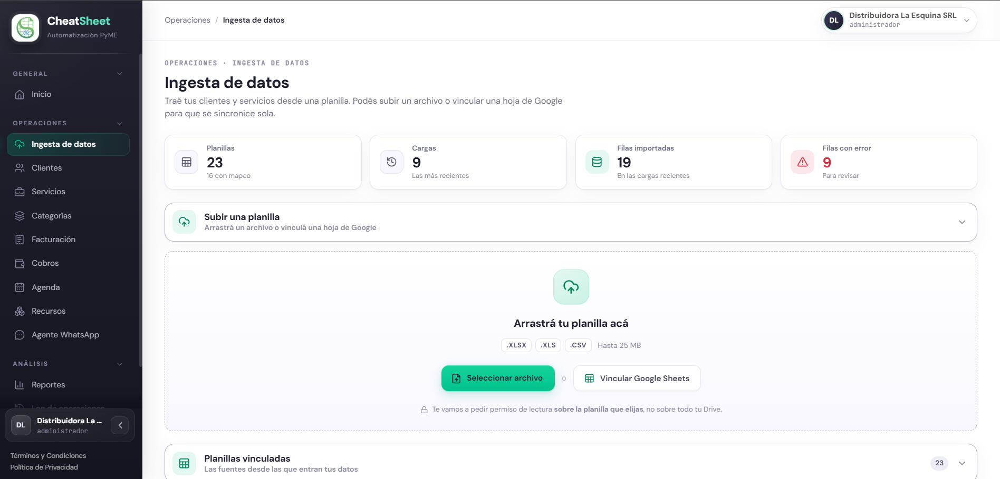
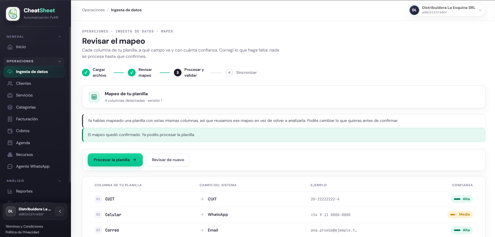
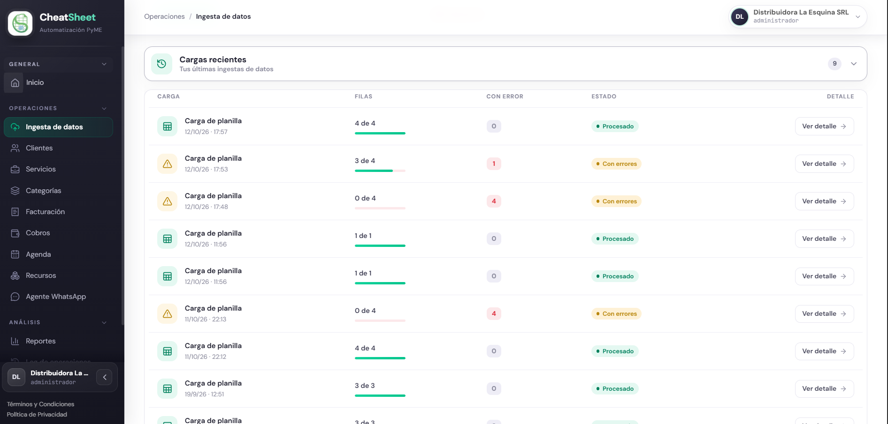
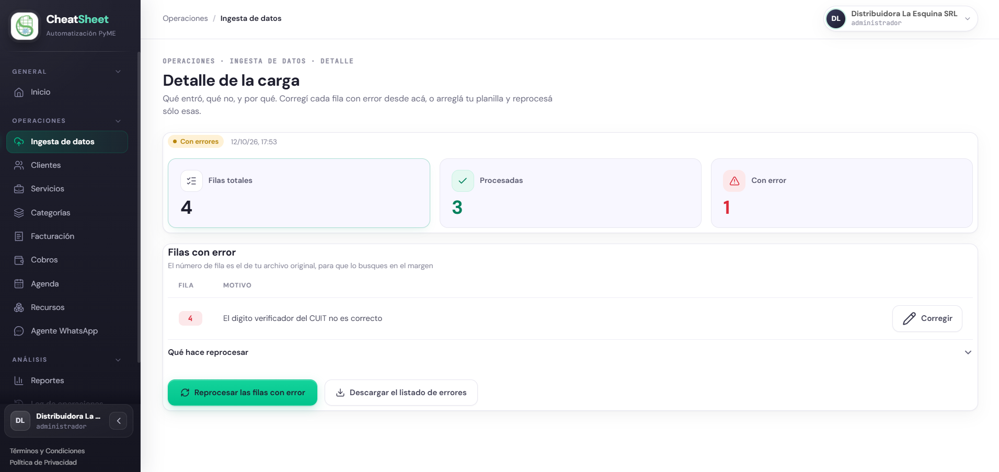

## Planillas

### Para qué sirve

La ingesta de datos incorpora al sistema los clientes y servicios que la empresa ya tiene en una
planilla, sin adaptar el archivo a ningún formato. El sistema interpreta las columnas con
asistencia de IA, el Administrador revisa y confirma esa interpretación (el mapeo), y luego se
procesan las filas. Cada fila se normaliza antes de guardarse, y la planilla original nunca se
modifica. Las filas con errores se informan una por una, se pueden corregir desde el panel y
volver a procesar.

### Quién puede usarla

| Funcionalidad | Administrador | Operador | Solo Lectura |
|---|---|---|---|
| Subir o vincular una planilla, y desvincularla | Sí | No | No |
| Revisar y confirmar el mapeo | Sí | Sí | No |
| Procesar y reprocesar | Sí | Sí | No |
| Consultar cargas, detalle y errores, y descargar el listado | Sí | Sí | Sí |

### Cómo llegar

- «Menú › Operaciones › Ingesta de datos» (PAN-ING-01). Desde ahí se llega a la revisión del mapeo
  (PAN-ING-02) y al detalle de cada carga (PAN-ING-03).

La pantalla tiene tres secciones plegables: «Subir una planilla», «Planillas vinculadas» y «Cargas
recientes». Arriba, un resumen muestra la cantidad de planillas, cargas, filas importadas y filas
con error.

### Subir o vincular una planilla

HU-E2-04 — Vincular planilla de Google Sheets o Excel. La planilla puede entrar de dos formas: como
archivo subido (.xlsx, .xls o .csv, hasta 25 MB) o como hoja de Google Sheets vinculada. En Google
Sheets el sistema pide permiso de lectura solo sobre la planilla elegida, no sobre todo el Drive.

#### Paso a paso

1. Ingresar a «Menú › Operaciones › Ingesta de datos».
2. Para subir un archivo, arrastrarlo sobre «Arrastrá tu planilla acá» o hacer clic en
   «Seleccionar archivo» y elegirlo.
3. Esperar el aviso «Se cargo … Ya podes revisar el mapeo.». La planilla aparece en «Planillas
   vinculadas» con el estado «Falta mapear».
4. Para vincular una hoja de Google, hacer clic en «Vincular Google Sheets».
5. En «Enlace o nombre de la planilla», pegar el enlace de Google Sheets y continuar.
6. Autorizar en Google el permiso de lectura sobre esa planilla.
7. Para cortar la conexión con una planilla, hacer clic en «Desvincular» en su tarjeta y confirmar
   el aviso «Vas a desvincular esta planilla. Los datos que ya se importaron se quedan; solo se
   corta la conexión.».

Cada tarjeta de «Planillas vinculadas» muestra el origen («Archivo subido», «Google Sheets» o
«Excel Online»), si es de «Solo lectura» o de «Lectura y escritura», y el avance en tres pasos:
«Subida» o «Conexión», «Mapeo» y «Lectura». El estado es «Falta mapear», «Vinculada» o «Pausada».

#### Mensajes y errores frecuentes

| Mensaje | Qué significa | Qué hacer |
|---|---|---|
| «Formato no aceptado. Use .xlsx, .xls o .csv.» | El archivo no es una planilla admitida | Exportar la planilla a .xlsx, .xls o .csv |
| «El archivo supera el límite de 25 MB.» | El archivo es demasiado grande | Dividir la planilla en archivos más chicos |
| «Escribí un enlace de Google Sheets o un nombre para la planilla.» | Se continuó con el campo vacío | Pegar el enlace de la planilla |
| «Se requieren permisos de lectura sobre la planilla para vincularla.» | No se otorgó el permiso en Google | Repetir la vinculación y autorizar la lectura |

### Revisar el mapeo propuesto por la IA

HU-E3-01 — Mapear los encabezados de la planilla con asistencia inteligente. Al subir o vincular
una planilla, el sistema analiza los encabezados y propone a qué campo del sistema corresponde cada
columna, con un nivel de confianza «Alta», «Media» o «Baja». Las columnas con confianza baja
quedan «Sin asignar». Si la empresa vuelve a subir una planilla con los mismos encabezados, el
sistema reutiliza el mapeo ya confirmado.

#### Paso a paso

1. En la tarjeta de la planilla, hacer clic en «Revisar mapeo».
2. En la tabla, revisar para cada fila la «Columna de tu planilla», el «Campo del sistema»
   propuesto, el ejemplo de dato y la confianza.
3. Prestar atención a las filas marcadas «Sin asignar» o con confianza «Media».

#### Mensajes y errores frecuentes

| Mensaje | Qué significa | Qué hacer |
|---|---|---|
| «No pudimos proponerte un mapeo automático esta vez. Asigná las columnas a mano; el sistema lo va a recordar para las próximas sincronizaciones.» | La IA no respondió o no reconoció las columnas | Asignar cada columna a mano |
| «Ya habías mapeado una planilla con estas mismas columnas, así que reusamos ese mapeo en vez de volver a analizarla. Podés cambiar lo que quieras antes de confirmar.» | La planilla tiene los mismos encabezados que una ya mapeada | Revisar el mapeo reutilizado y confirmarlo |
| «La planilla no tiene columnas para mapear.» | La primera fila del archivo está vacía | Revisar que la planilla tenga encabezados en la primera fila |

### Confirmar o corregir el mapeo

HU-E3-02 — Confirmar o corregir el mapeo propuesto. Cualquier asignación se puede cambiar antes de
confirmar. Para clientes es obligatorio asignar el nombre; para servicios, el nombre y el precio.

#### Paso a paso

1. En «Revisar el mapeo», abrir el selector «Campo del sistema» de la columna a corregir.
2. Elegir el campo correcto, o dejar la columna sin asignar si no se quiere importar.
3. Verificar abajo el conteo de «columnas asignadas» y «sin asignar · revisión manual».
4. Hacer clic en «Confirmar y procesar».
5. Verificar el aviso «El mapeo quedó confirmado. Ya podés procesar la planilla.».
6. Para volver a cambiar algo, hacer clic en «Revisar de nuevo».

#### Mensajes y errores frecuentes

| Mensaje | Qué significa | Qué hacer |
|---|---|---|
| «Debe asignar todas las columnas obligatorias antes de continuar.» | Falta asignar un campo obligatorio; «Confirmar y procesar» queda deshabilitado | Asignar los campos que indica el aviso «Falta: …» |

### Procesar la carga inicial

HU-E3-03 — Procesar la carga inicial de la planilla. El procesamiento corre en segundo plano: la
pantalla queda libre y el resultado aparece en «Cargas recientes». Las filas con datos inválidos se
marcan con error y no detienen el resto. Cada valor se normaliza antes de guardarse, por ejemplo
«MARIA DE LOS ANGELES perez» se guarda como «Maria de los Angeles Perez».

#### Paso a paso

1. Con el mapeo confirmado, hacer clic en «Procesar la planilla» o, desde su tarjeta, en
   «Procesar».
2. Verificar el aviso «Empezamos a procesar la planilla. El resultado va a aparecer en Cargas
   recientes.».
3. Abrir «Cargas recientes» y recargar la página hasta ver la carga terminada.
4. Revisar el estado: «Procesando», «Procesado», «Con errores» o «Fallido», y la columna de filas,
   por ejemplo «3 de 4».

#### Mensajes y errores frecuentes

| Mensaje | Qué significa | Qué hacer |
|---|---|---|
| «Con errores» | Algunas filas no se pudieron importar; el resto sí | Abrir «Ver detalle» y revisar cada fila |
| «Fallido» | La carga no pudo completarse | Volver a procesar la planilla; si se repite, revisar el archivo |

### Sincronizar los cambios de la planilla

HU-E3-04 — Sincronizar los cambios incrementales de la planilla. En una hoja de Google Sheets
vinculada, el sistema revisa periódicamente la planilla y procesa solo las filas nuevas o
modificadas. Un cambio que solo afecta mayúsculas o espacios no se considera un cambio. Si cambian
las columnas de la planilla, la sincronización se pausa y la tarjeta pasa a «Pausada».

#### Paso a paso

1. Ingresar a «Menú › Operaciones › Ingesta de datos».
2. En «Planillas vinculadas», revisar el estado de la planilla y la fecha del paso «Lectura».
3. Si la planilla figura «Pausada», hacer clic en «Revisar mapeo», ajustar las columnas nuevas y
   confirmar para reanudar la sincronización.
4. Revisar en «Cargas recientes» el resultado de cada sincronización.

#### Mensajes y errores frecuentes

| Mensaje | Qué significa | Qué hacer |
|---|---|---|
| «La estructura de la planilla cambió. Revise el mapeo para reanudar la sincronización.» | Se agregaron, renombraron o quitaron columnas | Revisar y confirmar el mapeo |

### Consultar el resultado y los errores de una carga

HU-E3-05 — Consultar el resultado y los errores de un procesamiento. El detalle muestra «Filas
totales», «Procesadas» y «Con error», y la lista de filas fallidas con su motivo. El número de fila
es el del archivo original.

#### Paso a paso

1. En «Cargas recientes», hacer clic en «Ver detalle» de la carga.
2. Revisar el resumen de filas totales, procesadas y con error.
3. En «Filas con error», leer el número de fila y el motivo de cada una.
4. Para corregir los datos fuera del sistema, hacer clic en «Descargar el listado de errores». Se
   descarga un archivo .csv con las columnas fila y motivo.

#### Mensajes y errores frecuentes

| Mensaje | Qué significa | Qué hacer |
|---|---|---|
| «Esta carga no dejó ninguna fila con error.» | Todas las filas se importaron | Nada |
| «El digito verificador del CUIT no es correcto» | El CUIT de esa fila es inválido | Corregir el CUIT en la planilla o desde «Corregir» |
| «Un CUIT tiene 11 digitos, no …» | El CUIT de esa fila tiene dígitos de más o de menos | Corregir el CUIT |

### Reprocesar tras corregir errores

HU-E3-06 — Reprocesar una planilla tras corregir errores. El reproceso usa el mismo mapeo y vuelve
solo sobre las filas que fallaron: las ya importadas no se duplican. El resultado aparece como una
carga nueva, marcada como reproceso de la anterior.

#### Paso a paso

1. En el detalle de la carga, para corregir una fila desde el panel, hacer clic en «Corregir» en esa
   fila.
2. En «Corregir la fila …», revisar «Por qué falló», cambiar el dato y hacer clic en «Guardar y
   reimportar».
3. Verificar el aviso «Se corrigió la fila … y se importó.».
4. Para volver a procesar todas las filas con error después de corregir la planilla original, hacer
   clic en «Reprocesar las filas con error».
5. Verificar el aviso «Encolamos el reproceso de las filas con error. En unos minutos vas a ver una
   carga nueva.» y revisar la carga nueva en «Cargas recientes».

#### Mensajes y errores frecuentes

| Mensaje | Qué significa | Qué hacer |
|---|---|---|
| «No se pudo completar la operación» | Falló la corrección o el reproceso | Volver a intentar más tarde |

### Escribir de vuelta en la planilla

HU-E3-07 — Escribir de vuelta en la planilla los registros gestionados desde el panel. En una hoja de
Google Sheets vinculada en «Lectura y escritura», los clientes creados o modificados desde el panel o
por el agente se escriben en una hoja propia y protegida del sistema dentro de la planilla, nunca en
la hoja original de la empresa. Los registros que vinieron de la propia planilla no se reescriben.
Los archivos subidos y Excel Online son de «Solo lectura» y no reciben escritura.

#### Paso a paso

1. Ingresar a «Menú › Operaciones › Ingesta de datos».
2. En «Planillas vinculadas», verificar que la tarjeta diga «Lectura y escritura».
3. Crear o editar un cliente desde «Menú › Operaciones › Clientes».
4. Abrir la planilla en Google Sheets y revisar la hoja del sistema, donde aparece el cliente.

#### Mensajes y errores frecuentes

| Mensaje | Qué significa | Qué hacer |
|---|---|---|
| «Solo lectura» en la tarjeta | La planilla no admite escritura de vuelta | Nada: la escritura solo está disponible para Google Sheets en lectura y escritura |
