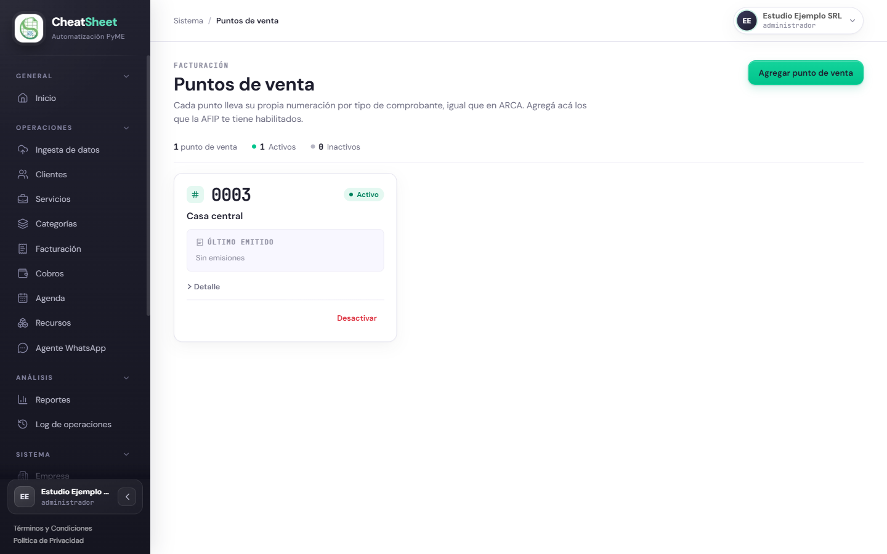
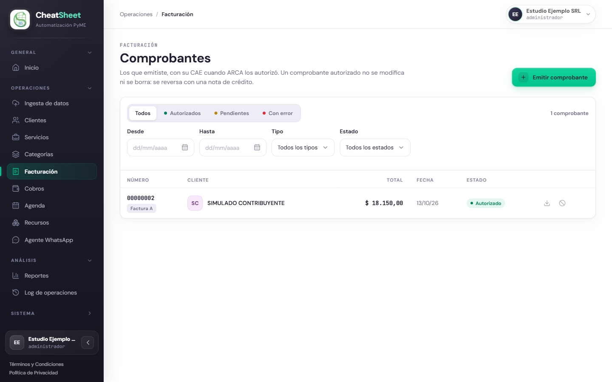
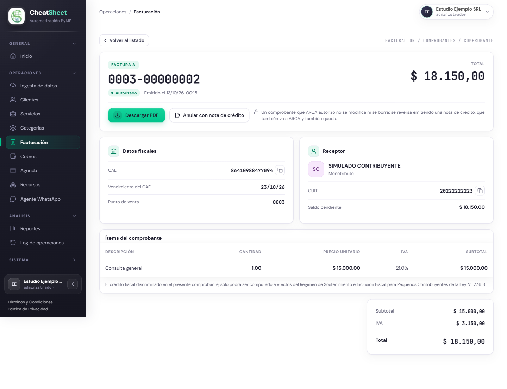
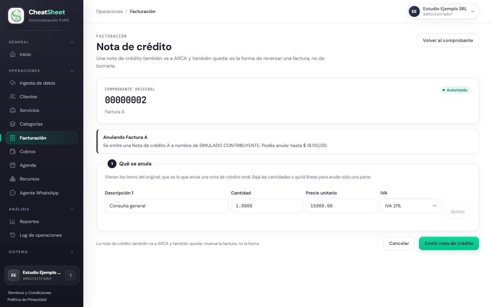

## Facturación

### Para qué sirve

El módulo Facturación Electrónica emite comprobantes fiscales ante ARCA y guarda el CAE que ARCA
otorga a cada uno. Permite consultar los comprobantes emitidos, descargar su representación en PDF,
anular un comprobante autorizado mediante una nota de crédito y administrar los puntos de venta con
los que se numeran.

Un comprobante autorizado no se modifica ni se borra: la única forma de reversarlo, total o
parcialmente, es emitir una nota de crédito, que también se informa a ARCA y también queda
registrada.

Antes de emitir el primer comprobante, la empresa necesita:

- ARCA conectada, con el servicio de facturación electrónica delegado en CheatSheet (MAN-20).
- Su condición frente al IVA cargada en «Datos de la empresa» (MAN-10).
- Al menos un punto de venta activo, habilitado en ARCA para el CUIT de la empresa.
- El cliente receptor cargado en el catálogo de clientes, con su CUIT (MAN-30).

### Quién puede usarla

| Funcionalidad | Administrador | Operador | Solo Lectura |
|---|---|---|---|
| Listado y detalle de comprobantes | Consulta, filtra y descarga el PDF | Consulta, filtra y descarga el PDF | Consulta, filtra y descarga el PDF |
| Emitir un comprobante | Sí | Sí | No: el botón no aparece y la dirección de la pantalla lo devuelve al listado |
| Anular con nota de crédito | Sí | Sí | No: la acción no aparece y la dirección de la pantalla lo devuelve al detalle |
| Puntos de venta | Agrega, desactiva y activa | Solo consulta | Solo consulta |

El servidor aplica las mismas restricciones aunque la acción se pida sin pasar por el panel.

### Cómo llegar

- «Menú › Operaciones › Facturación» para el listado de comprobantes, la emisión, el detalle y la
  nota de crédito.
- «Menú › Sistema › Puntos de venta» para administrar los puntos de venta. La sección «Sistema»
  aparece cerrada al ingresar: se abre con un clic sobre su título.

### Configurar los puntos de venta

HU-E5-05 — Configurar y administrar los puntos de venta. Cada punto de venta lleva su propia
numeración por tipo de comprobante, igual que en ARCA. El panel no habilita puntos de venta en
ARCA: el punto se habilita primero en el sitio de ARCA, para el CUIT de la empresa, y después se
agrega en el panel.

#### Paso a paso

1. Ingresar a «Menú › Sistema › Puntos de venta».
2. Hacer clic en «Agregar punto de venta».
3. Completar «Número» con el número habilitado en ARCA (por ejemplo, `1`).
4. Completar «Descripción» (por ejemplo, «Consultorio central»).
5. Hacer clic en «Agregar» y esperar el mensaje «Verificando en ARCA…».
6. Verificar que el punto aparezca en el listado con el número en cuatro dígitos (`0001`) y el
   estado «Activo».

Cada punto muestra su estado («Activo» o «Inactivo») y, bajo «Último emitido», el último número
autorizado por cada tipo de comprobante; mientras no emitió ninguno, dice «Sin emisiones».

Para dejar de emitir con un punto, hacer clic en «Desactivar» y confirmar el aviso. Los
comprobantes ya emitidos se conservan y la numeración queda donde está. Para volver a usarlo,
hacer clic en «Activar»: el sistema verifica otra vez contra ARCA que siga habilitado. Un punto de
venta no se elimina.

#### Mensajes y errores frecuentes

| Mensaje | Qué significa | Qué hacer |
|---|---|---|
| «El punto de venta no está habilitado en ARCA.» | ARCA no tiene ese número habilitado para el CUIT de la empresa, o lo tiene bloqueado | Habilitar el punto de venta en el sitio de ARCA y volver a agregarlo o activarlo |
| «Ya existe un punto de venta con ese número.» | La empresa ya cargó ese número | Usar el punto existente o, si está «Inactivo», hacer clic en «Activar» |
| «La empresa no tiene conectada la integracion con ARCA» | Falta conectar ARCA | Conectar ARCA (MAN-20) y volver a intentar |
| «ARCA no respondio a la consulta de puntos de venta» | ARCA no respondió en ese momento | Esperar unos minutos y volver a intentar |

### Emitir un comprobante

HU-E5-03 — Emitir un comprobante fiscal y obtener su CAE. La emisión tiene tres pasos: el CUIT del
receptor se valida contra el padrón de ARCA, se elige el tipo de comprobante y el punto de venta, y
se cargan los ítems. El tipo de comprobante disponible depende de la condición frente al IVA de la
empresa y de la del receptor: el panel solo ofrece los tipos válidos para esa combinación.

#### Paso a paso

1. Ingresar a «Menú › Operaciones › Facturación».
2. Hacer clic en «Emitir comprobante».
3. En «¿A quién le facturás?», buscar al cliente por nombre o por CUIT (por ejemplo, Ana Prueba) y
   hacer clic en «Facturar».
4. Esperar que el paso «Receptor» muestre «Verificado en el padrón de ARCA», con el nombre, el CUIT,
   la condición frente al IVA y los tipos de «Se le puede emitir». El CUIT del cliente se valida
   solo; si se corrige, hacer clic en «Validar».
5. En «Tipo de comprobante», elegir el tipo. Si hay uno solo posible, ya aparece elegido.
6. En «Punto de venta», elegir el punto con el que se numera el comprobante.
7. Completar «Domicilio del receptor (opcional)» si corresponde.
8. En «Descripción 1», escribir el concepto o elegir un servicio del catálogo de la lista de
   sugerencias (por ejemplo, Consulta general, $ 15.000,00, «IVA 21%»).
9. Completar «Cantidad», «Precio unitario» e «IVA». Para agregar otra línea, hacer clic en
   «Agregar ítem».
10. Revisar el recuadro «Resumen»: mientras falte algo, «Para emitir falta:» indica qué.
11. Hacer clic en «Emitir comprobante».
12. Esperar a que el panel abra el detalle del comprobante con el estado «Pendiente» y el aviso
    «Esperando la respuesta de ARCA».

El sistema calcula el IVA y los totales; el panel no muestra totales hasta que el comprobante está
emitido. Con un emisor Responsable Inscripto y un receptor Monotributo, el comprobante es una
Factura A y lleva la leyenda de la Ley Nº 27.618, visible en el detalle y en el PDF.

No hay que volver a emitir un comprobante «Pendiente»: si ARCA ya lo autorizó, un segundo intento
sería un segundo comprobante por la misma venta.

#### Mensajes y errores frecuentes

| Mensaje | Qué significa | Qué hacer |
|---|---|---|
| «Todavía no tenés un punto de venta activo, y sin punto de venta no hay numeración fiscal.» | La empresa no tiene ningún punto de venta activo | Seguir el enlace «Configurá uno» y agregar un punto de venta |
| «Sin CUIT: no se le puede emitir un comprobante» | El cliente del catálogo no tiene CUIT cargado | Hacer clic en «Completar sus datos» y cargar el CUIT del cliente (MAN-30) |
| «El CUIT ingresado no es válido. Debe contener 11 dígitos correctos.» | El CUIT tiene un dígito verificador incorrecto; no se consulta a ARCA | Corregir el CUIT y hacer clic en «Validar» |
| «No se encontró el CUIT en el padrón de ARCA.» | El CUIT es válido pero no existe en el padrón | Verificar el CUIT con el cliente |
| «El CUIT figura en el padrón de ARCA pero no está activo.» | El receptor existe pero está inactivo en ARCA | Consultar al cliente su situación fiscal antes de emitir |
| «Tu empresa todavía no tiene una condición de IVA cargada. Completá los datos fiscales antes de emitir comprobantes.» | Faltan los datos fiscales de la empresa | Completar «Datos de la empresa» (MAN-10) |
| «Debe agregar al menos un ítem para emitir el comprobante.» | No hay ningún ítem con descripción y precio; el botón queda deshabilitado | Cargar al menos un ítem |
| «El precio unitario debe ser mayor a cero.» | Un ítem tiene precio cero o negativo | Corregir el precio y volver a hacer clic en «Emitir comprobante» |
| «No pudimos emitir el comprobante ahora. Antes de reintentar, revisá el listado por si se emitió.» | El panel no recibió la respuesta del servidor | Revisar el listado antes de volver a emitir |

### Consultar el listado de comprobantes

HU-E5-01 — Consultar el listado de comprobantes emitidos. El listado muestra solo los comprobantes
de la empresa, del más reciente al más antiguo, con número, tipo, cliente, total, fecha y estado.

#### Paso a paso

1. Ingresar a «Menú › Operaciones › Facturación».
2. Para filtrar por estado, hacer clic en «Todos», «Autorizados», «Pendientes» o «Con error», o
   elegir una opción en «Estado».
3. Para filtrar por período, completar «Desde» y «Hasta».
4. Para filtrar por tipo, elegir una opción en «Tipo» (Factura A, B o C, o Nota de crédito A, B o C).
5. Revisar la cantidad de resultados arriba de la tabla.
6. Para quitar los filtros, hacer clic en «Limpiar filtros».
7. Hacer clic en el número de un comprobante, o en cualquier parte de su fila, para abrir el detalle.

Los estados que muestra el listado son:

| Estado | Qué significa |
|---|---|
| «Pendiente» | El comprobante se envió a ARCA y todavía no hay respuesta |
| «Autorizado» | ARCA lo autorizó y otorgó el CAE |
| «Error» | ARCA lo rechazó; el motivo se ve en el detalle |
| «Anulado» | Una o más notas de crédito autorizadas lo anularon por el total |

En cada fila, el ícono de descarga baja el PDF de un comprobante autorizado y el ícono «Anular con
nota de crédito» abre la nota de crédito (solo Administrador y Operador).

#### Mensajes y errores frecuentes

| Mensaje | Qué significa | Qué hacer |
|---|---|---|
| «Todavía no emitiste comprobantes.» | La empresa no emitió ningún comprobante | Emitir el primero con «Emitir comprobante» |
| «No hay comprobantes para los filtros seleccionados.» | Ningún comprobante coincide con los filtros | Cambiar los filtros o hacer clic en «Limpiar filtros» |
| «No se pudo actualizar el listado.» | El panel no pudo consultar el servidor | Volver a aplicar el filtro |

### Consultar el detalle de un comprobante

HU-E5-02 — Consultar el estado y detalle de un comprobante. El detalle muestra el tipo, el número
con el formato de ARCA (`0001-00000001`), el estado, la fecha de emisión, el total, el CAE y su
vencimiento, el punto de venta, el receptor con su CUIT y su condición frente al IVA, el saldo
pendiente y los ítems con subtotal e IVA. No admite ninguna edición.

#### Paso a paso

1. Ingresar a «Menú › Operaciones › Facturación».
2. Hacer clic en el número del comprobante.
3. Revisar «Datos fiscales»: «CAE», «Vencimiento del CAE» y «Punto de venta».
4. Para copiar el CAE o el CUIT, hacer clic en «Copiar CAE» o «Copiar CUIT».
5. Si el comprobante está «Autorizado», hacer clic en «Descargar PDF».
6. Si el comprobante está «Pendiente», recargar la página más tarde para ver el CAE o el motivo del
   rechazo.
7. Hacer clic en «Volver al listado» para regresar.

#### Mensajes y errores frecuentes

| Mensaje | Qué significa | Qué hacer |
|---|---|---|
| «Esperando la respuesta de ARCA» | El comprobante se envió y ARCA todavía no contestó | Recargar la página más tarde; no emitirlo de nuevo |
| «ARCA rechazó el comprobante», con el código y la descripción de ARCA (por ejemplo, «Error 10016: …») | ARCA no autorizó el comprobante; queda en «Error» y sin PDF | Corregir lo que indica ARCA y emitir un comprobante nuevo |
| «ARCA no tiene registro de este comprobante, así que no llegó a autorizarse. Podés emitirlo de nuevo.» | El envío no llegó a ARCA | Emitir el comprobante de nuevo |
| «Anulado parcialmente» o «Anulado por completo» | Una o más notas de crédito autorizadas reversaron parte o todo el comprobante | Ninguna acción: es informativo |

### Anular un comprobante con una nota de crédito

HU-E5-04 — Anular un comprobante mediante una nota de crédito. Solo se anula un comprobante
autorizado. La nota de crédito toma del original el tipo (A, B o C), el receptor y su condición
frente al IVA, y no puede superar el monto que queda sin anular. La anulación puede ser total o
parcial; una nota de crédito no se anula con otra.

#### Paso a paso

1. Abrir el detalle del comprobante autorizado.
2. Hacer clic en «Anular con nota de crédito».
3. Leer el aviso «Anulando …», que indica qué nota de crédito se emite, a nombre de quién y hasta qué
   monto se puede anular.
4. En «Qué se anula», revisar los ítems: vienen los del original, que anulan el total.
5. Para una anulación parcial, bajar las cantidades o hacer clic en «Quitar» en las líneas que no se
   anulan.
6. Hacer clic en «Emitir nota de crédito».
7. Verificar que el panel vuelva al detalle del original y que la nota aparezca en el listado con el
   estado «Pendiente».

La nota de crédito también se inicia desde un cobro reembolsado, con el enlace «Emitir nota de
crédito» (MAN-60). En ningún caso se emite sola: requiere el clic en «Emitir nota de crédito».

#### Mensajes y errores frecuentes

| Mensaje | Qué significa | Qué hacer |
|---|---|---|
| «El monto de la nota de crédito no puede superar el del comprobante original.» | Los ítems superan el monto que queda sin anular; el botón se deshabilita | Bajar cantidades o precios hasta el monto indicado en el aviso |
| «Sólo se puede anular un comprobante que ARCA autorizó, y éste todavía no lo está.» | El comprobante está «Pendiente» o en «Error» | Esperar la autorización, o corregir y emitir un comprobante nuevo |
| «Ya está anulado del todo» | Las notas de crédito anteriores ya cubren el total | Ninguna acción: no queda saldo para anular |
| «No se pudo emitir la nota de crédito.» | El panel no recibió la respuesta del servidor | Revisar el listado antes de volver a intentar |
