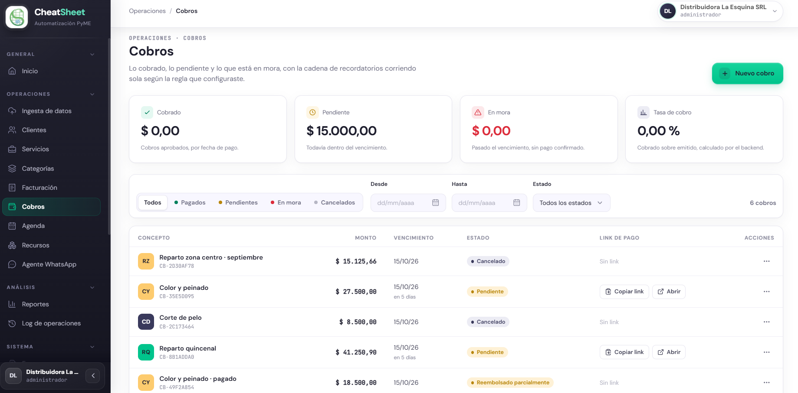
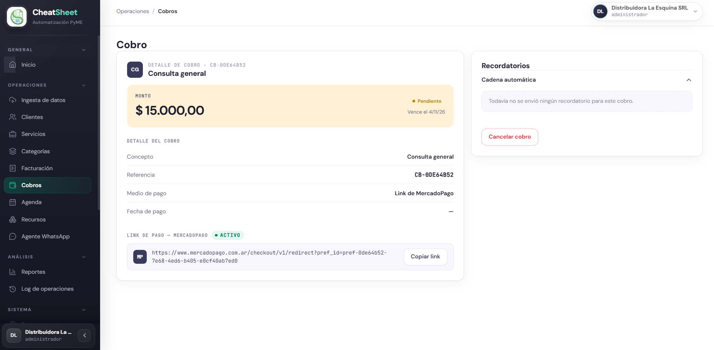
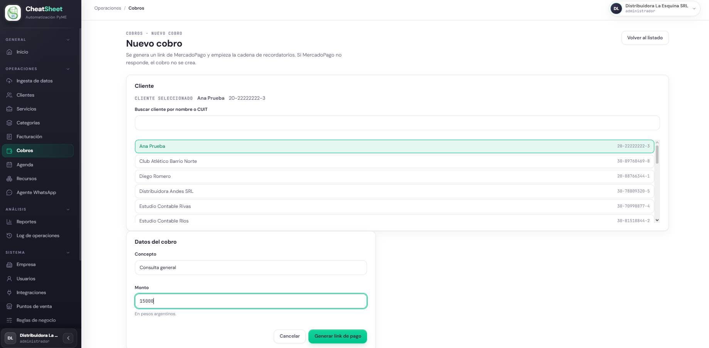
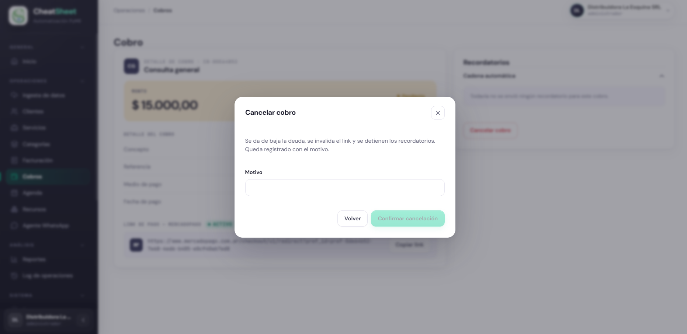
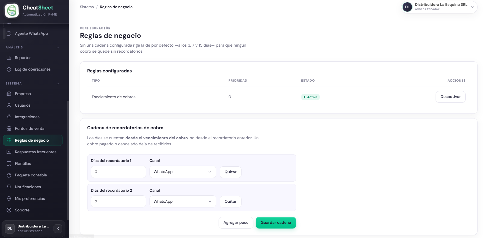

## Cobros

### Para qué sirve

El módulo Cobros reúne lo que la empresa cobró, lo que está pendiente y lo que entró en mora, con la cadena de recordatorios corriendo según la regla configurada. Desde este módulo el Administrador genera links de pago de MercadoPago para sus clientes, consulta el estado de cada cobro, lo cancela cuando corresponde, registra reembolsos y define las reglas de recordatorio que se aplican de forma automática.

### Quién puede usarla

El Administrador y el Operador generan, consultan y cancelan cobros. El reembolso de un cobro es exclusivo del Administrador. El rol Solo Lectura consulta el estado y el detalle de los cobros, pero no accede al alta ni a las acciones que modifican un cobro.

### Cómo llegar

Desde el menú lateral, en la sección Operaciones, ingresar a «Menú › Cobros». Las reglas de recordatorio se configuran en «Menú › Reglas de negocio», dentro de la sección Sistema.

### Consultar el estado de los cobros

La pantalla principal de Cobros (HU-E6-01 — Consultar el estado de los cobros) muestra en el encabezado cuatro indicadores del período en curso: «Cobrado», «Pendiente», «En mora» y «Tasa de cobro». Debajo, el listado presenta cada cobro con su concepto, monto, vencimiento, estado y link de pago.

Los indicadores se calculan sobre el mes en curso: «Cobrado» agrupa los cobros aprobados por su fecha de pago, «En mora» los vencidos sin pago confirmado, y «Tasa de cobro» mide lo cobrado sobre lo emitido en el período.

El listado puede filtrarse de dos maneras. Los botones rápidos sobre la tabla filtran por los estados más frecuentes: «Todos», «Pagados», «Pendientes» y «En mora». El desplegable «Estado» permite filtrar por cualquiera de los estados posibles, incluidos «Cancelado», «Reembolsado parcialmente» y «Reembolsado». Los campos «Desde» y «Hasta» acotan el listado por fecha.

#### Mensajes y errores frecuentes

| Mensaje | Qué significa | Qué hacer |
|---|---|---|
| Todavía no hay cobros. | La empresa no tiene cobros registrados. | Generar el primer cobro con «Nuevo cobro». |
| No hay cobros para los filtros seleccionados. | Los filtros aplicados no devuelven resultados. | Ajustar los filtros de estado o de fecha. |

### Consultar el detalle de un cobro

Al seleccionar un cobro del listado se abre su detalle (HU-E6-02 — Consultar el detalle de un cobro), con el monto, el concepto, la referencia interna, el medio de pago, la fecha de pago cuando corresponde y el estado. En el mismo detalle se muestra el link de pago de MercadoPago con su estado y el historial de la cadena de recordatorios.

Para copiar el link y enviárselo al cliente, pulsar «Copiar link». El sistema confirma la acción con el mensaje «Link copiado al portapapeles.».

### Generar un link de cobro

Para iniciar un cobro, pulsar «Nuevo cobro» en la pantalla de Cobros. Se abre la pantalla de alta (HU-E6-03 — Generar un link de cobro para un cliente), que genera un link de MercadoPago e inicia la cadena de recordatorios. Si MercadoPago no responde, el cobro no se crea.

#### Paso a paso

1. Ingresar a «Menú › Cobros».
2. Pulsar «Nuevo cobro».
3. Buscar y seleccionar al cliente en la sección «Cliente».
4. Completar el campo «Concepto» con el detalle del cobro.
5. Completar el campo «Monto» con el importe en pesos argentinos.
6. Pulsar «Generar link de pago».
7. Verificar en el detalle del cobro que el link figura en estado activo.

#### Mensajes y errores frecuentes

| Mensaje | Qué significa | Qué hacer |
|---|---|---|
| Debe seleccionar un cliente. | No se eligió un cliente para el cobro. | Seleccionar un cliente de la lista antes de generar. |
| Debe ingresar un concepto para el cobro. | El campo «Concepto» está vacío. | Completar el concepto del cobro. |
| El monto debe ser mayor a cero. | El monto ingresado es cero o negativo. | Ingresar un monto mayor a cero. |
| No se pudo generar el link de pago. Intente nuevamente. | MercadoPago no respondió al generar el link. | Reintentar la operación. El cobro no se crea mientras el link no se genere. |

### Cancelar un cobro

Un cobro pendiente puede cancelarse desde su detalle (HU-E6-04 — Cancelar un cobro). Al cancelarlo se da de baja la deuda, se invalida el link y se detienen los recordatorios. La cancelación queda registrada con su motivo. Un cobro pagado no se cancela: en ese caso corresponde un reembolso.

#### Paso a paso

1. Abrir el detalle del cobro que se desea cancelar.
2. Pulsar «Cancelar cobro».
3. Completar el campo «Motivo» con la razón de la cancelación.
4. Pulsar «Confirmar cancelación».

#### Mensajes y errores frecuentes

| Mensaje | Qué significa | Qué hacer |
|---|---|---|
| El motivo debe tener al menos 10 caracteres. | El motivo ingresado es demasiado corto. | Ampliar el motivo de la cancelación. |
| No se pudo cancelar el cobro. | La operación no pudo completarse. | Reintentar. Si persiste, informar al área técnica. |

### Reembolsar un cobro

El reembolso de un cobro pagado es una acción exclusiva del Administrador (HU-E6-05 — Reembolsar un cobro). Permite devolver total o parcialmente el dinero de un cobro ya aprobado. El reembolso puede procesarse a través de MercadoPago o registrarse de forma manual cuando la devolución se hizo por transferencia.

#### Paso a paso

1. Abrir el detalle de un cobro en estado pagado.
2. Pulsar «Reembolsar».
3. Completar el campo «Monto a reembolsar».
4. Completar el campo «Motivo».
5. Pulsar «Registrar reembolso».

### Asociar un cobro a un comprobante

Al generar un cobro, el Administrador puede asociarlo a un comprobante autorizado con saldo pendiente (HU-E6-06 — Asociar un cobro a un comprobante existente). El selector «Comprobante asociado» aparece en la pantalla de alta de cobro cuando existen comprobantes con saldo disponible; de lo contrario, la sección no se muestra. Para no asociar ningún comprobante, se elige la opción «Sin comprobante».

### Asociar un cobro a un turno

La asociación de un cobro a un turno como seña (HU-E6-07 — Asociar un cobro a un turno como seña) está prevista para vincular el pago anticipado de un turno de la Agenda. Esta funcionalidad no se encuentra disponible en el panel al momento de redactar este manual.

### Definir las reglas de recordatorio

Las reglas de recordatorio determinan cada cuántos días, y por qué canal, se le avisa al cliente sobre un cobro pendiente (HU-E11-01 — Definir reglas de negocio parametrizables). Si no se configura ninguna regla, rige una cadena por defecto a los 3, 7 y 15 días para que ningún cobro quede sin recordatorios. Los días se cuentan desde el vencimiento del cobro. Un cobro pagado o cancelado deja de recibir recordatorios.

#### Paso a paso

1. Ingresar a «Menú › Reglas de negocio».
2. En «Cadena de recordatorios de cobro», completar el campo «Días del recordatorio 1» y seleccionar el canal.
3. Para agregar más pasos a la cadena, pulsar «Agregar paso» y completar los días y el canal de cada uno.
4. Pulsar «Guardar cadena».
5. Verificar que la regla aparece en «Reglas configuradas» con su estado «Activa».

Para dejar de aplicar una regla configurada, pulsar «Desactivar» en la fila correspondiente de «Reglas configuradas».

#### Mensajes y errores frecuentes

| Mensaje | Qué significa | Qué hacer |
|---|---|---|
| Los días de escalamiento deben ser mayores a cero. | Un paso tiene los días en cero. | Ingresar un número de días mayor a cero en cada paso. |
