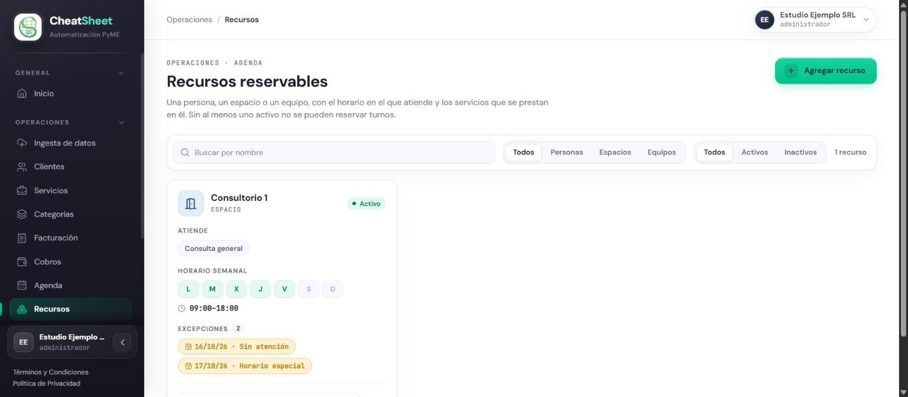
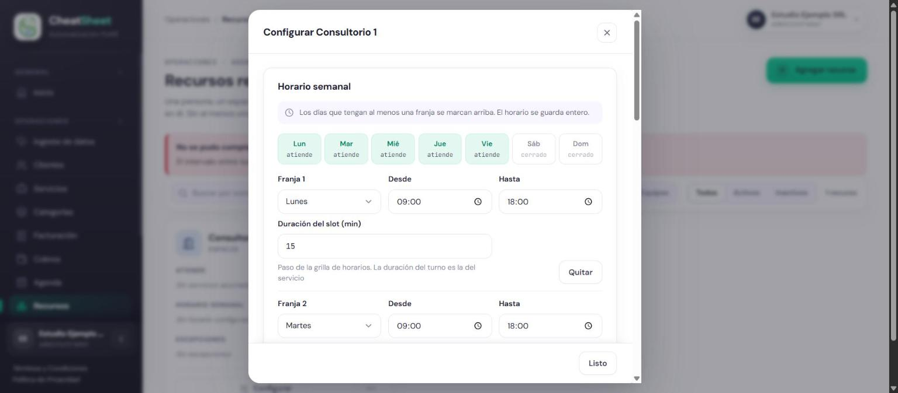
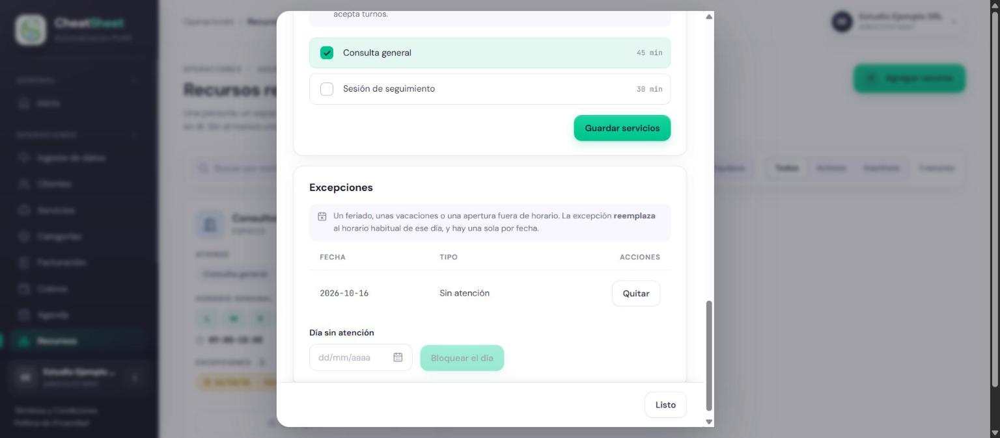
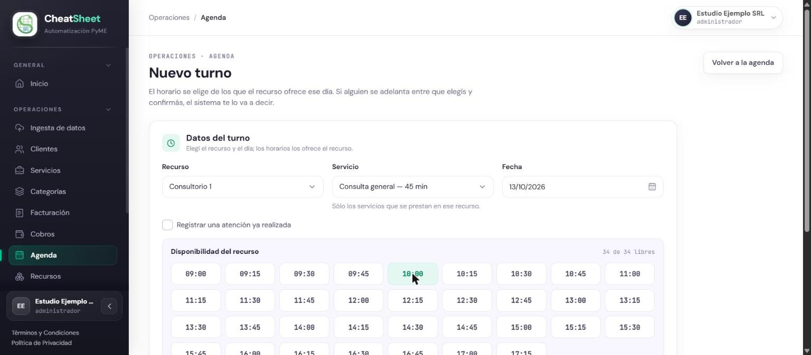
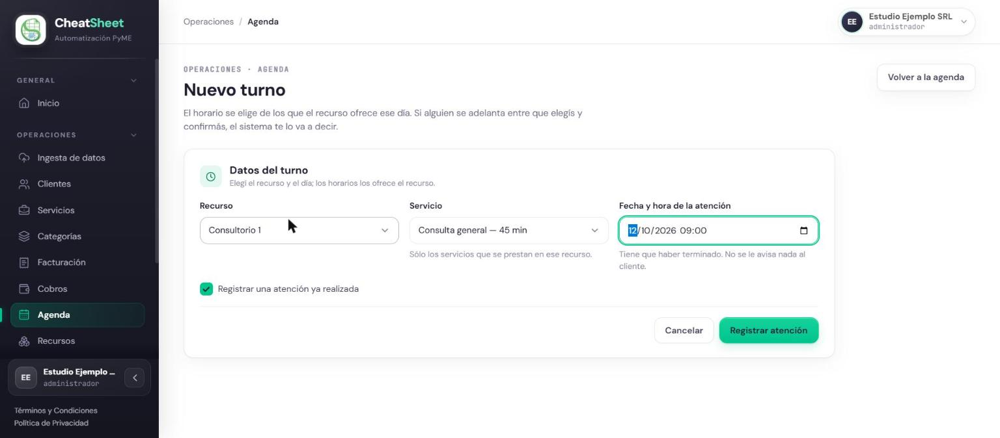
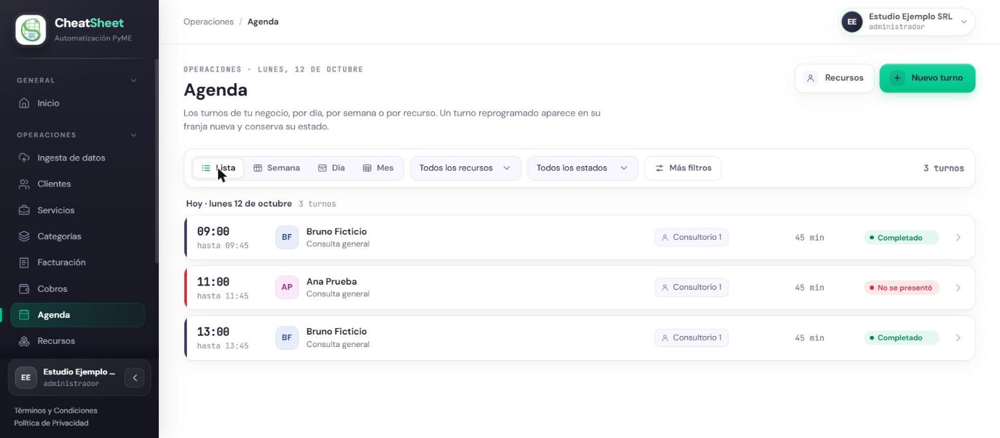
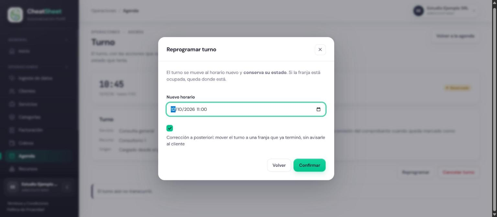
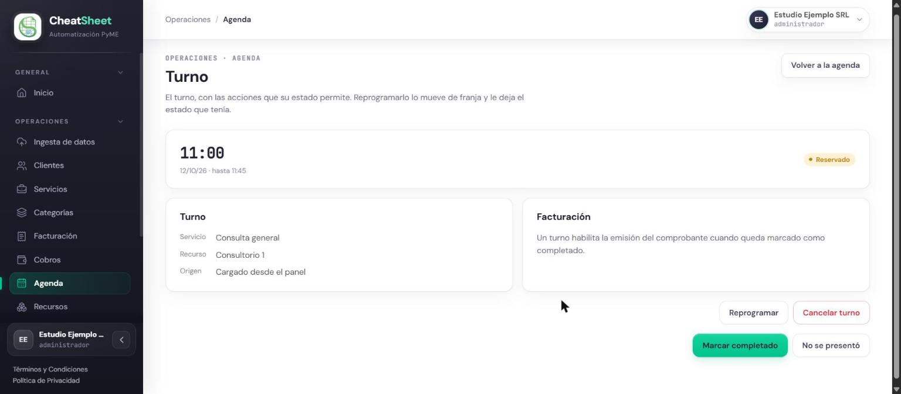

## Agenda

### Para qué sirve

La Agenda organiza los turnos de la empresa sobre sus recursos reservables: las personas,
espacios o equipos que atienden. El Administrador define cuándo atiende cada recurso y qué
servicios presta; con eso el panel y el agente de WhatsApp ofrecen solo horarios reales, sin
superposiciones. Desde la Agenda se crean turnos para clientes que no reservan por WhatsApp, se
cancelan o reprograman, y se registra si el cliente asistió, lo que habilita facturar el servicio.

### Quién puede usarla

| Funcionalidad | Administrador | Operador | Solo Lectura |
|---|---|---|---|
| Configurar recursos y excepciones | Sí | Solo consulta | Solo consulta |
| Ver la agenda | Sí | Sí | Sí |
| Crear, cancelar y reprogramar turnos | Sí | Sí | No |
| Registrar asistencia o inasistencia | Sí | Sí | No |
| Registrar una atención ya realizada o corregir un turno a posteriori | Sí | No | No |

### Cómo llegar

- «Menú › Operaciones › Agenda» para la agenda de turnos.
- «Menú › Operaciones › Recursos», o el botón «Recursos» de la Agenda, para los recursos reservables.
- «Menú › Operaciones › Clientes» y la acción «Agendar» de un cliente, para crear un turno.

### Configurar un recurso reservable

HU-E7-04 — Definir la disponibilidad de un recurso reservable. Un recurso nace activo y sin
servicios asociados, así que todavía no acepta turnos. Su horario semanal se arma con franjas: cada
franja es un día, una hora de inicio, una hora de fin y una duración de slot. La duración del slot
es el paso de la grilla de horarios que se ofrecen; la duración del turno es la del servicio.

#### Paso a paso

1. Ingresar a «Menú › Operaciones › Recursos».
2. Hacer clic en «Agregar recurso».
3. Completar «Nombre» y elegir el «Tipo»: Persona, Espacio o Equipo.
4. Hacer clic en «Crear».
5. En la tarjeta del recurso, hacer clic en «Configurar».
6. En «Horario semanal», elegir el día de la «Franja 1» y completar «Desde», «Hasta» y «Duración del slot (min)».
7. Hacer clic en «Agregar franja» por cada día adicional y completar sus datos. Cada franja corresponde a un solo día.
8. Completar «Intervalo entre turnos (min)» si se quiere dejar tiempo libre después de cada turno; vacío equivale a 0.
9. Hacer clic en «Guardar horario».
10. En «Servicios que se prestan acá», marcar los servicios que se reservan en ese recurso y hacer clic en «Guardar servicios».
11. Hacer clic en «Listo».

Para dejar de recibir reservas en un recurso, abrir «Más acciones» en su tarjeta y elegir
«Desactivar». Los turnos ya reservados se mantienen; «Reactivar» lo vuelve a habilitar.

#### Mensajes y errores frecuentes

| Mensaje | Qué significa | Qué hacer |
|---|---|---|
| «La hora de inicio debe ser anterior a la hora de fin.» | La franja termina antes de empezar | Corregir «Desde» o «Hasta» |
| «La duración del slot debe estar entre 5 y 480 minutos.» | El paso de la grilla está fuera de rango o supera la franja | Ingresar un valor entre 5 y 480 |
| «El intervalo entre turnos debe estar entre 0 y 480 minutos.» | El intervalo es negativo o excesivo | Ingresar un valor entre 0 y 480 |
| «Todavía no configuraste ningún recurso. Sin al menos uno activo no se pueden reservar turnos.» | La empresa no tiene recursos activos | Crear un recurso y configurarlo |

### Registrar una excepción de disponibilidad

HU-E7-05 — Registrar excepciones de disponibilidad. Una excepción reemplaza el horario habitual de
un día: un feriado o unas vacaciones. Hay una sola excepción por fecha y por recurso, y el día
bloqueado deja de ofrecer horarios en el panel y en WhatsApp.

#### Paso a paso

1. Ingresar a «Menú › Operaciones › Recursos» y hacer clic en «Configurar» en el recurso.
2. En «Excepciones», abrir «Día sin atención» y elegir la fecha en el calendario.
3. Hacer clic en «Bloquear el día».
4. Verificar que la fecha aparece en la tabla con el tipo «Sin atención».
5. Para volver al horario habitual de ese día, hacer clic en «Quitar».

#### Mensajes y errores frecuentes

| Mensaje | Qué significa | Qué hacer |
|---|---|---|
| «Ya existe una excepción para esa fecha en este recurso.» | La fecha ya tiene una excepción | Quitar la existente antes de cargar otra |

### Crear un turno

HU-E7-06 — Crear un turno manualmente desde el panel. Sirve para agendar a un cliente que llama
por teléfono o se presenta en persona. El turno queda Reservado y con origen «Cargado desde el
panel». Los horarios que se ofrecen son los del recurso para ese día y ese servicio; los que se
superponen con otro turno aparecen tachados.

#### Paso a paso

1. Ingresar a «Menú › Operaciones › Clientes».
2. En la fila del cliente, hacer clic en «Agendar».
3. Elegir el «Recurso». Solo se ofrecen los recursos activos.
4. Elegir el «Servicio». Solo se ofrecen los servicios que se prestan en ese recurso, con su duración.
5. Elegir la «Fecha».
6. Elegir un horario libre en «Disponibilidad del recurso»; el campo «Horario» se completa solo.
7. Hacer clic en «Reservar turno».

Si el cliente tiene WhatsApp registrado y la empresa tiene WhatsApp conectado, el cliente recibe
la confirmación del turno. Sin WhatsApp conectado, el turno se crea igual pero el aviso no sale.

**Registrar una atención ya realizada (solo Administrador).** Para cargar una atención que ya
ocurrió, marcar «Registrar una atención ya realizada», completar «Fecha y hora de la atención» y
hacer clic en «Registrar atención». El turno queda Completado, no se avisa al cliente y la
bitácora lo marca como «Cargar turno a posteriori».

#### Mensajes y errores frecuentes

| Mensaje | Qué significa | Qué hacer |
|---|---|---|
| «No se pudo reservar — El horario seleccionado no está disponible.» | Otro turno tomó ese horario entre la consulta y la confirmación | Elegir otro horario de la grilla actualizada |
| «No se puede agendar un turno en un horario que ya pasó.» | El horario elegido ya transcurrió | Elegir un horario posterior a la hora actual |
| «El turno aún no transcurrió.» | Al registrar una atención ya realizada, la franja todavía no terminó | Verificar la fecha y la hora de la atención |
| «Elegí el servicio para ver los horarios» | Falta elegir el servicio | Elegir el servicio |

### Ver la agenda

HU-E7-01 — Ver la agenda de turnos desde el panel. La agenda muestra los turnos con su estado:
Reservado, Confirmado, Completado, No se presentó o Cancelado. Un turno reprogramado aparece en su
franja nueva y conserva su estado.

#### Paso a paso

1. Ingresar a «Menú › Operaciones › Agenda».
2. Elegir la vista: «Lista», «Semana», «Día» o «Mes».
3. Moverse entre períodos con «Período anterior», «Hoy» y «Período siguiente».
4. Filtrar por recurso con «Todos los recursos» y por estado con «Todos los estados».
5. Hacer clic en un turno para abrir su detalle.

#### Mensajes y errores frecuentes

| Mensaje | Qué significa | Qué hacer |
|---|---|---|
| «No hay turnos para el período seleccionado.» | No hay turnos en el período y con los filtros elegidos | Cambiar el período o los filtros, o crear un turno |

### Cancelar o reprogramar un turno

HU-E7-02 — Cancelar o reprogramar un turno desde el panel. Ambas acciones están disponibles sobre
un turno Reservado o Confirmado y quedan en la bitácora. Reprogramar mueve el turno a otro horario
y conserva su estado. Si el cliente tiene WhatsApp registrado y la empresa lo tiene conectado,
recibe el aviso.

#### Paso a paso

1. Abrir el turno desde la agenda.
2. Para reprogramar, hacer clic en «Reprogramar», completar «Nuevo horario» y hacer clic en «Confirmar».
3. Para cancelar, hacer clic en «Cancelar turno». El turno pasa a Cancelado de inmediato: el panel no pide confirmación.

**Corrección a posteriori (solo Administrador).** Para mover un turno a un horario que ya
terminó, marcar «Corrección a posteriori: mover el turno a una franja que ya terminó, sin avisarle
al cliente» antes de confirmar. No se avisa al cliente y la bitácora lo marca como «Corregir turno
a posteriori».

#### Mensajes y errores frecuentes

| Mensaje | Qué significa | Qué hacer |
|---|---|---|
| «El horario seleccionado no está disponible.» | El nuevo horario se superpone con otro turno del recurso | Elegir otro horario |
| «No se puede reprogramar un turno a un horario que ya pasó.» | El nuevo horario ya transcurrió | Elegir un horario futuro, o usar la corrección a posteriori si corresponde |
| «El turno aún no transcurrió.» | En una corrección a posteriori, la franja nueva todavía no terminó | Elegir una franja ya terminada |

### Registrar la asistencia o inasistencia

HU-E7-03 — Registrar la asistencia o inasistencia a un turno. Cuando el horario del turno ya
pasó, su detalle ofrece «Marcar completado» y «No se presentó». Un turno Completado habilita la
emisión del comprobante del servicio, que se hace desde la acción «Facturar» del cliente.

#### Paso a paso

1. Abrir el turno desde la agenda.
2. Hacer clic en «Marcar completado» si el cliente asistió, o en «No se presentó» si no asistió.
3. Verificar el nuevo estado en la parte superior del detalle.

#### Mensajes y errores frecuentes

| Mensaje | Qué significa | Qué hacer |
|---|---|---|
| «El turno aún no transcurrió.» | El horario del turno todavía no pasó | Esperar a que transcurra el turno |
