## Agente de WhatsApp y atención

### Para qué sirve

Este capítulo explica cómo atender las conversaciones que el agente de WhatsApp deriva a una persona, cómo cerrarlas, cómo administrar las respuestas frecuentes que el agente contesta solo, cómo configurar el horario de atención y cómo editar los mensajes automáticos que el sistema envía a los clientes.

El agente responde una pregunta frecuente con el texto que la empresa cargó, reserva o cancela turnos con las mismas reglas que el panel y deriva la conversación a una persona cuando corresponde. Cada conversación queda en el panel con todos sus mensajes.

### Quién puede usarla

| Acción | Administrador | Operador | Solo Lectura |
|---|---|---|---|
| Ver la bandeja y el historial de una conversación | Sí | Sí | Sí |
| Tomar una conversación, responder y cerrar el escalamiento | Sí | Sí | No |
| Ver las respuestas frecuentes, el horario y las plantillas | Sí | Sí | Sí |
| Cambiar respuestas frecuentes, horario y plantillas | Sí | No | No |

Para los roles que no pueden una acción, el panel oculta el botón y la API la rechaza aunque se la llame directamente.

### Cómo llegar

- Conversaciones: «Menú › Operaciones › Agente WhatsApp».
- Respuestas frecuentes y horario de atención: «Menú › Sistema › Respuestas frecuentes». La sección «Sistema» aparece cerrada al ingresar: se abre con un clic sobre su título.
- Plantillas de notificación: «Menú › Sistema › Plantillas».
- Los turnos que reserva el agente figuran en «Menú › Operaciones › Agenda» con «Origen» «Agente» (MAN-70), y sus acciones en «Menú › Análisis › Log de operaciones» con el iniciador «Agente IA» (MAN-90).

### Atender una conversación escalada

HU-E9-01 — Atender una conversación escalada. Una conversación está escalada cuando el agente la derivó a una persona y el escalamiento sigue abierto. Mientras lo está, el agente no responde en ese hilo: los mensajes nuevos del cliente se registran y esperan a un Administrador o a un Operador. Al derivar, el cliente recibe «Lo derivo con un asesor que va a continuar la conversación.»; con el horario de atención configurado y el negocio cerrado, el aviso agrega desde cuándo lo atiende un asesor. El título de cada hilo escalado es el motivo:

| Motivo del hilo | Cuándo ocurre |
|---|---|
| «El cliente pidió hablar con una persona» | El cliente lo pide de forma explícita |
| «El agente no interpretó la intención con confianza suficiente» | El agente no entiende tres mensajes seguidos, o no entiende la respuesta del cliente mientras reserva o cancela un turno |
| «La transcripción de la nota de voz no alcanzó calidad suficiente» | La nota de voz no se pudo transcribir con calidad |
| «Cancelación de turno con seña» | El cliente pide cancelar un turno con seña pagada; el agente no lo cancela |

La bandeja muestra a la izquierda los hilos, con los contadores «N hilos» y «N esperan», y a la derecha el hilo elegido. Abre filtrada por «Esperan a un asesor», que incluye los hilos ya tomados; «Todas» agrega el resto. La pastilla de cada hilo indica su estado: «Espera un asesor» (nadie tomó el escalamiento), «En atención» (alguien lo tomó y el agente no responde) o «La atiende el agente» (no hay escalamiento abierto).

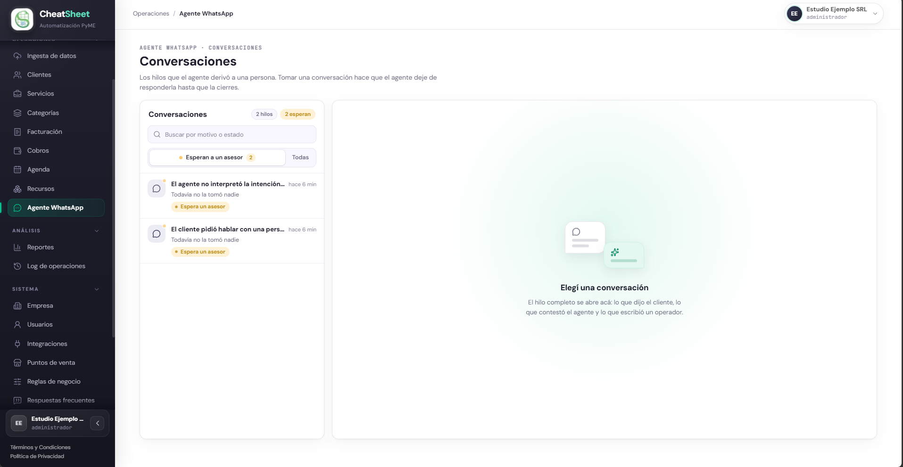

Al abrir un hilo, la lista pasa a mostrar «Todas» y el historial completo aparece a la derecha, con el recuadro «Esperando a un asesor» y el motivo. Cada mensaje indica su autor («Cliente», «Agente», «Operador» o «Sistema», para los avisos automáticos de turnos), la hora, su clasificación («Turno», «Consulta», «Pago», «Pregunta frecuente» o «Sin clasificar») y, si salió, su estado: «Enviado», «Entregado», «Leído» o «No se pudo enviar», con el motivo debajo. El estado avanza cuando WhatsApp informa la entrega; si no la informa, queda en «Enviado».

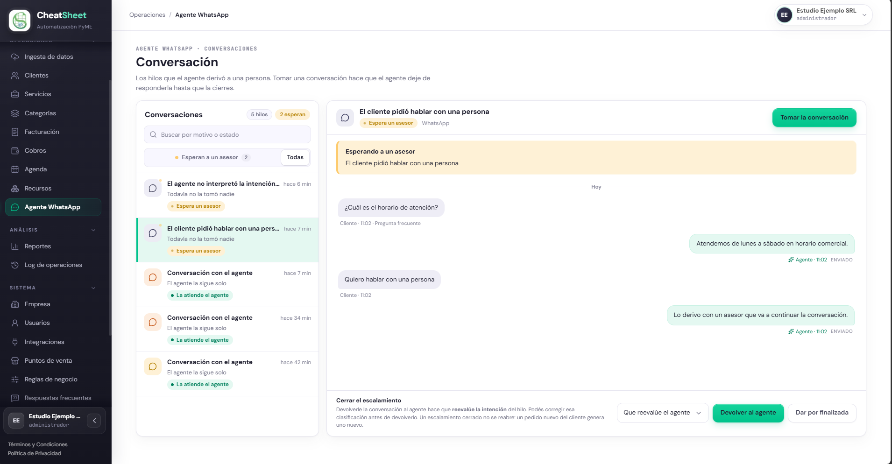

#### Paso a paso

1. Ingresar a «Menú › Operaciones › Agente WhatsApp».
2. Identificar los hilos con la pastilla «Espera un asesor». Para buscar, escribir en «Buscar por motivo o estado».
3. Hacer clic en el hilo y leer el historial: el cliente no tiene que repetir lo que ya dijo.
4. Pulsar «Tomar la conversación». La pastilla pasa a «En atención» y el agente deja de responder. La toma queda en el Log de operaciones como «Tomar escalamiento».
5. Escribir la respuesta en el campo «Escribí tu respuesta…» y pulsar «Enviar». El mensaje sale por WhatsApp y aparece con el autor «Operador».
6. Si el motivo es «Cancelación de turno con seña», decidir qué hacer con el turno desde «Menú › Operaciones › Agenda» (MAN-70) y avisar al cliente por este hilo.

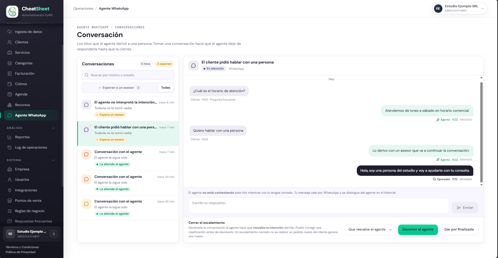

El hilo no se actualiza solo: para ver mensajes nuevos del cliente, volver a abrirlo.

#### Mensajes y errores frecuentes

| Mensaje | Qué significa | Qué hacer |
|---|---|---|
| «No hay conversaciones esperando a un asesor.» | Ningún hilo tiene un escalamiento abierto | Pulsar «Todas» para ver el historial |
| «Con tu rol podés leer las conversaciones, pero no atenderlas.» | El usuario tiene el rol Solo Lectura | Pedir la tarea a un Administrador o a un Operador |
| «El escalamiento ya fue tomado o resuelto» | Otra persona lo tomó o lo cerró antes | Actualizar la bandeja y abrir otro hilo |
| «Para escribirle al cliente hay que tomar el escalamiento primero» | El hilo ya no tiene un escalamiento abierto | Actualizar la bandeja |
| «WhatsApp no aceptó el mensaje» | El envío falló y el mensaje no salió | Reintentar con «Enviar»; si persiste, abrir una solicitud en «Menú › Sistema › Soporte» (MAN-90) |
| «Fuera de la ventana de 24 h y sin plantilla aprobada», «WhatsApp no está conectado» o «No sabemos si llegó: Meta no respondió» (bajo «No se pudo enviar») | Un mensaje del agente o un aviso del sistema no salió; el motivo lo informa WhatsApp o el sistema | Aprobar la plantilla, conectar WhatsApp en MAN-20 o consultar al cliente antes de reenviar; un «Código …» desconocido se informa en una solicitud de soporte |

### Resolver y cerrar un escalamiento

HU-E9-02 — Resolver y cerrar un escalamiento. El escalamiento se cierra de una de dos maneras, y el cierre queda en el Log de operaciones como «Cerrar escalamiento». Un escalamiento cerrado no se reabre: un nuevo pedido del cliente genera uno nuevo. La tarjeta «Cerrar el escalamiento» aparece con el hilo «En atención» y también con el hilo en «Espera un asesor»: se puede cerrar sin haberlo tomado.

| Botón | Qué hace |
|---|---|
| «Devolver al agente» | Cierra el escalamiento y el agente retoma el hilo. Reclasifica el hilo: con «Que reevalúe el agente» relee el último mensaje del cliente; con «Turno», «Consulta», «Pago» o «Pregunta frecuente» aplica esa clasificación |
| «Dar por finalizada» | Cierra el escalamiento y archiva la conversación; si el cliente escribe de nuevo, se abre una conversación nueva |

#### Paso a paso

1. Abrir el hilo desde «Menú › Operaciones › Agente WhatsApp».
2. En la tarjeta «Cerrar el escalamiento», elegir en «Clasificación al devolver» la opción que corresponda. Solo se usa con «Devolver al agente».
3. Pulsar «Devolver al agente» o «Dar por finalizada».
4. Verificar que la pastilla dice «La atiende el agente», que aparece «Este hilo no tiene ningún escalamiento abierto.» y que desaparecen la caja de respuesta y la tarjeta de cierre.

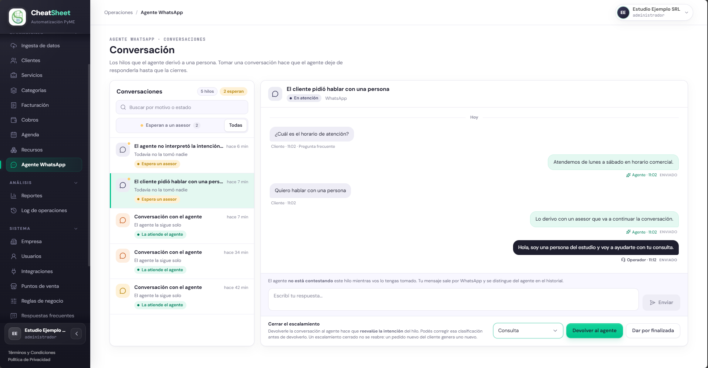

#### Mensajes y errores frecuentes

| Mensaje | Qué significa | Qué hacer |
|---|---|---|
| «Un escalamiento cerrado no se reabre. Un nuevo pedido del cliente genera uno nuevo.» | El escalamiento ya estaba cerrado, por ejemplo desde otra ventana | Actualizar el hilo |

### Administrar las respuestas frecuentes

HU-E9-04 — Administrar el repositorio de FAQ. Una respuesta frecuente es una pregunta y la respuesta que el agente envía tal cual, sin que ningún modelo la reescriba. Hoy el agente reconoce una pregunta solo cuando el mensaje del cliente es idéntico, letra por letra, a la «Pregunta disparadora»; si ninguna coincide, ofrece derivar con un asesor. La búsqueda por significado depende de un proveedor externo que todavía no está conectado.

El listado muestra «Pregunta», «Respuesta», «Estado» («Disponible» o «Todavía no buscable») y los usos «Este mes», «Mes anterior» y «Total», por mes calendario en hora de Argentina. Un uso se cuenta cuando el agente respondió con esa respuesta y el mensaje de WhatsApp salió. Las más usadas este mes van primero.

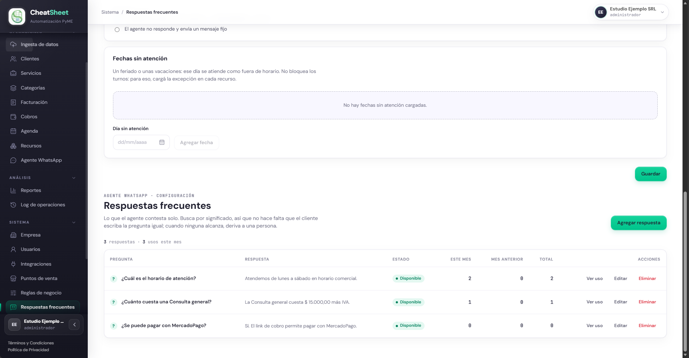

#### Paso a paso

1. Ingresar a «Menú › Sistema › Respuestas frecuentes». Arriba están las tarjetas del horario de atención; debajo, el encabezado «Respuestas frecuentes».
2. Pulsar «Agregar respuesta».
3. Completar «Pregunta disparadora» y «Respuesta».
4. Pulsar «Guardar». La respuesta aparece con los tres usos en cero y, normalmente, el estado «Disponible».
5. Para modificarla, pulsar «Editar» en su fila, cambiar los campos y pulsar «Guardar».
6. Para ver su uso, pulsar «Ver uso». La tarjeta «Uso de la respuesta» muestra los usos y la participación de la respuesta antes y después de su última edición (hasta 30 días a cada lado). Pulsar «Cerrar» para volver.
7. Para quitarla, pulsar «Eliminar» y confirmar con «Eliminar» en la ventana «Eliminar respuesta». El agente deja de usarla de inmediato. La eliminación no se deshace.

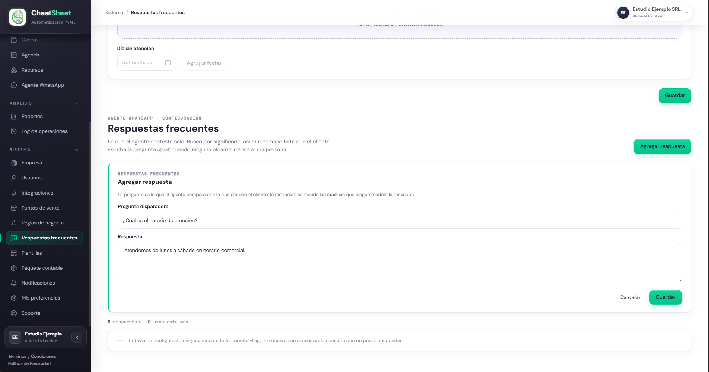

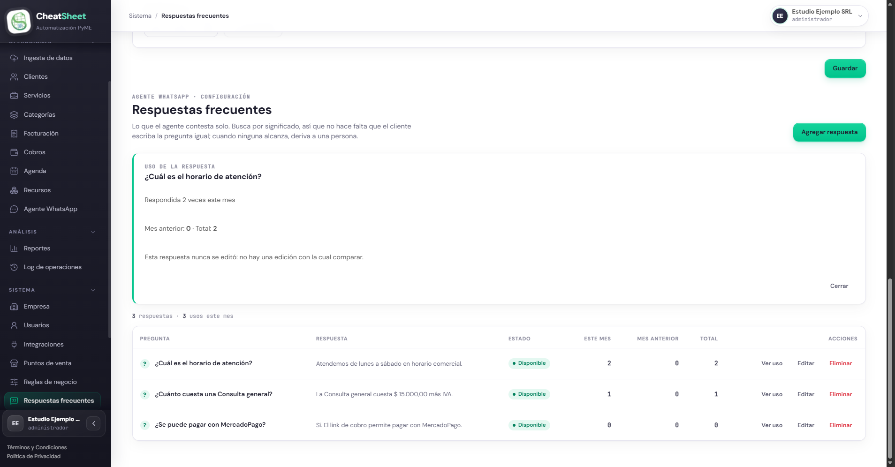

#### Mensajes y errores frecuentes

| Mensaje | Qué significa | Qué hacer |
|---|---|---|
| «La pregunta y la respuesta son obligatorias.» | Falta uno de los dos campos; «Guardar» permanece deshabilitado | Completar ambos campos |
| «Todavía no configuraste ninguna respuesta frecuente. El agente deriva a un asesor cada consulta que no puede responder.» | No hay respuestas cargadas | Pulsar «Agregar respuesta» |
| «Todavía no buscable» (estado) | La respuesta está guardada, pero el sistema no pudo indexarla | Esperar la próxima pasada del sistema; se puede editar mientras tanto |
| «Esta respuesta nunca se editó…», «Se editó hace menos de un día…» o «Se editó durante su primer día…» | En «Uso de la respuesta», todavía no hay con qué comparar la participación | Consultar de nuevo tras una edición con al menos un día de antigüedad |
| «Con tu rol podés leer las respuestas y cuánto se usan, pero no editarlas.» | El usuario no es Administrador | Pedir el cambio a un Administrador |

### Configurar el horario de atención

HS-T2 — Procesar un mensaje entrante recibido desde WhatsApp (RN-04). El horario de atención dice cuándo atiende una persona el canal de WhatsApp y qué hace el agente fuera de ese horario. Se configura arriba de «Respuestas frecuentes»; solo el Administrador lo cambia y los demás roles lo ven en modo lectura. Si nunca se configuró, la tarjeta dice «Sin horario configurado: el agente atiende y deriva a cualquier hora.».

El horario no es la disponibilidad de los recursos: no impide ni habilita reservar un turno. Para que un recurso no pueda reservarse un día, se carga su excepción en «Menú › Operaciones › Recursos» (MAN-70). Es fuera de horario todo lo que no cae dentro de una franja: la noche, un día en «Cerrado», el hueco entre dos franjas y una fecha sin atención. Se mide en hora de Argentina (ART, GMT-3) y el fin de cada franja es exclusivo.

| Política | Qué hace el agente fuera de horario |
|---|---|
| «El agente responde igual (avisa desde cuándo atiende un asesor)» | Sigue atendiendo como de día; si deriva, el aviso agrega «Ahora estamos fuera del horario de atención: un asesor te va a responder a partir de…». La conversación escalada aparece en «Esperan a un asesor» |
| «El agente no responde y envía un mensaje fijo» | No interpreta el mensaje y no deriva a una persona: envía un solo mensaje por período de cierre («Hola, gracias por escribirnos. En este momento estamos fuera del horario de atención. Atendemos de nuevo…»). El hilo figura en «Todas», no en «Esperan a un asesor». Si el cliente contesta una oferta hecha antes del cierre, se atiende y el mensaje termina avisando que el negocio está fuera de horario |

Los textos son fijos del sistema; la empresa no puede editarlos.

#### Paso a paso

1. Ingresar a «Menú › Sistema › Respuestas frecuentes». La tarjeta «Horarios de atención» está arriba.
2. Para cada día, tildar el día y completar «Desde» y «Hasta». Para un horario cortado, pulsar «Agregar franja»; para atender hasta el final del día, tildar «Hasta la medianoche». «Quitar» elimina una franja y, con la última, el día queda en «Cerrado».
3. En «Fuera de horario», elegir una de las dos políticas.
4. En la tarjeta «Fechas sin atención», elegir una fecha en «Día sin atención» (un feriado o unas vacaciones) y pulsar «Agregar fecha». Ese día se atiende como fuera de horario. «Quitar» elimina una fecha. El tope es de 200 fechas y no hay calendario automático de feriados.
5. Pulsar «Guardar». Aparece «Horario guardado.».

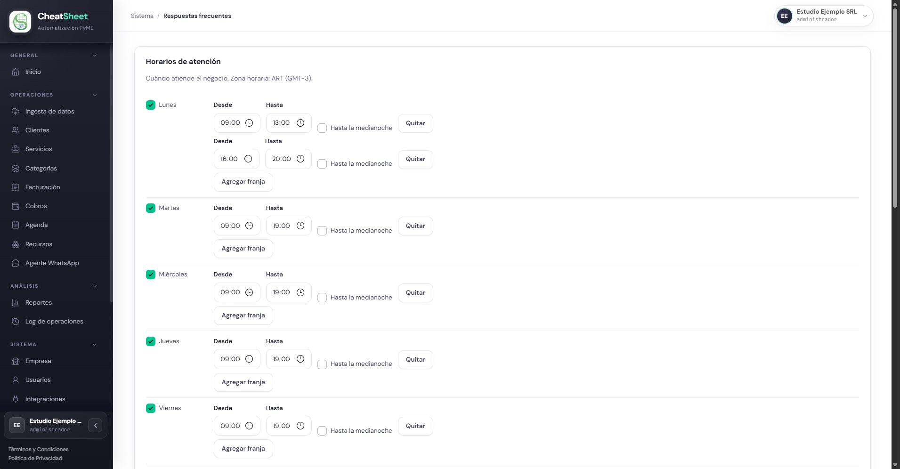

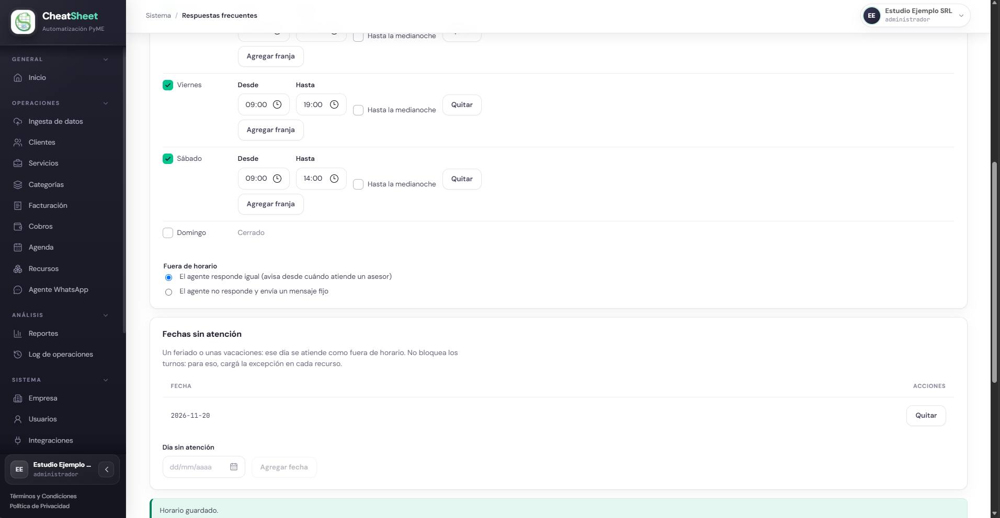

El horario es una regla de negocio llamada «Horario de atención». Para volver al comportamiento sin horario, pulsar «Desactivar» en su fila de «Menú › Sistema › Reglas de negocio» (MAN-60); guardar el horario de nuevo la reactiva.

#### Mensajes y errores frecuentes

| Mensaje | Qué significa | Qué hacer |
|---|---|---|
| «La hora de cierre debe ser posterior a la de apertura.» | Una franja termina antes de empezar | Corregir «Desde» y «Hasta» |
| «Las franjas de un mismo día no pueden superponerse ni tocarse.» | Dos franjas se pisan o una termina cuando empieza la otra | Unirlas o separarlas |
| «Indicá al menos un día con horario de atención.» | Todos los días están en «Cerrado» | Tildar al menos un día |
| «Esa fecha ya está cargada.» | La fecha sin atención ya existe | Elegir otra fecha |
| «Este horario está desactivado en las reglas de negocio: el agente atiende y deriva a cualquier hora. Guardar lo vuelve a activar.» | La regla «Horario de atención» está desactivada | Pulsar «Guardar» para reactivarla |

### Administrar las plantillas de notificación

HU-E11-02 — Administrar las plantillas de notificación. Una plantilla es el texto de un mensaje automático que el sistema envía a los clientes por WhatsApp. Las seis plantillas las define el sistema: no se agregan ni se eliminan, solo se edita su texto, que admite variables entre llaves dobles que el sistema reemplaza al enviar. Cada tarjeta muestra el nombre del mensaje, su texto y su estado de aprobación; arriba figuran «N plantillas · N esperan la aprobación de Meta» y el canal y el idioma de todas.

| Plantilla | Cuándo se envía | Variables disponibles |
|---|---|---|
| «Link de pago generado» | Ningún envío del sistema usa hoy esta plantilla | `{{concepto}}`, `{{link}}`, `{{monto}}`, `{{nombre}}` |
| «Recordatorio de cobro» | Recordatorio de un cobro pendiente (MAN-60) | `{{concepto}}`, `{{link}}`, `{{monto}}`, `{{nombre}}`, `{{vencimiento}}` |
| «Recordatorio de turno» | Recordatorio automático según la regla «Agenda de notificaciones» (MAN-60) | `{{fecha}}`, `{{hora}}`, `{{nombre}}`, `{{servicio}}` |
| «Cancelación de turno» | Aviso al cancelar un turno desde el panel | `{{fecha}}`, `{{hora}}`, `{{nombre}}`, `{{servicio}}` |
| «Confirmación de turno» | Aviso al reservar un turno desde el panel | `{{fecha}}`, `{{hora}}`, `{{nombre}}`, `{{recurso}}`, `{{servicio}}` |
| «Reprogramación de turno» | Aviso al reprogramar un turno | `{{fecha}}`, `{{fecha_anterior}}`, `{{hora}}`, `{{hora_anterior}}`, `{{nombre}}`, `{{servicio}}` |

WhatsApp exige que Meta apruebe una plantilla antes de enviarla fuera de las 24 horas de una conversación. Mientras no esté «Aprobada», el sistema envía el texto de fábrica del mensaje, que Meta no entrega fuera de ese plazo. Los mensajes del propio agente no son plantillas.

| Estado | Qué significa |
|---|---|
| «Sin enviar a Meta» | Meta no la tiene aceptada: nunca se envió, la última creación fue refutada, Meta la eliminó o WhatsApp no está conectado. Se envía con «Enviar a revisión» |
| «En revisión de Meta» | Meta la está revisando; el texto no se edita hasta que responda |
| «Aprobada» | Meta la aprobó y el sistema la usa. Se puede editar una vez cada 24 horas |
| «Rechazada» | Meta la rechazó; debajo figuran el motivo y el texto de Meta. Se corrige el texto o se pulsa «Enviar a revisión» |
| «Pausada por Meta» | Meta la pausó; mientras tanto se envía el texto de fábrica |
| «Deshabilitada por Meta» | Meta la deshabilitó; al editar su texto se vuelve a crear en Meta |
| «No requiere aprobación» | Plantilla de un canal sin aprobación; las seis actuales son de WhatsApp |

Si los recordatorios de turno están activos, WhatsApp está conectado y «Recordatorio de turno» no está «Aprobada», aparece el aviso «Los recordatorios de turno pueden no llegar».

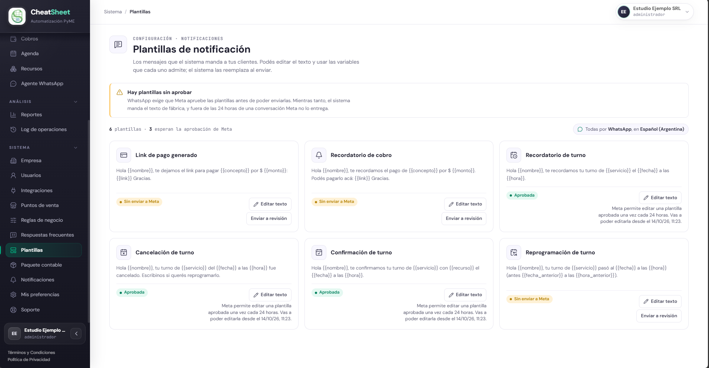

#### Paso a paso

1. Ingresar a «Menú › Sistema › Plantillas».
2. Pulsar «Editar texto» en la tarjeta de la plantilla. Si el botón está deshabilitado, la tarjeta explica el motivo: está en revisión o fue aprobada hace menos de 24 horas.
3. Modificar el «Texto del mensaje». Para insertar una variable, pulsarla en «Variables disponibles»: se inserta donde está el cursor.
4. Pulsar «Guardar». El texto se envía a Meta antes de guardarse; si Meta lo rechaza, no se guarda nada y el panel muestra el motivo.
5. Para enviar a Meta una plantilla «Sin enviar a Meta» o «Rechazada» sin cambiar su texto, pulsar «Enviar a revisión».
6. Recargar la pantalla para ver el estado: cambia cuando Meta responde.

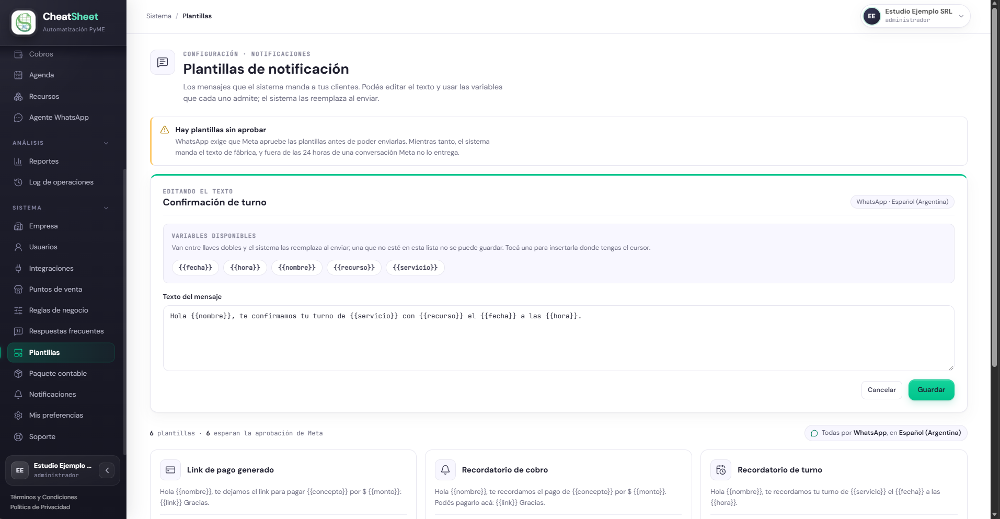

#### Mensajes y errores frecuentes

| Mensaje | Qué significa | Qué hacer |
|---|---|---|
| «La variable indicada no es válida para esta plantilla.» | El texto usa una variable que la plantilla no admite; «Guardar» permanece deshabilitado | Quitarla o usar una de «Variables disponibles» |
| «Meta no acepta una plantilla que empiece o termine con una variable.» | El texto empieza o termina con una variable | Agregar texto antes de la primera variable y después de la última |
| «Meta permite editar una plantilla aprobada una vez cada 24 horas. Vas a poder editarla desde el …» | La plantilla se aprobó hace menos de 24 horas | Editarla desde la fecha y hora indicadas |
| «Meta no respondió. No se guardó nada: volvé a intentarlo en un rato.» | Meta no contestó | Repetir más tarde |
| «Meta la clasificó como Marketing: los clientes que se dieron de baja de marketing no la reciben.» | Meta asignó la categoría Marketing | Tenerlo en cuenta: esos clientes no reciben el mensaje |
| «Hay plantillas sin aprobar» | Alguna plantilla no está «Aprobada» | Enviar a revisión las «Sin enviar a Meta» o «Rechazada»; las «En revisión de Meta» esperan su respuesta |
