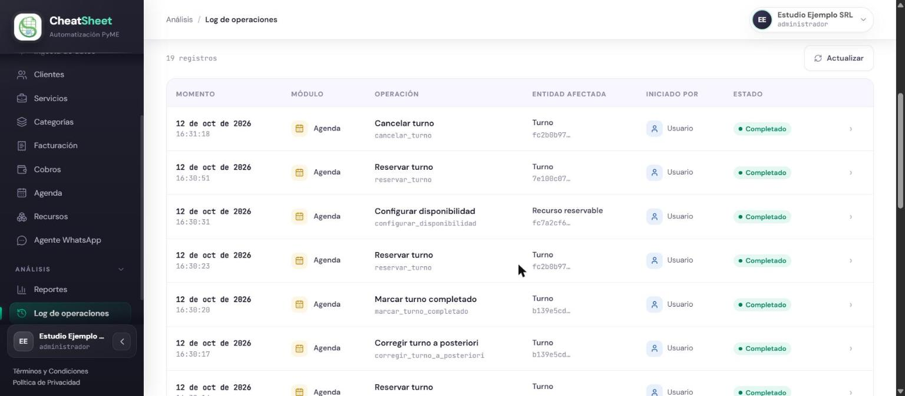
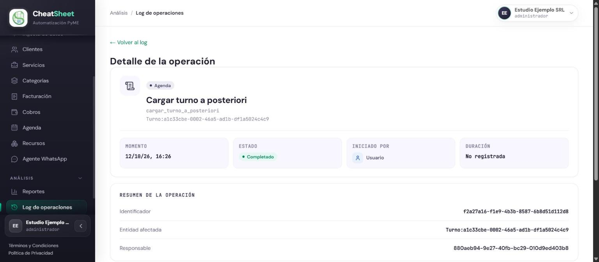
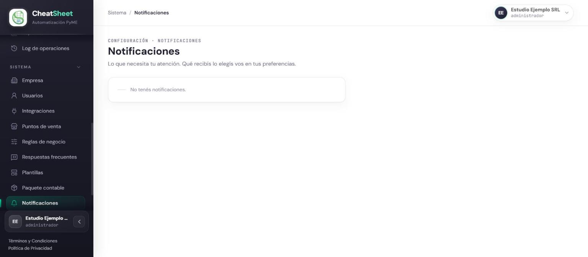
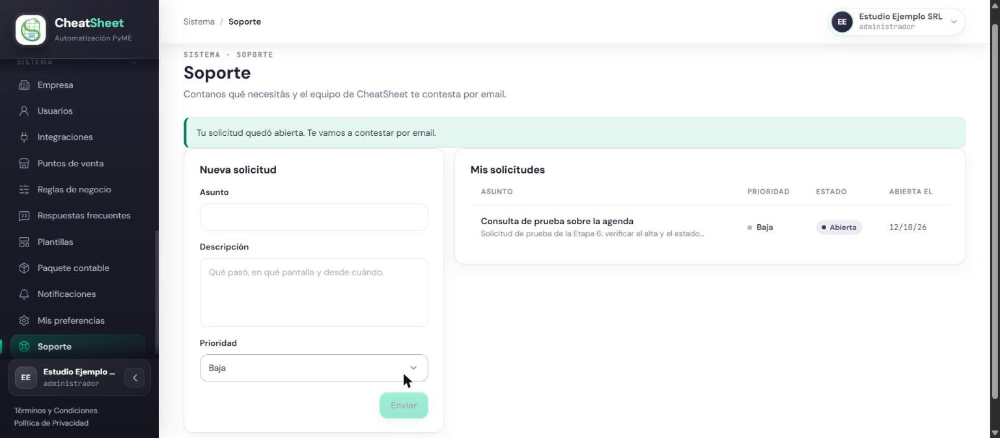

## Bitácora, notificaciones y soporte

### Para qué sirve

La bitácora («Log de operaciones») registra todo lo que el sistema ejecuta en nombre de la
empresa: cada operación con su momento, su módulo, la entidad que afectó, quién la puso en marcha
(una persona, un proceso automático o el agente de WhatsApp) y su resultado. Sus registros no se
pueden editar ni borrar. El centro de notificaciones avisa a cada usuario de los eventos que
requieren su atención, y Soporte permite pedir ayuda al equipo de CheatSheet.

### Quién puede usarla

| Funcionalidad | Administrador | Operador | Solo Lectura |
|---|---|---|---|
| Log de operaciones y su detalle | Sí | Sí | No |
| Notificaciones | Sí, las propias | Sí, las propias | Sí, las propias |
| Abrir una solicitud de soporte | Sí | No | No |
| Consultar las solicitudes de soporte | Sí | Solo consulta | Solo consulta |

### Cómo llegar

- «Menú › Análisis › Log de operaciones» para la bitácora.
- «Menú › Sistema › Notificaciones» para el centro de notificaciones.
- «Menú › Sistema › Soporte» para las solicitudes de soporte.

### Consultar la bitácora de operaciones

HU-E12-01 — Ver la bitácora de operaciones. El listado muestra las operaciones más recientes
primero, con «Momento», «Módulo», «Operación», «Entidad afectada», «Iniciado por» y «Estado». Los
indicadores de arriba resumen cuántas hay en total, cuántas se completaron, cuántas terminaron con
error y cuántas ejecutó el agente de IA.

#### Paso a paso

1. Ingresar a «Menú › Análisis › Log de operaciones».
2. En «Filtros», completar «Desde» y «Hasta» para acotar el período.
3. Elegir el «Módulo», el «Estado» (Completado o Error) y el «Iniciador» (Usuario, Sistema o Agente IA).
4. Escribir en «Buscar» una operación, una entidad afectada o un CAE.
5. Hacer clic en «Limpiar filtros» para volver al listado completo, o en «Actualizar» para traer las operaciones nuevas.
6. Hacer clic en una fila para abrir el detalle de la operación.

#### Mensajes y errores frecuentes

| Mensaje | Qué significa | Qué hacer |
|---|---|---|
| «No hay operaciones para los filtros seleccionados.» | Ninguna operación coincide con los filtros | Ampliar el período o hacer clic en «Limpiar filtros» |
| «El rol Solo Lectura no accede a la bitácora de operaciones» | El usuario tiene el rol Solo Lectura | Pedir a un Administrador la información necesaria |
| «No se pudo consultar la bitácora.» | La consulta falló | Hacer clic en «Actualizar»; si persiste, abrir una solicitud de soporte |

### Ver el detalle de una operación

HU-E12-02 — Ver el detalle de una operación individual. El detalle muestra el «Momento», el
«Estado», quién la inició y la «Duración»; el «Resumen de la operación» con su «Identificador», la
«Entidad afectada» y el «Responsable»; los datos que la operación guardó de sí misma; y el
«Timeline de ejecución» con sus pasos internos en orden. En una operación de facturación incluye
los datos del comprobante y la respuesta de ARCA; en una operación con error, el motivo y el paso
donde ocurrió.

#### Paso a paso

1. En el Log de operaciones, hacer clic en la fila de la operación.
2. Revisar el resumen, los datos registrados y el timeline.
3. Hacer clic en «Volver al log» para regresar al listado.

#### Mensajes y errores frecuentes

| Mensaje | Qué significa | Qué hacer |
|---|---|---|
| «Esta operación no registró datos adicionales.» | La operación no guardó datos de entrada ni de salida | Ninguna acción; el resumen y el timeline siguen disponibles |
| «No registrada» (en «Duración») | La operación no informó cuánto tardó | Ninguna acción |
| «Sin usuario: la ejecutó la plataforma» | La operación la inició un proceso automático | Ninguna acción |

### Consultar las notificaciones

HU-E11-03 — Consultar el centro de notificaciones del panel. Cada usuario ve solo sus
notificaciones, con su categoría, su severidad y si ya las leyó. Las de severidad alta se destacan
con «Requiere atención» hasta que se leen. Qué categorías recibe cada usuario se elige en «Mis
preferencias».

#### Paso a paso

1. Ingresar a «Menú › Sistema › Notificaciones».
2. Leer el aviso y su fecha.
3. Hacer clic en «Marcar como leída». La notificación pasa a «Leída» y deja de destacarse.

#### Mensajes y errores frecuentes

| Mensaje | Qué significa | Qué hacer |
|---|---|---|
| «No tenés notificaciones.» | No hay avisos para el usuario | Ninguna acción |
| «No se pudo marcar la notificación como leída.» | La acción falló | Volver a intentarlo |

### Abrir una solicitud de soporte

HU-E9-03 — Abrir una solicitud de soporte a CheatSheet. El Administrador describe el problema y
elige una prioridad; la solicitud queda Abierta hasta que el equipo de CheatSheet la atiende y la
cierra, y la respuesta llega por email.

#### Paso a paso

1. Ingresar a «Menú › Sistema › Soporte».
2. En «Nueva solicitud», completar «Asunto».
3. Completar «Descripción»: qué pasó, en qué pantalla y desde cuándo.
4. Elegir la «Prioridad»: Baja, Media o Alta.
5. Hacer clic en «Enviar».
6. Verificar el mensaje «Tu solicitud quedó abierta. Te vamos a contestar por email.» y la solicitud en «Mis solicitudes», con su estado.

#### Mensajes y errores frecuentes

| Mensaje | Qué significa | Qué hacer |
|---|---|---|
| «Enviar» deshabilitado | Falta el asunto o la descripción, que son obligatorios | Completar los dos campos |
| «No se pudo abrir la solicitud.» | El envío falló | Volver a intentarlo |
| «Todavía no abriste ninguna solicitud.» | La empresa no tiene solicitudes | Ninguna acción |
