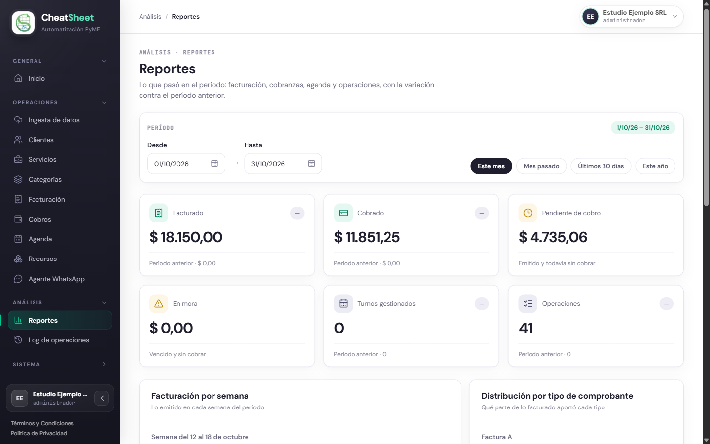
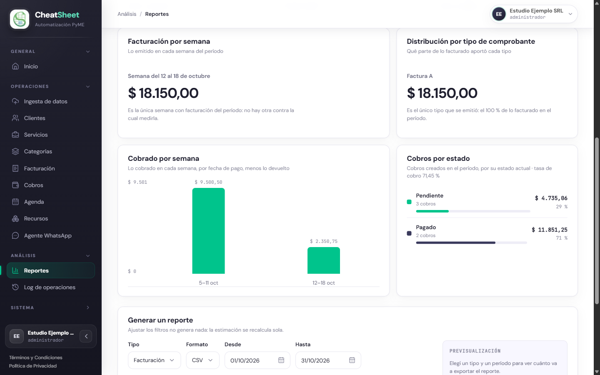
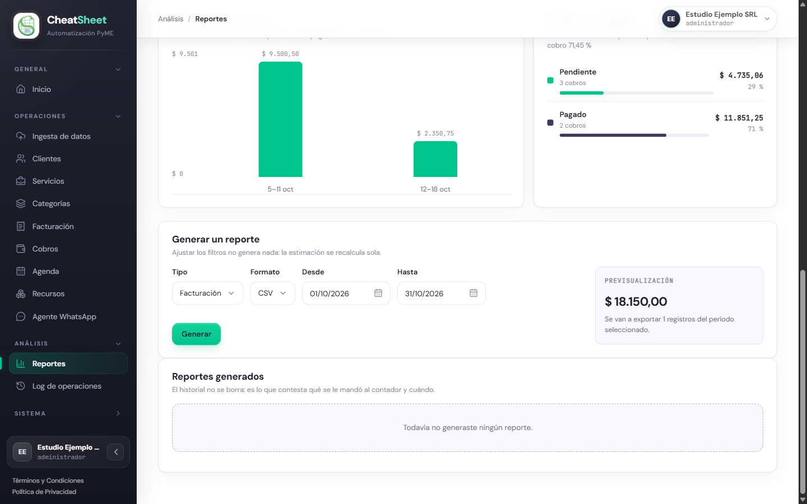
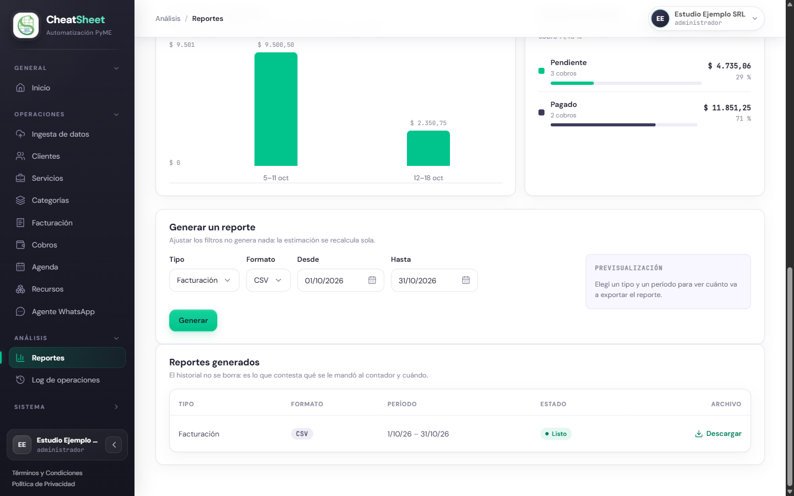
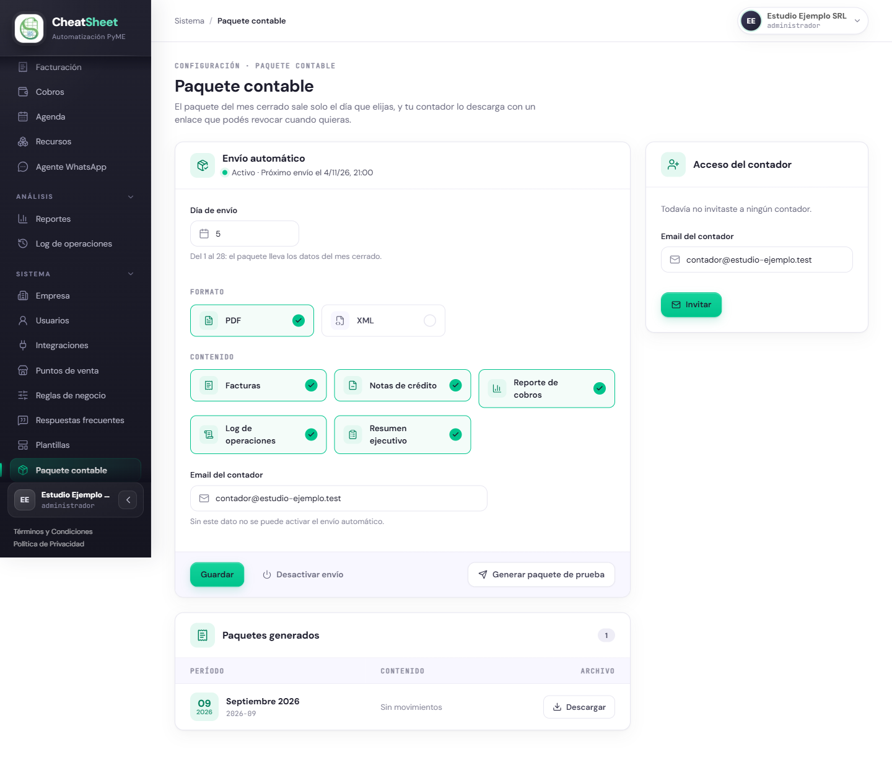
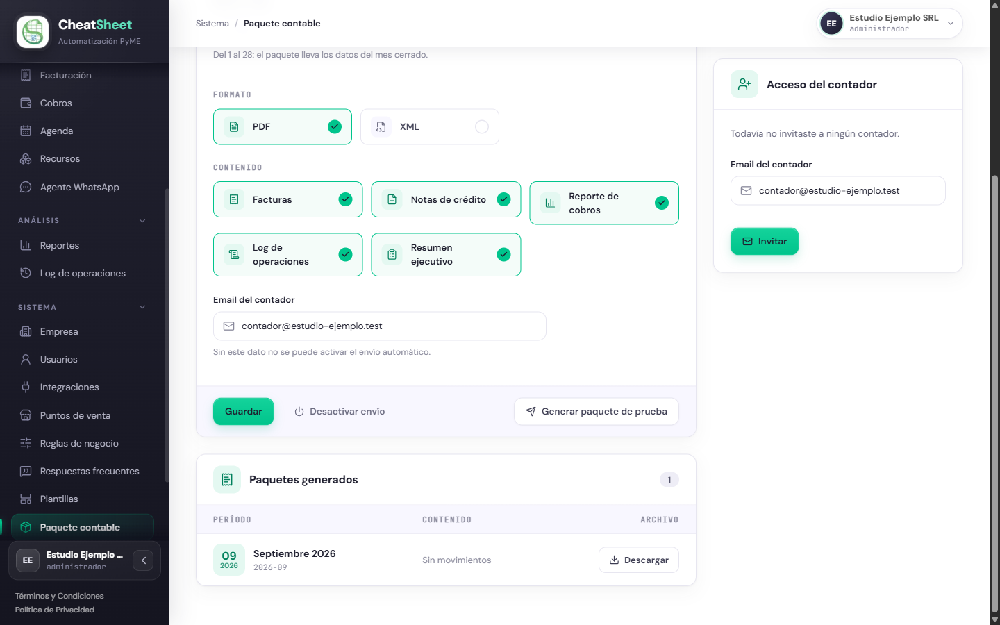

## Reportes

### Para qué sirve

Los módulos Tablero e Indicadores y Reportería y Paquete Contable muestran cómo le fue a la empresa
en un período y entregan esa información fuera del panel. El tablero reúne lo facturado, lo
cobrado, lo pendiente, los turnos y las operaciones, con la variación contra el período anterior.
Los reportes exportan esos datos a un archivo descargable, y el paquete contable reúne cada mes la
documentación fiscal para el contador de la empresa, que la descarga con un enlace de acceso
limitado, sin cuenta en el sistema.

Ninguna cifra se calcula en el navegador: llegan calculadas del servidor, de modo que el tablero,
el reporte y el paquete del mismo período muestran los mismos importes. Lo cobrado se mide por
fecha de pago, y los reembolsos restan en el período en que se devolvió el dinero.

### Quién puede usarla

| Funcionalidad | Administrador | Operador | Solo Lectura |
|---|---|---|---|
| Tablero de Reportes y resumen de Inicio | Consulta | Consulta | Consulta |
| Previsualizar y generar reportes | Sí | Sí | No: el bloque «Generar un reporte» no aparece |
| Historial y descarga de reportes | Sí | Sí | No: la sección «Reportes generados» aparece vacía |
| Configurar el envío automático y generar un paquete de prueba | Sí | No: ve la configuración con los controles deshabilitados | No: ve la configuración con los controles deshabilitados |
| Descargar paquetes generados | Sí | Sí | Sí |
| Invitar al contador y revocar su acceso | Sí | No: solo ve el estado del acceso | No: solo ve el estado del acceso |

El servidor aplica las mismas restricciones aunque la acción se pida sin pasar por el panel.

### Cómo llegar

- «Menú › Análisis › Reportes» para el tablero, la previsualización, la generación y el
  historial de reportes.
- «Menú › General › Inicio» para el resumen del período, con el enlace «Ver reportes».
- «Menú › Sistema › Paquete contable» para el envío automático y el acceso del contador. La
  sección «Sistema» aparece cerrada al ingresar: se abre con un clic sobre su título.

### Consultar el tablero de indicadores

HU-E10-01 — Visualizar los indicadores (KPIs) del tablero. Al ingresar, el tablero muestra el mes
en curso. El encabezado tiene seis cifras: «Facturado», «Cobrado», «Pendiente de cobro», «En
mora», «Turnos gestionados» y «Operaciones». Las de flujo muestran debajo el valor del «Período
anterior» y una flecha con la variación porcentual; un guion («—») indica que el período anterior
fue cero y no hay con qué comparar. «Pendiente de cobro» y «En mora» son saldos a la fecha y no
llevan variación.

Debajo, cuatro gráficos siguen el mismo período: «Facturación por semana», «Distribución por tipo
de comprobante», «Cobrado por semana» y «Cobros por estado». Este último agrupa los cobros creados
en el período según su estado actual e indica en el subtítulo la tasa de cobro.

#### Paso a paso

1. Ingresar a «Menú › Análisis › Reportes».
2. En «Período», elegir un atajo: «Este mes», «Mes pasado», «Últimos 30 días» o «Este año».
3. Para un rango propio, completar «Desde» y «Hasta» (por ejemplo, 01/09/2026 y 30/09/2026).
4. Verificar a la derecha de «Período» el rango que el tablero está mostrando.
5. Revisar las seis cifras del encabezado y su variación.
6. Revisar los cuatro gráficos.

Inicio muestra el mismo período con el mismo selector, y en «Cobros del período» las cifras
«Cobrado», «Pendiente de cobro», «En mora» y «Tasa de cobro», idénticas a las de Reportes. En
Inicio el período elegido queda en la dirección de la página y se conserva al recargar.

#### Mensajes y errores frecuentes

| Mensaje | Qué significa | Qué hacer |
|---|---|---|
| «No hay actividad registrada para este período.» | En el período no hay comprobantes, cobros, turnos ni operaciones; las cifras se muestran en cero | Elegir otro período |
| «No hubo facturación en este período.» / «No hubo cobros en este período.» | El gráfico no tiene datos para el período | Ninguna acción: es informativo |
| «Es la única semana con facturación del período: no hay otra contra la cual medirla.» | Hay un solo dato y se muestra el importe en lugar de una barra | Ninguna acción: es informativo |
| «No se pudo actualizar el tablero.» | El panel no pudo consultar el servidor | Volver a elegir el período |

### Previsualizar un reporte

HU-E10-02 — Previsualizar un reporte antes de generarlo. La previsualización estima cuántos
registros y qué importe va a exportar el reporte, sin generar ningún archivo ni dejar rastro en el
historial; se puede ajustar cuantas veces haga falta.

#### Paso a paso

1. Ingresar a «Menú › Análisis › Reportes» y bajar hasta «Generar un reporte».
2. En «Tipo», elegir «Facturación», «Cobros», «Operaciones» o «Resumen ejecutivo».
3. Completar «Desde» y «Hasta» con el período del reporte.
4. Leer el recuadro «Previsualización»: muestra el total y el texto «Se van a exportar … registros
   del período seleccionado.».
5. Cambiar el tipo o el período hasta que la estimación sea la esperada; el recuadro se actualiza
   solo.

#### Mensajes y errores frecuentes

| Mensaje | Qué significa | Qué hacer |
|---|---|---|
| «Elegí un tipo y un período para ver cuánto va a exportar el reporte.» | Todavía no se cambió ningún filtro | Elegir el tipo o el período |
| «El período seleccionado no tiene datos para este tipo de reporte.» | No hay registros de ese tipo en el período | Cambiar el período o el tipo |
| «No se pudo previsualizar el reporte.» | El panel no pudo consultar el servidor | Volver a cambiar el filtro |

### Generar y descargar un reporte

HU-E10-03 — Generar y descargar un reporte en el formato deseado. El formato disponible depende
del tipo: «Facturación» en CSV o XML, «Cobros» y «Operaciones» en CSV, y «Resumen ejecutivo» en PDF.
El CSV usa punto y coma como separador para abrirse correctamente en una planilla de cálculo en
español. Cada reporte queda en el historial con su tipo, formato, período y estado; el historial
no se borra.

#### Paso a paso

1. En «Generar un reporte», elegir «Tipo», «Desde» y «Hasta», y revisar la previsualización.
2. En «Formato», elegir el formato del archivo.
3. Hacer clic en «Generar».
4. En «Reportes generados», verificar la nueva fila con el estado «Listo».
5. Hacer clic en «Descargar» en esa fila para bajar el archivo.

Los estados del historial son «Pendiente», «En curso», «Listo» y «Fallido». Solo un reporte
«Listo» tiene enlace de descarga; los demás muestran un guion. Un reporte «Fallido» no se
reintenta: se genera uno nuevo y la fila fallida queda como evidencia.

#### Mensajes y errores frecuentes

| Mensaje | Qué significa | Qué hacer |
|---|---|---|
| «No hay datos para generar el reporte en el período seleccionado.» | El período no tiene registros de ese tipo; no se crea ningún reporte | Cambiar el período o el tipo |
| «No se pudo generar el archivo del reporte» | El archivo no se pudo guardar; el reporte queda «Fallido» | Volver a hacer clic en «Generar» más tarde |
| «No se pudo generar el reporte.» | El panel no recibió la respuesta del servidor | Revisar el historial antes de volver a generar |
| «Todavía no generaste ningún reporte.» | El historial está vacío | Generar el primer reporte |

### Configurar el paquete contable mensual

HU-E10-04 — Generar el paquete contable mensual. Con el envío automático activo, el sistema arma
el día elegido un archivo comprimido con la documentación del mes cerrado, que queda en
«Paquetes generados» para el panel y para el contador. Un mes tiene un solo paquete: generarlo de
nuevo lo reemplaza. Un mes sin movimientos también genera su paquete, con los totales en cero.

#### Paso a paso

1. Ingresar a «Menú › Sistema › Paquete contable».
2. En «Envío automático», completar «Día de envío» con un número del 1 al 28 (por ejemplo, `5`).
3. En «Formato», marcar «PDF», «XML» o ambos.
4. En «Contenido», marcar lo que lleva el paquete: «Facturas», «Notas de crédito», «Reporte de
   cobros», «Log de operaciones» y «Resumen ejecutivo».
5. Completar «Email del contador».
6. Hacer clic en «Guardar» y esperar el mensaje «Configuración guardada.».
7. Hacer clic en «Activar envío» y verificar el estado «Activo · Próximo envío el …».
8. Para probarlo, hacer clic en «Generar paquete de prueba» y esperar el mensaje «El paquete quedó
   disponible para descargar.».
9. En «Paquetes generados», hacer clic en «Descargar» en la fila del mes.

Cada fila de «Paquetes generados» muestra el mes, el código del período (por ejemplo, `2026-09`) y
la cantidad de documentos por contenido, o «Sin movimientos». Si un contenido no existe en el
formato elegido, sale en el suyo: el reporte de cobros siempre va en CSV y el resumen ejecutivo en
PDF. Para dejar de enviar, hacer clic en «Desactivar envío».

#### Mensajes y errores frecuentes

| Mensaje | Qué significa | Qué hacer |
|---|---|---|
| «Debe indicar el email del contador para activar el envío automático.» | Se intentó activar el envío sin el email del contador | Completar «Email del contador», hacer clic en «Guardar» y luego en «Activar envío» |
| «Ingrese un email válido.» | El email no tiene un formato válido | Corregir el email y volver a guardar |
| «El día de envío va del 1 al 28» | El día está fuera del rango permitido | Elegir un día entre 1 y 28 |
| «El paquete necesita al menos un formato» | No hay ningún formato marcado | Marcar «PDF», «XML» o ambos |
| «No se pudo generar el paquete contable» | El archivo no se pudo guardar | Volver a hacer clic en «Generar paquete de prueba» más tarde |
| «Todavía no hay ningún paquete contable.» | La empresa no generó ningún paquete | Generar uno con «Generar paquete de prueba» |

### Compartir el paquete contable con el contador

HU-E10-05 — Compartir el paquete contable con el contador mediante enlace. El sistema envía al
contador, por correo, un enlace de acceso limitado que vence a los 30 días. El enlace nunca se
muestra en el panel. Con él, el contador ve las cifras del período y descarga los paquetes
contables; no accede a facturación, cobros, configuración ni datos de clientes. La empresa tiene
un solo contador con acceso a la vez.

#### Paso a paso

1. Ingresar a «Menú › Sistema › Paquete contable».
2. Verificar que «Paquetes generados» tenga al menos un paquete; si no, generar uno.
3. En «Acceso del contador», completar «Email del contador».
4. Hacer clic en «Invitar» y esperar el mensaje «Le mandamos el enlace de acceso al contador.».
5. Verificar que el contador figure como «Invitado con acceso limitado», con «El enlace vence» y
   «Accesos registrados».
6. Para quitarle el acceso, hacer clic en «Revocar acceso» y aceptar el aviso «El enlace deja de
   funcionar de inmediato. ¿Revocar el acceso?».
7. Verificar el mensaje «El enlace quedó invalidado.».

Después de revocar, o cuando el enlace vence, el contador que lo abre ve solo «El acceso a este
paquete ya no está disponible.». Para invitar a otro contador, primero se revoca el acceso actual.

#### Mensajes y errores frecuentes

| Mensaje | Qué significa | Qué hacer |
|---|---|---|
| «Ingrese un email válido.» | El email no tiene un formato válido; no se envía la invitación | Corregir el email y hacer clic en «Invitar» |
| «Todavía no hay ningún paquete contable para compartir. Generá uno primero.» | La empresa no tiene paquetes generados | Hacer clic en «Generar paquete de prueba» y volver a invitar |
| «Ya hay un contador con acceso. Revocá el acceso actual antes de invitar a otro.» | Ya existe un enlace vigente | Hacer clic en «Revocar acceso» e invitar al nuevo contador |
| «No se pudo enviar el correo al contador. Revisá el email e intentá de nuevo.» | El correo no salió y la invitación no se registró | Revisar el email y volver a hacer clic en «Invitar» |
