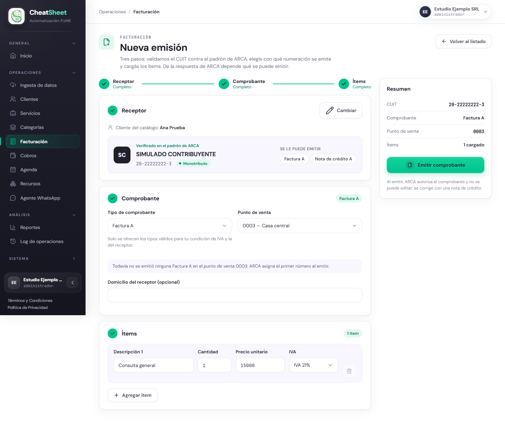

## PRU-01 — Emitir un comprobante y obtener su CAE

**Tipo:** Funcional

| Campo | Contenido |
|---|---|
| ID de prueba | PRU-01 |
| CU/HU referenciado | HU-E5-03 — Emitir un comprobante fiscal y obtener su CAE; HU-E5-02 — Consultar el estado y detalle de un comprobante |
| Pantalla / Reporte | PAN-FAC-03, PAN-FAC-02 |
| Datos de entrada | Empresa Estudio Ejemplo SRL, CUIT `30-00000001-5`, Responsable Inscripto, con la integración con ARCA en estado «Conectado» (delegada en CheatSheet, homologación). Usuario `admin3@estudio-ejemplo.test` con rol Administrador. Punto de venta 0003 «Casa central», activo. Cliente Ana Prueba, CUIT `20-22222222-3`, cargado en Datos Maestros. Ítem: descripción «Consulta general», cantidad 1, precio unitario 15000, IVA 21 %. Tipo de comprobante Factura A. Domicilio del receptor vacío |
| Pasos | 1. Ingresar a staging con `admin3@estudio-ejemplo.test`.   2. Ingresar a «Integraciones» (PAN-CFG-INT) y verificar que ARCA figura «Conectado» con «CUIT 30-00000001-5 · delegada en CheatSheet».   3. Ingresar a «Puntos de venta» (PAN-FAC-05), presionar «Agregar punto de venta», completar «Número» con 3 y «Descripción» con «Casa central», y verificar que queda «Activo».   4. Ingresar a «Clientes» (PAN-DM-01) y verificar que Ana Prueba existe con CUIT `20-22222222-3`.   5. Ingresar a «Facturación» (PAN-FAC-01) y presionar «Emitir comprobante».   6. En «¿A quién le facturás?», presionar «Facturar» en la fila de Ana Prueba.   7. En el paso «Receptor» (PAN-FAC-03), verificar «Cliente del catálogo: Ana Prueba» y la tarjeta «Verificado en el padrón de ARCA» con la condición y la lista «Se le puede emitir».   8. En el paso «Comprobante», revisar las opciones de «Tipo de comprobante», elegir «Factura A» y, en «Punto de venta», «0003 — Casa central».   9. Verificar el texto de numeración debajo de los selectores.   10. En el paso «Ítems», completar «Descripción 1» con «Consulta general», «Cantidad» con 1, «Precio unitario» con 15000 y dejar «IVA 21%».   11. En «Resumen», verificar CUIT `20-22222222-3`, «Factura A», punto de venta 0003 e «Ítems: 1 cargado».   12. Presionar «Emitir comprobante».   13. Verificar que el panel lleva al detalle del comprobante (PAN-FAC-02) con estado «Pendiente».   14. Recargar la página hasta que el estado cambie a «Autorizado».   15. Verificar en «Datos fiscales» el CAE de 14 dígitos y su vencimiento, y en «Ítems del comprobante» subtotal, IVA, total y la leyenda de la Ley Nº 27.618.   16. Presionar «Descargar PDF» y verificar que se obtiene el PDF del comprobante.   17. Ingresar a «Facturación» y verificar que el comprobante figura en el listado con estado «Autorizado». |
| Resultado esperado | HU-E5-03, precondiciones: sesión con rol Administrador u Operador; la empresa tiene ARCA conectado y un punto de venta configurado; el cliente receptor existe en Datos Maestros. Criterios de aceptación: «Ingreso un CUIT válido y existente» → «El sistema completa automáticamente razón social y condición IVA y habilita el resto del formulario». «Emisor Responsable Inscripto y receptor Monotributo» → «Solo se ofrece Factura A y se agrega la leyenda de RN-13». «Confirmo la emisión» → «El comprobante aparece en el listado con estado Pendiente mientras aguarda respuesta de ARCA». «ARCA autoriza el comprobante» → «El estado cambia a Autorizado, se muestra el CAE y su vencimiento, y queda disponible la descarga del PDF». RN-03: el comprobante tiene al menos un ítem con descripción, cantidad y precio unitario mayor a cero. RN-04: la emisión es asíncrona y el estado se actualiza cuando ARCA responde. RN-13: la Factura A a un receptor Monotributo incluye la leyenda «El crédito fiscal discriminado en el presente comprobante, sólo podrá ser computado a efectos del Régimen de Sostenimiento e Inclusión Fiscal para Pequeños Contribuyentes de la Ley Nº 27.618», en el detalle y en el PDF. HU-E5-02: «Abro un comprobante del listado» → «Veo el detalle completo con datos fiscales, CAE y vencimiento de CAE»; «El comprobante está Autorizado» → «El botón “Descargar PDF” está disponible». Con los datos de entrada, el comprobante autorizado tiene subtotal $ 15.000,00, IVA $ 3.150,00 y total $ 18.150,00 |
| Resultado obtenido | Ejecución del 13/10/2026 en staging. Paso 2: ARCA «Conectado», «CUIT 30-00000001-5 · delegada en CheatSheet · Homologación». Paso 3: el punto de venta 0003 «Casa central» queda «Activo» (Figura MAN-50-1). Paso 4: Ana Prueba existe con CUIT 20-22222222-3. Pasos 6 y 7: el receptor se verifica en el padrón como «SIMULADO CONTRIBUYENTE», Monotributo, y «Se le puede emitir» muestra «Factura A» y «Nota de crédito A». Paso 8: el selector ofrece «Factura A» y «Nota de crédito A» con «Elegí un tipo» por defecto (diferencia (1) de observaciones). Paso 9: «Todavía no se emitió ninguna Factura A en el punto de venta 0003: ARCA asigna el primer número al emitir.». Pasos 10 y 11: el «Resumen» queda completo, sin faltantes (Figura PRU-01-1). Pasos 12 a 14: el panel lleva al detalle de la Factura A 0003-00000002 con «Esperando la respuesta de ARCA» y estado «Pendiente»; al recargar, «Autorizado». Paso 15: CAE 86410988477094, vencimiento 23/10/26, receptor SIMULADO CONTRIBUYENTE Monotributo, subtotal $ 15.000,00, IVA $ 3.150,00, total $ 18.150,00 y la leyenda de la Ley Nº 27.618 (Figura PRU-01-2). Paso 16: «Descargar PDF» devuelve `0003-00000002.pdf` (application/pdf). Paso 17: el listado muestra la Factura A 00000002 «Autorizado» por $ 18.150,00 (Figura PRU-01-3). Todos los criterios verificables se cumplen; la diferencia (1) queda registrada como bug mayor |
| Estado | Aprobada |
| Evidencia | Figuras PRU-01-1 a PRU-01-3, tomadas en staging el 13/10/2026 sobre Estudio Ejemplo SRL (`30-00000001-5`). CAE 86410988477094 otorgado por ARCA homologación |

