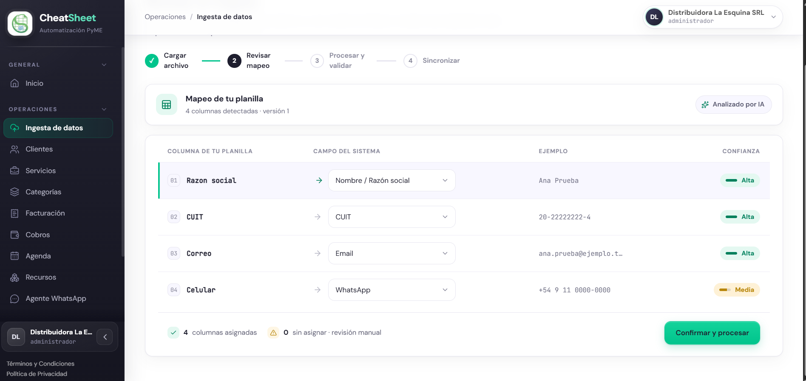
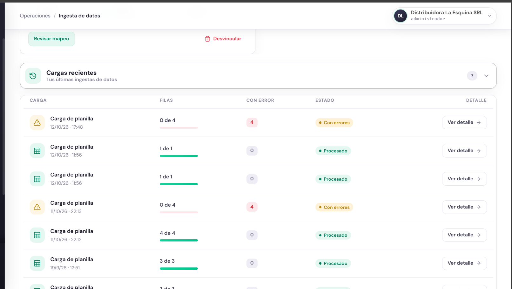
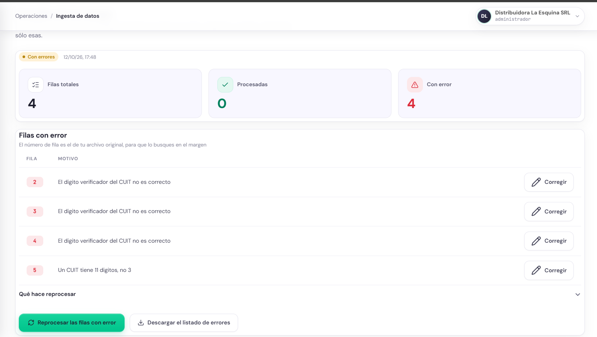
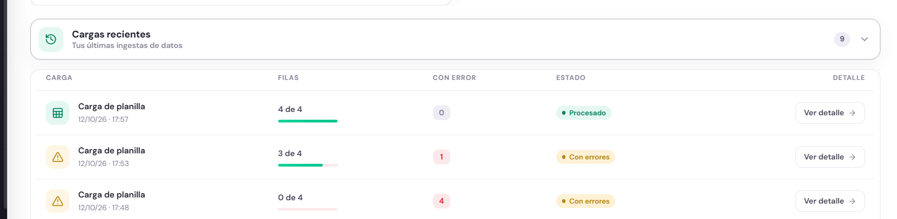
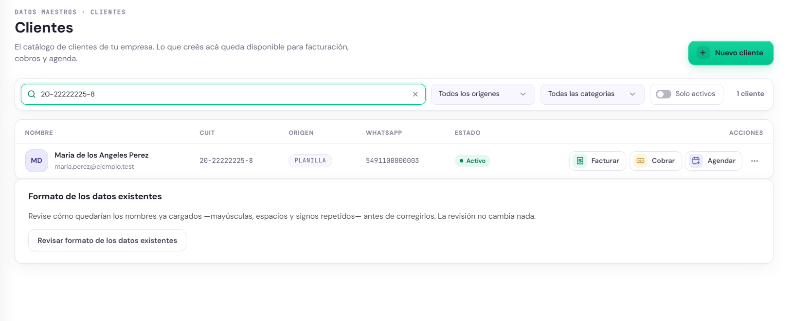
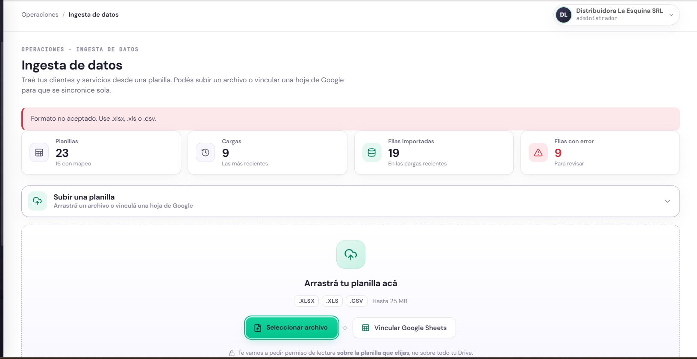
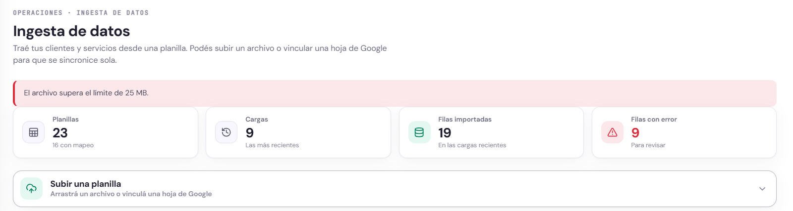

## PRU-03 — Procesar la carga inicial de una planilla

**Tipo:** Funcional

| Campo | Contenido |
|---|---|
| ID de prueba | PRU-03 |
| CU/HU referenciado | HU-E3-03 — Procesar la carga inicial de la planilla; HU-E3-02 — Confirmar o corregir el mapeo propuesto (precondición); HU-E4-05 — Normalización de los datos del catálogo (RN-04) |
| Pantalla / Reporte | PAN-ING-01, PAN-ING-02 |
| Datos de entrada | Empresa Distribuidora La Esquina SRL, CUIT `30-00000002-3`, sesión con rol Administrador. Planillas `.csv` con encabezado `Razon social,CUIT,Correo,Celular` y cuatro clientes: Ana Prueba, Bruno Ficticio, Carla Demo y «MARIA DE LOS ANGELES perez  », con WhatsApp `+54 9 11 0000-0000` a `+54 9 11 0000-0003`. Primera planilla: tres CUIT con el dígito verificador alterado (`20-22222222-4`, `20-22222223-2`, `20-22222224-0`) y uno con el valor `123`. Segunda planilla: CUIT `20-22222222-3`, `20-22222223-1`, `27-22222224-4` y `20-22222225-8`. Para los rechazos: un archivo `.pdf` y un `.csv` de 26,4 MB |
| Pasos | 1. Ingresar a staging con el usuario Administrador.   2. Abrir Ingesta de Datos (PAN-ING-01) y elegir Seleccionar archivo con la primera planilla.   3. Abrir Revisar mapeo (PAN-ING-02), verificar las columnas asignadas y elegir Confirmar y procesar y luego Procesar la planilla.   4. Verificar el estado de la carga en Cargas recientes.   5. Abrir Ver detalle y verificar las filas con error y el motivo de cada una.   6. Repetir los pasos 2 a 4 con la segunda planilla.   7. Abrir Clientes, buscar el CUIT `20-22222225-8` y verificar cómo quedó guardado el nombre.   8. Elegir Seleccionar archivo con el `.pdf` y verificar el mensaje.   9. Elegir Seleccionar archivo con el `.csv` de 26,4 MB y verificar el mensaje. |
| Resultado esperado | HU-E3-03: al confirmar, el sistema inicia el procesamiento asíncrono y muestra el archivo con estado «Procesando» (RN-01); si finaliza sin errores, el estado cambia a «Procesado» con el total de filas procesadas; con filas inválidas, el estado muestra «Con errores» con la cantidad de filas válidas y fallidas, sin abortar el resto (RN-02, RN-03); un formato no soportado muestra «Formato no aceptado. Use .xlsx, .xls o .csv.» y no inicia la carga; un archivo mayor al límite muestra «El archivo supera el límite de 25 MB.» y no inicia la carga; el nombre «MARIA DE LOS ANGELES perez  » se guarda normalizado y la planilla original queda intacta (RN-04) |
| Resultado obtenido | Corrida del 12/10/2026 en staging. Paso 3: el mapeo asistido asigna las cuatro columnas (tres con confianza Alta y Celular con Media) y queda «4 columnas asignadas · 0 sin asignar». Paso 4: la carga de las 17:48 aparece en Cargas recientes con «0 de 4», 4 con error y estado «Con errores»; el procesamiento termina antes de que la lista se actualice, por lo que el estado intermedio «Procesando» no llega a observarse. Paso 5: el detalle muestra 4 filas totales, 0 procesadas y 4 con error; filas 2 a 4 con «El digito verificador del CUIT no es correcto» y fila 5 con «Un CUIT tiene 11 digitos, no 3». Paso 6: un primer intento con el CUIT de Carla Demo de reglas.md §6 (`20-22222224-9`) da «Con errores», 3 de 4, con la fila de Carla rechazada por dígito verificador, lo que es correcto (ver observaciones); con `27-22222224-4`, la carga de las 17:57 termina «Procesado», 4 de 4, 0 con error. Paso 7: el cliente queda guardado como «Maria de los Angeles Perez», con origen PLANILLA y WhatsApp `5491100000003`. Paso 8: aparece «Formato no aceptado. Use .xlsx, .xls o .csv.» y el contador de planillas no cambia. Paso 9: aparece «El archivo supera el límite de 25 MB.» y el contador de planillas no cambia |
| Estado | Aprobada |
| Evidencia | Figuras PRU-03-1 a PRU-03-7 |

