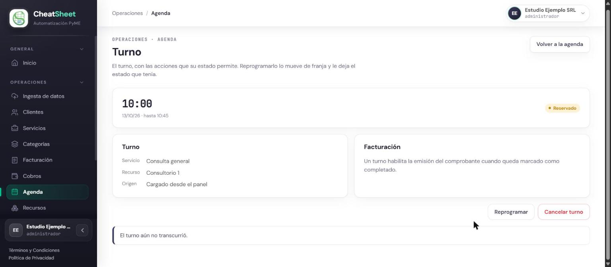
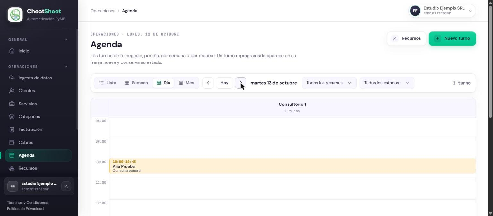
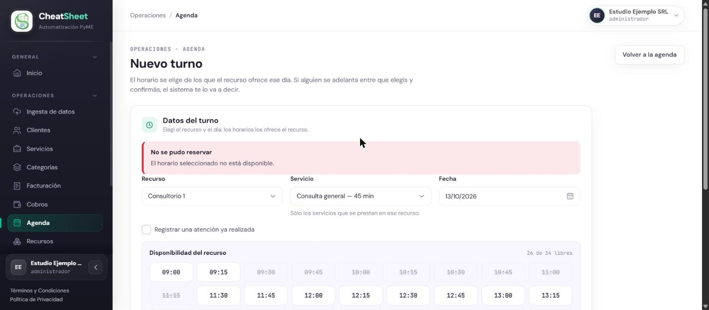

## PRU-04 — Crear un turno manualmente desde el panel

**Tipo:** Funcional

| Campo | Contenido |
|---|---|
| ID de prueba | PRU-04 |
| CU/HU referenciado | HU-E7-06 — Crear un turno manualmente desde el panel; HU-E7-01 — Ver la agenda de turnos desde el panel |
| Pantalla / Reporte | PAN-AGE-02, PAN-AGE-01, PAN-LOG-01 |
| Datos de entrada | Empresa Estudio Ejemplo SRL, CUIT `30-00000005-8`, Responsable Inscripto. Usuario `admin.gomez@estudio-ejemplo.test` con rol Administrador. Clientes Ana Prueba, CUIT `20-22222222-3`, WhatsApp `+54 9 11 0000-0000`, y Bruno Ficticio, CUIT `20-22222223-1`, sin WhatsApp. Servicio agendable «Consulta general», $ 15.000,00, IVA 21 %, duración estándar 45 minutos. Servicio agendable «Sesión de seguimiento», $ 9.500,00, IVA 21 %, 30 minutos, **no** asociado al recurso. Recurso «Consultorio 1», tipo espacio, activo, con «Consulta general» asociada, disponibilidad de lunes a viernes de 09:00 a 18:00, duración de slot 15 minutos, sin intervalo entre turnos. Turno del martes 13/10/2026 a las 10:00 |
| Pasos | 1. Ingresar a staging con `admin.gomez@estudio-ejemplo.test`.   2. Ingresar a Clientes y, en la fila de Ana Prueba, elegir «Agendar».   3. En Nuevo turno (PAN-AGE-02), elegir el recurso «Consultorio 1» y abrir el selector «Servicio»; verificar que ofrece «Consulta general — 45 min» y no ofrece «Sesión de seguimiento».   4. Elegir «Consulta general» y la fecha 13/10/2026; verificar que los horarios ofrecidos avanzan de a 15 minutos.   5. Elegir el horario 10:00, hacer clic en «Reservar turno» y verificar el estado, el origen y la franja del turno creado.   6. Ingresar a la Agenda (PAN-AGE-01), vista «Día», 13/10/2026, y verificar que el turno aparece.   7. Volver a Nuevo turno desde la fila de Bruno Ficticio, con el mismo recurso, servicio y fecha, y verificar que los horarios que se superponen con el turno de 10:00 figuran tachados.   8. Elegir el horario 10:45 y, antes de confirmar, reservar ese mismo horario desde otra sesión; hacer clic en «Reservar turno».   9. En Nuevo turno, elegir la fecha de hoy y verificar qué horarios se ofrecen; enviar a la API una reserva para hoy a una hora anterior a la actual.   10. Ingresar a Log de operaciones (PAN-LOG-01) y verificar el registro de la reserva con el usuario que la ejecutó. |
| Resultado esperado | HU-E7-06: «Creo un turno en una franja disponible — El turno queda Reservado con canal de reserva PANEL y aparece en la agenda»; «Selecciono un servicio no asociado al recurso — El sistema no ofrece ese servicio para ese recurso»; «Creo el turno para un cliente con WhatsApp registrado — El sistema crea el turno y envía la confirmación al cliente por WhatsApp»; «Intento crear un turno en una franja ocupada — El sistema muestra “El horario seleccionado no está disponible.” y no crea el turno»; «Creo un turno para hoy en una hora anterior a la actual — El sistema muestra “No se puede agendar un turno en un horario que ya pasó.” y no lo crea»; «Elijo un servicio agendable de 45 minutos — El turno se crea con duración de 45 minutos y los inicios ofrecidos siguen el paso del slot del recurso». HU-E7-06 RN-05: la creación queda en la bitácora con el usuario que la ejecutó. HU-E7-01: «Abro la agenda — Veo los turnos del recurso y rango seleccionados con su estado» |
| Resultado obtenido | Ejecución del 12/10/2026 en staging. Paso 3: el selector ofrece solo «Consulta general — 45 min». Paso 4: la grilla ofrece 34 inicios, de 09:00 a 17:15, cada 15 minutos. Paso 5: el turno queda «Reservado», de 10:00 a 10:45, con origen «Cargado desde el panel». Paso 6: la vista «Día» del 13/10/2026 muestra «10:00–10:45 · Ana Prueba · Consulta general» en Consultorio 1. Paso 7: los inicios de 09:30 a 10:30 figuran tachados y 10:45 queda libre («29 de 34 libres»). Paso 8: el panel muestra «No se pudo reservar — El horario seleccionado no está disponible.», no crea el turno y refresca la grilla. Paso 9: para hoy solo se ofrecen horarios posteriores a la hora actual (16:30 a 17:15); la API rechaza la reserva de las 15:00 con 422 y «No se puede agendar un turno en un horario que ya pasó.». Paso 10: la bitácora registra «Reservar turno» del módulo Agenda, iniciado por Usuario, Completado. La confirmación por WhatsApp no se pudo verificar porque la empresa no tiene WhatsApp conectado (ver observaciones) |
| Estado | Aprobada |
| Evidencia | Figuras PRU-04-1, PRU-04-2, PRU-04-3 y PRU-04-4. Respuesta de la API en staging del 12/10/2026 al paso 9: `POST /turnos` 422 `{"detalle": "No se puede agendar un turno en un horario que ya pasó."}` |

