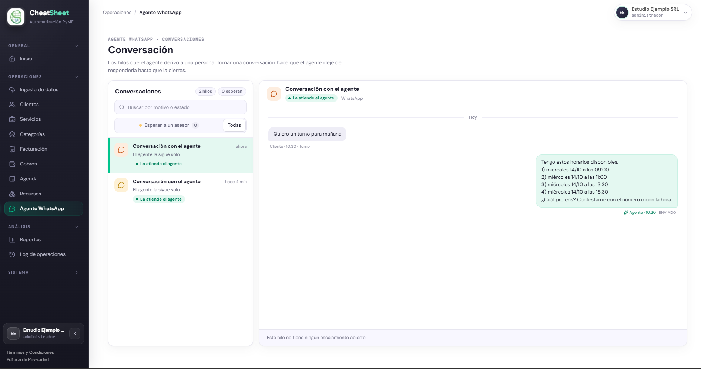
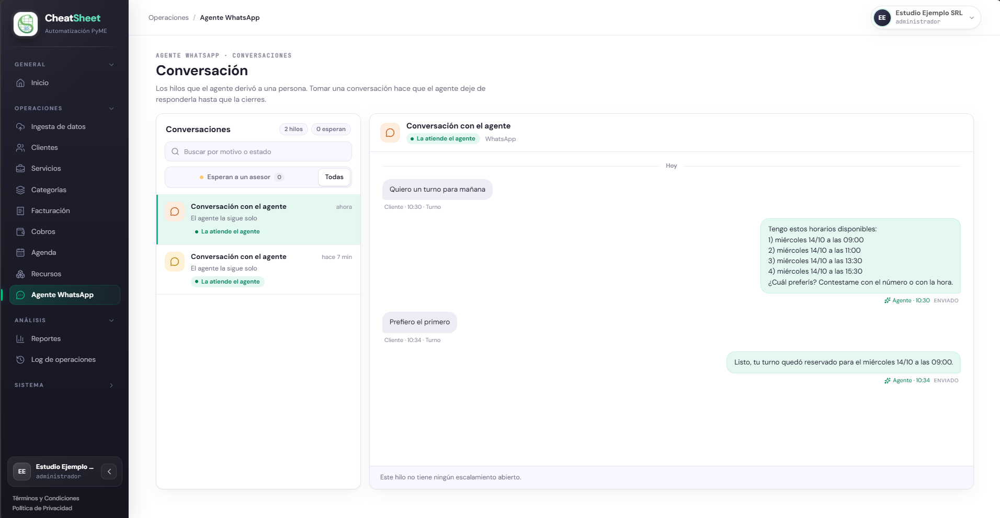
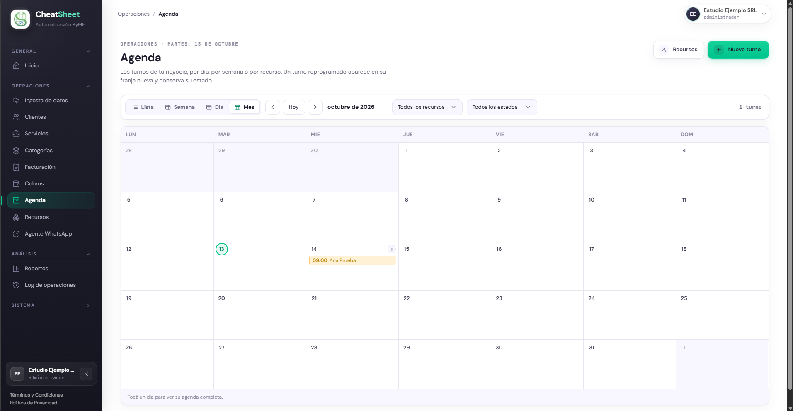
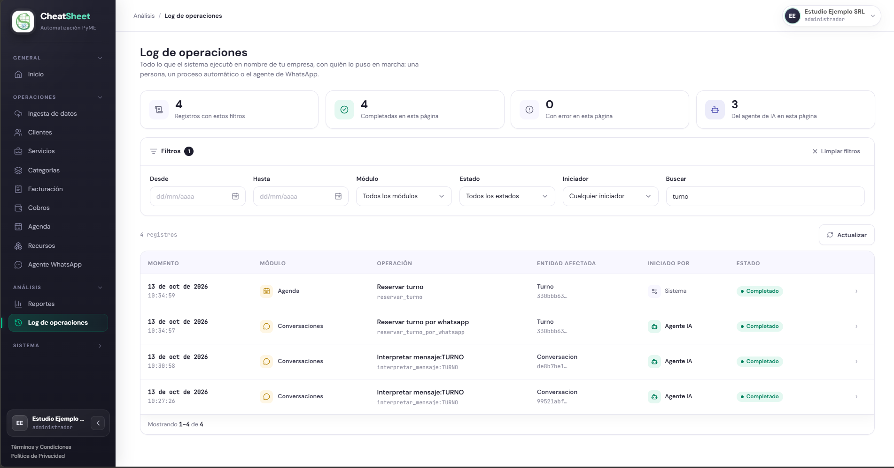

## PRU-05 — Una reserva hecha por WhatsApp aparece en la agenda y en la bitácora

**Tipo:** Integración

| Campo | Contenido |
|---|---|
| ID de prueba | PRU-05 |
| CU/HU referenciado | HU-E8-01 — Reservar un turno conversando por WhatsApp; HU-E7-01 — Ver la agenda de turnos desde el panel; HU-E12-01 — Ver la bitácora de operaciones |
| Pantalla / Reporte | PAN-AGE-01 (Agenda), PAN-AGE-02 (Detalle de turno), PAN-LOG-01 (Log de operaciones); el hilo de la conversación se consulta en PAN-WA-01 |
| Datos de entrada | Empresa Estudio Ejemplo SRL, CUIT `30-00000006-6`, Responsable Inscripto, en staging. Administrador `admin.oro@estudio-ejemplo.test` y Operador `operador.oro@estudio-ejemplo.test`. Cliente Ana Prueba, CUIT `20-22222222-3`, con el WhatsApp `+54 9 11 0000-0000` registrado como contacto (el sistema lo guarda como `5491100000000`). Servicio Consulta general, $ 15.000,00 sin IVA, IVA 21 %, marcado «Se puede reservar por agenda», con duración estándar de 30 minutos. Un recurso activo con horario semanal de lunes a viernes de 09:00 a 18:00, duración del slot de 30 minutos, intervalo entre turnos sin modificar, y el servicio Consulta general asociado. Horario de atención sin configurar. Mensaje 1: «Quiero un turno para mañana». Mensaje 2: «Prefiero el primero». Ambos se envían como mensaje entrante simulado: un pedido `POST` a `/webhooks/whatsapp/{empresa_id}` de la API, con un cuerpo JSON en el formato de notificación de Meta (mensaje de tipo texto, remitente `5491100000000`, identificador único) y la cabecera `X-Hub-Signature-256` con el HMAC-SHA256 del cuerpo exacto, calculado con el secreto `WHATSAPP_WEBHOOK_SECRET` del entorno de staging |
| Pasos | 1. Ingresar al panel de staging con `admin.oro@estudio-ejemplo.test` (Administrador) y abrir «Operaciones › Agenda». Pulsar «Día», avanzar con «Período siguiente» (flecha derecha) hasta el día siguiente y verificar que no hay turnos de Ana Prueba y que se muestra «No hay turnos para el período seleccionado.».   2. Enviar el mensaje 1 como mensaje entrante simulado firmado desde el número de Ana Prueba y verificar que la API responde 200.   3. Abrir «Operaciones › Agente WhatsApp», pulsar «Todas» y abrir la conversación más reciente (su título es «Conversación con el agente»: la lista no muestra el nombre del cliente). Recargar la página si el hilo no muestra el mensaje. Verificar que el mensaje del Cliente lleva la marca «Turno» y que el Agente respondió con un listado numerado de horarios del día siguiente, con estado de entrega «Enviado». Capturar la pantalla como `PRU-05_1.png`.   4. Dentro de los 30 minutos posteriores al paso 2, enviar el mensaje 2 como mensaje entrante simulado firmado desde el mismo número y verificar que la API responde 200.   5. Recargar el hilo y verificar que el mensaje «Prefiero el primero» lleva la marca «Turno» y que el Agente confirmó con «Listo, tu turno quedó reservado para el …», con el día y la hora del primer horario ofrecido. Capturar la pantalla como `PRU-05_2.png`.   6. Abrir «Operaciones › Agenda», pulsar «Día» y avanzar con «Período siguiente» (flecha derecha) hasta el día siguiente. Verificar que aparece un bloque de Ana Prueba con el servicio Consulta general en la hora confirmada. Capturar la pantalla como `PRU-05_3.png`. Abrir el bloque y verificar en el detalle (PAN-AGE-02) el estado «Reservado», el servicio Consulta general, el recurso y el origen «Agente».   7. Abrir «Análisis › Log de operaciones», escribir `turno` en «Buscar» y verificar tres registros, todos en estado «Completado»: «Interpretar mensaje:turno» (módulo Conversaciones, iniciado por Agente IA), «Reservar turno» (módulo Agenda, iniciado por Sistema) y «Reservar turno por whatsapp» (módulo Conversaciones, iniciado por Agente IA). Capturar la pantalla como `PRU-05_4.png`. Elegir «Agente IA» en «Iniciador» y verificar que solo quedan los dos registros del agente.   8. Abrir el menú de la cuenta del encabezado, pulsar «Cerrar sesión», ingresar con `operador.oro@estudio-ejemplo.test` (Operador) y repetir los pasos 6 y 7 sin capturar. Verificar que ve el mismo turno y los mismos registros. |
| Resultado esperado | HU-E8-01: «Escribo que quiero un turno y para cuándo» → el agente interpreta la intención y ofrece horarios disponibles reales; «Elijo uno de los horarios ofrecidos» → el agente confirma el turno y lo registra (RN-04: el cliente recibe la confirmación por el mismo canal). HU-E7-01: «Abro la agenda» → se ven los turnos del recurso y del rango seleccionados con su estado. HU-E12-01: «Ingreso al Log de Operaciones» → se ve el listado con timestamp, módulo, operación, entidad afectada, iniciador y estado; «Filtro por iniciador IA» → se ven solo las operaciones ejecutadas automáticamente por el agente. Por lo tanto: el hilo muestra los dos mensajes del cliente clasificados como «Turno» y las dos respuestas del agente; la agenda del día siguiente muestra un turno de Ana Prueba, con Consulta general, en estado «Reservado» y origen «Agente»; la bitácora registra la interpretación del mensaje y la creación del turno, y el Operador ve lo mismo que el Administrador |
| Resultado obtenido | Ejecutada el 13/10/2026 en staging (commit 946fcde), con el intérprete real de Anthropic. Antes de la corrida se envió el mensaje 1 desde el número de otro cliente de prueba (Bruno Ficticio) para comprobar el secreto y la dirección de la API; recibió la misma oferta y no se le respondió.   1. La agenda del miércoles 14/10 mostraba «No hay turnos para el período seleccionado.».   2. Mensaje 1 enviado a las 10:30: la API respondió 200.   3. El hilo mostró «Quiero un turno para mañana» con la marca «Turno» y la respuesta del Agente «Tengo estos horarios disponibles:» con 1) miércoles 14/10 a las 09:00, 2) 11:00, 3) 13:30 y 4) 15:30, y «¿Cuál preferís? Contestame con el número o con la hora.», con estado «Enviado» (Figura PRU-05-1).   4. Mensaje 2 enviado a las 10:34, cuatro minutos después: la API respondió 200.   5. «Prefiero el primero» quedó con la marca «Turno» y el Agente confirmó «Listo, tu turno quedó reservado para el miércoles 14/10 a las 09:00.», con estado «Enviado» (Figura PRU-05-2).   6. La vista Día del 14/10 mostró «1 turno»: el bloque 09:00–09:30 de Ana Prueba con Consulta general, en el color de «Reservado» (Figura PRU-05-3). El detalle mostró estado «Reservado», servicio Consulta general, recurso Consultorio 1 y origen «Agente».   7. Con «Buscar» = `turno`, la bitácora mostró 4 registros, todos «Completado», y 3 del agente de IA: «Reservar turno» (Agenda, Sistema, 10:34:59), «Reservar turno por whatsapp» (Conversaciones, Agente IA, 10:34:57), ambos sobre el turno 330bbb63…; «Interpretar mensaje:TURNO» (Conversaciones, Agente IA, 10:30:58) sobre la conversación de Ana; y la misma interpretación a las 10:27:26 sobre la conversación del envío de comprobación (Figura PRU-05-4). Con «Agente IA» en «Iniciador» quedaron solo los tres registros del agente.   8. No ejecutado: la invitación del Operador no se pudo enviar porque el correo de staging (Amazon SES en sandbox) rechaza destinatarios no verificados. Queda pendiente verificar que el Operador ve el mismo turno y los mismos registros |
| Estado | Aprobada (pasos 1 a 7; el paso 8 no se ejecutó, ver «Resultado obtenido») |
| Evidencia | Figuras PRU-05-1 a PRU-05-4 |

### Módulos involucrados

- Canal Conversacional (WhatsApp): recibe el mensaje entrante firmado, interpreta la intención, ofrece los horarios y confirma el turno por el mismo canal.
- Datos Maestros: identifica a Ana Prueba por su número de WhatsApp.
- Agenda y Recursos: calcula los horarios disponibles, crea el turno con origen «Agente» y lo muestra en la agenda.
- Auditoría y Bitácora: registra la interpretación del mensaje, la creación del turno y el iniciador de cada operación.
