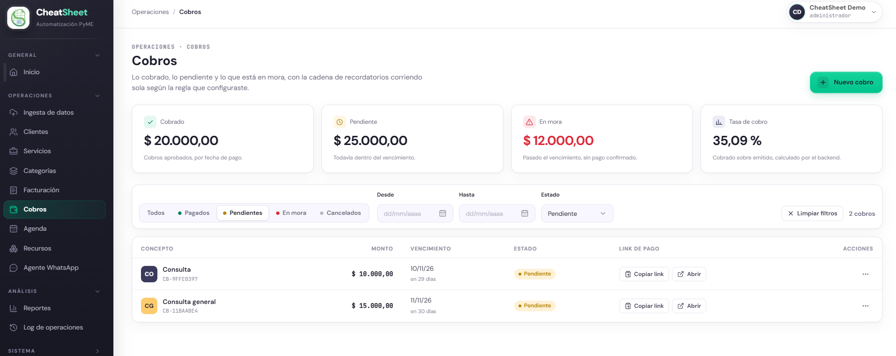
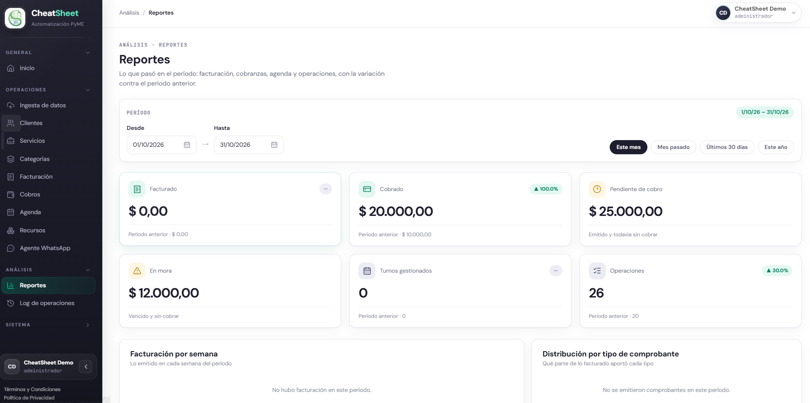
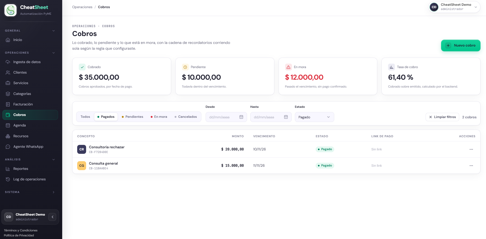
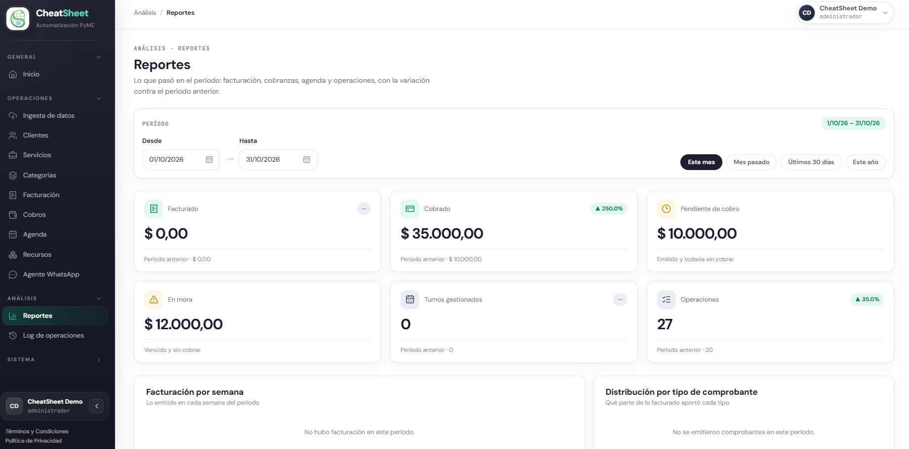

## PRU-06 — El webhook de MercadoPago aprueba el cobro y aparece en el listado y en los indicadores

**Tipo:** Integración

| Campo | Contenido |
|---|---|
| ID de prueba | PRU-06 |
| CU/HU referenciado | HS-T1 — Confirmar un pago a partir del webhook de MercadoPago; HU-E6-01 — Consultar el estado de los cobros; HU-E10-01 — Visualizar los indicadores del tablero |
| Pantalla / Reporte | PAN-COB-01 (listado de cobros), PAN-COB-02 (detalle del cobro), PAN-REP-01 (tablero de indicadores) |
| Datos de entrada | Administrador de la empresa «CheatSheet Demo» (entorno local). Un cobro pendiente a nombre del cliente **Ana Prueba** (CUIT 20-22222222-3), concepto `Consulta general`, monto `$ 15.000,00`, con link de MercadoPago generado. MercadoPago en modo simulado (ver observaciones 1 y 2). |
| Pasos | 1. Ingresar al panel con el usuario Administrador y registrar en el tablero (PAN-REP-01) el valor inicial de la métrica «Cobrado» del período.   2. Navegar a «Menú › Cobros» (PAN-COB-01) y verificar que el cobro de prueba figura en estado «Pendiente».   3. Provocar la recepción de la notificación de pago del webhook de MercadoPago para ese cobro (ver observación 1).   4. Abrir el detalle del cobro (PAN-COB-02) y verificar que pasó a «Pagado», con su fecha de pago y el medio «Link de MercadoPago».   5. Volver al listado (PAN-COB-01) y verificar que el cobro figura «Pagado».   6. Abrir el tablero (PAN-REP-01) y verificar que el monto del cobro se sumó a la métrica «Cobrado» del período.   7. Provocar la recepción de la misma notificación una segunda vez y verificar que el cobro y las métricas no cambian. |
| Resultado esperado | **Criterios de aceptación de HS-T1, HU-E6-01 y HU-E10-01.** 1. Al recibir un webhook de pago válido, el cobro pasa a APROBADO (etiqueta «Pagado») y se detiene la cadena de recordatorios (HS-T1 RN-02). 2. El cobro aprobado figura en el listado (PAN-COB-01) con la etiqueta «Pagado» (HU-E6-01). 3. El monto del cobro se suma a la métrica «Cobrado» del período en el tablero (HU-E10-01 RN-08). 4. Una notificación repetida del mismo pago no genera efectos duplicados (HS-T1 RN-04). 5. El evento queda registrado en la bitácora con iniciador Sistema (HS-T1 RN-05). |
| Resultado obtenido | Se cumplieron los cinco criterios. 1. Al recibir el webhook de pago con firma válida, el cobro `CB-11BAABE4` (`Consulta general`, $ 15.000,00) pasó de «Pendiente» a «Pagado» (APROBADO), con fecha de pago 12/10/2026 y medio «Link de MercadoPago». 2. En el listado (PAN-COB-01) el cobro figura con la etiqueta «Pagado». 3. La métrica «Cobrado» del período pasó de $ 20.000,00 a $ 35.000,00 (+$ 15.000,00), tanto en el encabezado de Cobros como en el tablero de Reportes (PAN-REP-01). 4. Al repetir la misma notificación una segunda vez, el cobro siguió en «Pagado» con la misma fecha de pago, la métrica «Cobrado» no varió y no se registró un segundo evento: no hubo efectos duplicados (RN-04). 5. El evento quedó en la bitácora como `confirmar_pago`, iniciador «Sistema», resultado «completado» (RN-05). El criterio de reducir el saldo del comprobante no aplica: el cobro no está asociado a un comprobante (observación 3). |
| Estado | Aprobado |
| Evidencia |             Prueba ejecutada en el entorno local del equipo (ver observación 1); el evento quedó además en la bitácora como `confirmar_pago` con iniciador «Sistema». |

### Módulos involucrados

- **Cobros**: recibe la notificación del webhook, confirma el pago y lleva el cobro a APROBADO; el listado (PAN-COB-01) lo refleja con la etiqueta «Pagado».
- **Tablero e Indicadores**: suma el monto del cobro aprobado a la métrica «Cobrado» del período (PAN-REP-01).
- **Integraciones Externas**: la notificación entrante del webhook de MercadoPago, en modo simulado (pasarela simulada en el entorno local).
