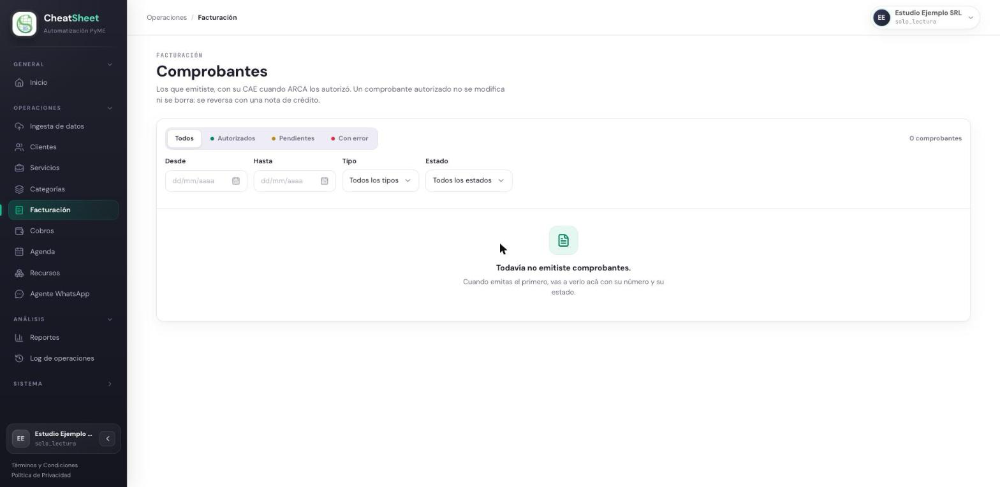

## PRU-07 — Solo Lectura no puede emitir un comprobante

**Tipo:** Seguridad y control de acceso

| Campo | Contenido |
|---|---|
| ID de prueba | PRU-07 |
| CU/HU referenciado | HU-E1-05 — Asignar o cambiar el rol de un usuario; HU-E5-03 — Emitir un comprobante fiscal y obtener su CAE; HU-E5-01 — Consultar el listado de comprobantes emitidos |
| Pantalla / Reporte | PAN-FAC-01, PAN-FAC-03 |
| Datos de entrada | Empresa Estudio Ejemplo SRL, CUIT `30-00000001-5`, Responsable Inscripto. Usuario `lectura.suarez@estudio-ejemplo.test` con rol Solo Lectura. Cliente Ana Prueba, CUIT `20-22222222-3`. Ítem «Consulta general», cantidad 1, $ 15.000,00, IVA 21 %. Tipo de comprobante Factura A |
| Pasos | 1. Ingresar a staging con `lectura.suarez@estudio-ejemplo.test`.   2. Ingresar a Facturación (PAN-FAC-01) y verificar que no se ofrece la acción de emitir.   3. Escribir en la barra de direcciones la ruta de Nueva emisión (`/facturacion/nueva`, PAN-FAC-03) y verificar a qué pantalla lleva.   4. Con la misma sesión, enviar a la API un pedido de emisión con los datos de entrada (`POST /comprobantes`), sin pasar por la pantalla.   5. Verificar el código y el cuerpo de la respuesta, y que no se creó ningún comprobante. |
| Resultado esperado | HU-E5-03: el actor de la emisión es Administrador u Operador, y la precondición exige una sesión con alguno de esos dos roles. HU-E5-01 RN-04: «El rol Solo Lectura puede ver y filtrar pero no iniciar acciones sobre los comprobantes.» HU-E1-05 RN-01: el rol aplica de forma inmediata sobre las acciones del usuario. Por lo tanto: el panel no ofrece emitir, la ruta de Nueva emisión no es accesible, y la API rechaza el pedido con 403 sin crear el comprobante |
| Resultado obtenido | Primera corrida (11/10/2026): pasos 2 y 3 correctos — el listado no muestra el botón de emitir y la ruta `/facturacion/nueva` devuelve al listado. Paso 4: la API rechazó el pedido con el mensaje «Solo un Administrador u Operador puede emitir comprobantes», pero con código 422 (`EntradaInvalida`) en lugar de 403. Se corrigió en el PR #135. Segunda corrida (11/10/2026, versión desplegada `9937920`): pasos 2 y 3 sin cambios; paso 4 responde 403 `OperacionNoPermitida` con el mismo mensaje, y el listado sigue con 0 comprobantes |
| Estado | Re-ejecutada |
| Evidencia | Figura PRU-07-1. Registro de la API en staging del 11/10/2026: `POST /comprobantes HTTP/1.1 403 Forbidden`, precedido por el evento `error_de_dominio` con `tipo: OperacionNoPermitida` y el mensaje de la historia |

### Comprobación en el backend

La petición se envía con la sesión de Solo Lectura, directamente a la ruta de emisión, sin pasar
por el formulario de Nueva emisión:

| Campo | Valor |
|---|---|
| Método y ruta | `POST /comprobantes` |
| Cuerpo | `cliente_id` de Ana Prueba, un `punto_de_venta_id` cualquiera, `tipo: FACTURA_A`, `receptor_cuit: 20222222223`, un ítem «Consulta general» por $ 15.000,00 con alícuota `0.21` |
| Respuesta esperada | 403, sin crear el comprobante |
| Respuesta obtenida, primera corrida | 422 `{"error": "EntradaInvalida", "detalle": "Solo un Administrador u Operador puede emitir comprobantes"}` |
| Respuesta obtenida, segunda corrida | 403 `{"error": "OperacionNoPermitida"}` |

El control de rol corre antes de buscar el punto de venta y antes de consumir un número de la
numeración, por eso un `punto_de_venta_id` inexistente no cambia el resultado: el pedido se rechaza
por el rol y no por los datos. La segunda corrida se hizo con el BFF anterior al arreglo que
reenvía la frase en un 403; con ese arreglo, el cuerpo llega además con el `detalle`.
