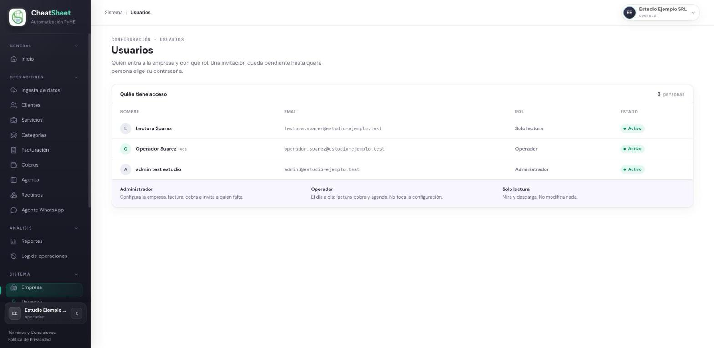
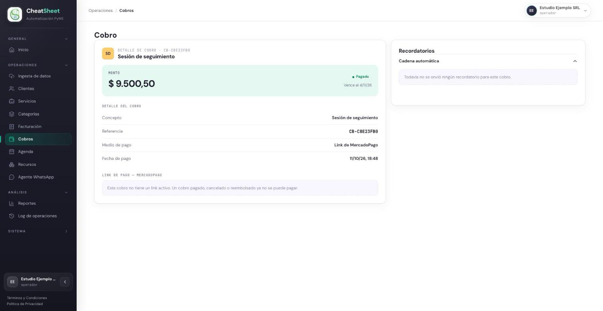
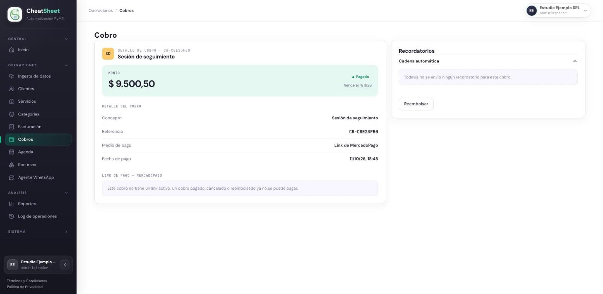

## PRU-08 — Operador no puede gestionar usuarios ni reembolsar un cobro

**Tipo:** Seguridad y control de acceso

| Campo | Contenido |
|---|---|
| ID de prueba | PRU-08 |
| CU/HU referenciado | HU-E1-04 — Registrar un nuevo usuario en la empresa; HU-E1-05 — Asignar o cambiar el rol de un usuario; HU-E6-05 — Reembolsar un cobro |
| Pantalla / Reporte | PAN-USR-01, PAN-COB-02 |
| Datos de entrada | Empresa Estudio Ejemplo SRL, CUIT `30-00000001-5`. Usuario `operador.suarez@estudio-ejemplo.test` con rol Operador. Usuario `admin3@estudio-ejemplo.test` con rol Administrador, solo para la comparación del paso 6. Usuario `lectura.suarez@estudio-ejemplo.test` como destino de los cambios de rol y de la desactivación. Cobro «Sesión de seguimiento», $ 9.500,50, pagado (dato preparado). Monto de reembolso $ 100,00 |
| Pasos | 1. Ingresar a staging con `operador.suarez@estudio-ejemplo.test`.   2. Ingresar a Usuarios (PAN-USR-01) y verificar qué acciones se ofrecen.   3. Con la misma sesión, enviar a la API una invitación, un cambio de rol y una desactivación sobre `lectura.suarez@estudio-ejemplo.test`.   4. Ingresar al detalle del cobro pagado (PAN-COB-02) y verificar si se ofrece reembolsar.   5. Con la misma sesión, enviar a la API un reembolso por MercadoPago y el registro de un reembolso manual sobre ese cobro, y verificar que el cobro no cambió.   6. Ingresar al mismo cobro como Administrador y verificar que la acción de reembolso sí se ofrece. |
| Resultado esperado | HU-E1-04: el actor de la invitación es el Administrador. HU-E1-05 RN-03: «Solo el rol Administrador puede cambiar roles. El Operador y el Solo Lectura no acceden a esta funcionalidad.», y su criterio «Ingreso como Operador a la sección de Usuarios — No tengo disponible la acción de cambiar roles». HU-E6-05 RN-05: «Las acciones de esta historia están restringidas al rol Administrador; el Operador puede ver el detalle pero no reembolsar ni registrar reembolsos.», y su criterio «Ingreso como Operador al detalle de un cobro pagado — Veo el detalle pero la acción de reembolso no está disponible». En la API, cada pedido se rechaza con 403 sin modificar nada |
| Resultado obtenido | Paso 2: el Operador ve la lista de usuarios con nombre, email, rol y estado, sin «Invitar usuario», sin selector de rol y sin «Desactivar». Paso 3: los tres pedidos responden 403 `PermisoDenegado` con «Solo un Administrador puede administrar los usuarios de la empresa». Paso 4: el detalle del cobro pagado se ve completo y no ofrece «Reembolsar» ni «Registrar reembolso». Paso 5: el reembolso por MercadoPago y el manual responden 403 `OperacionNoPermitida` con «Solo un Administrador puede reembolsar un cobro», y el cobro sigue Pagado con $ 0,00 reembolsado. Paso 6: el Administrador, en el mismo cobro, ve «Reembolsar» |
| Estado | Aprobada |
| Evidencia | Figuras PRU-08-1, PRU-08-2 y PRU-08-3. Registro de la API en staging del 11/10/2026 con las respuestas 403 de los pasos 3 y 5 |

### Comprobación en el backend

Cada petición se envía con la sesión del Operador, directamente a la API, sin pasar por los
formularios:

| Petición | Respuesta esperada | Respuesta obtenida |
|---|---|---|
| `POST /usuarios/invitaciones` con un email de prueba y rol Operador | 403 | 403 `{"error": "PermisoDenegado", "detalle": "Solo un Administrador puede administrar los usuarios de la empresa"}` |
| `PATCH /usuarios/{id}/rol` sobre Solo Lectura, con rol Administrador | 403 | 403, mismo cuerpo |
| `POST /usuarios/{id}/desactivacion` sobre Solo Lectura | 403 | 403, mismo cuerpo |
| `POST /cobros/{id}/reembolso` por $ 100,00, sobre el cobro pagado | 403 | 403 `{"error": "OperacionNoPermitida", "detalle": "Solo un Administrador puede reembolsar un cobro"}` |
| `POST /cobros/{id}/reembolsos` (manual) por $ 100,00, sobre el cobro pagado | 403 | 403, mismo cuerpo |
| `POST /cobros/{id}/reembolso` por $ 100,00, sobre un cobro pendiente | 403 | 403, mismo cuerpo |

El control de rol del reembolso corre antes de leer el cobro: por eso el último pedido, sobre un
cobro que no admite reembolso, se rechaza por el rol y no por el estado. Después de los seis
pedidos, el usuario Solo Lectura sigue activo y con su rol, no hay invitaciones nuevas y el cobro
pagado no tiene reembolsos.
