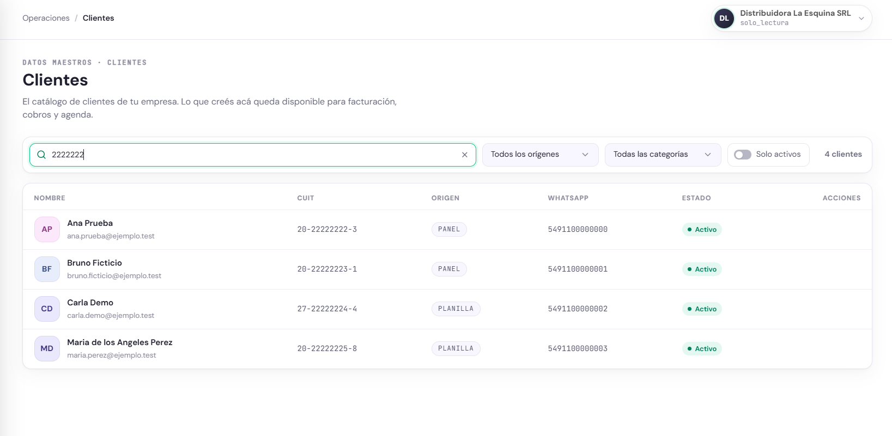
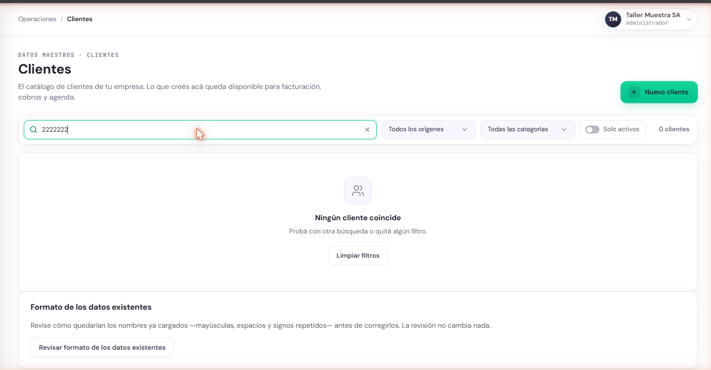

## PRU-09 — Solo Lectura no puede crear clientes y otra empresa no ve los clientes de la primera

**Tipo:** Seguridad y control de acceso

| Campo | Contenido |
|---|---|
| ID de prueba | PRU-09 |
| CU/HU referenciado | HU-E4-01 — Consultar y gestionar el catálogo de clientes; HU-E1-05 — Asignar o cambiar el rol de un usuario |
| Pantalla / Reporte | PAN-DM-01 |
| Datos de entrada | Empresa Distribuidora La Esquina SRL, CUIT `30-00000002-3`, con los clientes Ana Prueba, Bruno Ficticio, Carla Demo y Maria de los Angeles Perez cargados en PRU-03. Usuario Lectura Caballero con rol Solo Lectura en esa empresa. Segunda empresa Taller Muestra SA, sin clientes, con un usuario Administrador. Cliente nuevo para el intento de alta: Diego Prueba, CUIT `20-22222226-6`, WhatsApp `+54 9 11 0000-0004` |
| Pasos | 1. Ingresar a staging con el usuario Solo Lectura de Distribuidora La Esquina SRL.   2. Ingresar a Clientes (PAN-DM-01), buscar `2222222` y verificar qué acciones se ofrecen.   3. Con la misma sesión, enviar a la API el alta de Diego Prueba (`POST /clientes`), sin pasar por la pantalla, y verificar que el catálogo no cambió.   4. Ingresar a staging con el Administrador de Taller Muestra SA.   5. Ingresar a Clientes, buscar `2222222` y verificar el resultado.   6. Con la misma sesión, pedir a la API la ficha de Maria de los Angeles Perez por su identificador (`GET /clientes/{id}`). |
| Resultado esperado | HU-E4-01: el actor es Administrador u Operador, y la precondición exige una sesión con alguno de esos dos roles para ver, crear y editar clientes; el rol Solo Lectura puede consultar el catálogo pero no modificarlo. HU-E1-05 RN-01: el rol aplica de forma inmediata sobre las acciones del usuario. Por lo tanto: el panel no ofrece «Nuevo cliente» ni acciones sobre los clientes, y la API rechaza el alta con 403 sin crear el cliente. Además, el catálogo es propio de cada empresa («el catálogo de clientes de mi empresa»): un usuario de otra empresa no ve ni puede leer esos clientes |
| Resultado obtenido | Corrida del 12/10/2026 en staging. Paso 2: el Solo Lectura ve el listado con nombre, CUIT, origen, WhatsApp y estado de los cuatro clientes, sin el botón «Nuevo cliente» y con la columna Acciones vacía. Paso 3: la API responde 403 `PermisoDenegado` con «Se requiere rol Administrador u Operador para gestionar el catalogo»; el catálogo tiene 32 clientes antes y después, y Diego Prueba no existe. Paso 5: Taller Muestra SA muestra «Ningún cliente coincide» y 0 clientes. Paso 6: la API responde `ClienteNoEncontrado` («No existe el cliente …»), sin devolver ningún dato del cliente de la otra empresa |
| Estado | Aprobada |
| Evidencia | Figuras PRU-09-1 y PRU-09-2 |

### Comprobación en el backend

Cada petición se envía directamente a la API, sin pasar por los formularios:

| Sesión | Petición | Respuesta esperada | Respuesta obtenida |
|---|---|---|---|
| Solo Lectura, Distribuidora La Esquina SRL | `POST /clientes` con Diego Prueba, CUIT `20-22222226-6` | 403, sin crear el cliente | 403 `{"error": "PermisoDenegado", "detalle": "Se requiere rol Administrador u Operador para gestionar el catalogo"}` |
| Solo Lectura, Distribuidora La Esquina SRL | `GET /clientes` | 200 con el catálogo | 200, 32 clientes antes y después del alta rechazada |
| Administrador, Taller Muestra SA | `GET /clientes` | 200 sin clientes de la otra empresa | 200, 0 clientes |
| Administrador, Taller Muestra SA | `GET /clientes/{id}` de Maria de los Angeles Perez | Cliente no encontrado | 422 `{"error": "ClienteNoEncontrado", "detalle": "No existe el cliente …"}` |

La barrera entre empresas no depende del panel: la sesión de Taller Muestra SA pide el
identificador exacto de un cliente de Distribuidora La Esquina SRL y la base responde como si no
existiera. El código 422 en lugar de 404 no expone datos, pero no es el código que corresponde a un
recurso inexistente.
